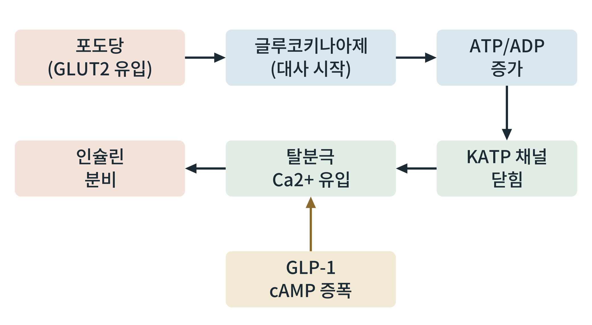

## 제34장 뇌와 췌장 β세포: 연료 감지기

> **이 장의 출발점** 1984년 영국 옥스퍼드의 프랜시스 애시크로프트(Frances Ashcroft)와 동료들은 쥐 췌장 β세포의 막에서 작은 유리 피펫으로 이온 통로 하나의 전류를 기록했다. 포도당을 넣자 칼륨 통로가 닫히는 것이 관찰되었다(Ashcroft et al., 1984). 포도당이 대사되어 만든 ATP가 칼륨 통로를 닫고, 그 결과 세포가 탈분극해 인슐린이 분비된다는 경로의 첫 직접 증거였다. 이 통로는 이후 ATP 민감성 칼륨 통로(KATP)라 불리게 되었고, 당뇨병 약물인 설포닐유레아가 이 통로를 닫는 약물임이 설명되었다. 이 장은 연료를 직접 감지해 신호로 바꾸는 두 기관, 췌장 β세포와 뇌를 같이 다룬다.

### 34.1 β세포의 포도당 감지

β세포는 혈당이 오르면 인슐린을 내놓고 내려가면 멈추어 혈당 조절의 중심이 되는 세포이다. 포도당은 GLUT2를 통해 β세포로 들어가고(사람 β세포의 수송체 구성에는 종 차이가 있다는 보고가 있다), 글루코키나아제가 포도당을 포도당 6-인산으로 바꾸는 단계가 감지 속도를 정한다. 이 효소는 생리적 혈당 범위에서 반응 속도가 포도당 농도에 민감하게 변하는 성질이 있어 포도당 센서라 불린다. 포도당 대사가 진행되면 세포 안 ATP/ADP 비가 오르고, KATP 채널이 닫혀 막이 탈분극하며, 전압 의존성 칼슘 통로가 열려 칼슘이 들어와 인슐린 분비 소포가 방출된다.

**그림 34-1. β세포의 포도당 감지와 인슐린 분비.** 포도당 대사가 ATP/ADP 비를 올려 KATP 채널을 닫고, 탈분극으로 칼슘이 들어와 인슐린이 분비된다. GLP-1은 cAMP를 올려 이 칼슘 신호에 의한 분비를 증폭하며, 포도당이 높을 때에만 이 증폭이 크게 작동하는 것으로 알려져 있다.

그림 34-1에서 읽을 점은 두 가지이다. 첫째, 포도당이 직접 인슐린을 분비시키는 것이 아니라 포도당의 대사 산물이 신호가 된다. 연료를 태우는 정도가 신호의 크기를 결정한다는 점에서 이 경로는 연료 감지기이다. 둘째, GLP-1이 이 경로의 상류가 아니라 칼슘 신호를 증폭하는 하류에 작용하므로, 포도당이 낮으면 인슐린 분비를 크게 일으키지 않는다. 이 성질이 GLP-1 작용제에서 저혈당 위험이 작은 이유로 설명된다. 반면 설포닐유레아는 KATP 채널을 직접 닫아 포도당과 무관하게 인슐린을 분비시키므로 저혈당 위험이 크다.

### 34.2 뇌의 연료 감지

뇌는 전신의 연료 상태를 읽고 식욕과 에너지 소비를 조절하는 센서 기관이다. 시상하부 등에는 포도당 농도 변화에 반응해 발화율을 바꾸는 뉴런이 있고, 이 감지에도 글루코키나아제와 KATP 채널이 관여한다는 보고가 있다. 뇌는 포도당 외에도 지방산, 아미노산(특히 류신), 케톤체, 락테이트 같은 다른 연료 신호를 읽고, 렙틴, 인슐린, 그렐린 같은 호르몬 신호와 통합한다(3장, 4장). 이 통합이 25장의 케톤 이용, 27장의 공복 호르몬 반응에서 본 뇌의 반응을 설명한다.

**표 34-1. 두 연료 감지기의 비교.**

| 항목 | 췌장 β세포 | 시상하부 등 뇌 |
|---|---|---|
| 주 감지 신호 | 포도당(ATP/ADP 비) | 포도당, 지방산, 아미노산, 호르몬 |
| 감지 분자 | GLUT2, 글루코키나아제, KATP | 글루코키나아제, KATP, mTOR, AMPK, 호르몬 수용체 |
| 출력 | 인슐린 분비 | 식욕, 자율신경, 에너지 소비 |
| 증폭 신호 | GLP-1, GIP(cAMP) | 렙틴, 인슐린, GLP-1(뇌 수용체) |
| 약물 표적 | KATP(설포닐유레아), GLP-1R | GLP-1R, MC4R 등 (1권 3장) |
| 사람에서의 확립도 | 높음 | 설치류 근거가 상대적으로 많음 |

표 34-1에서 읽을 점은 두 감지기가 같은 분자 부품(글루코키나아제, KATP)과 같은 약물 표적(GLP-1 수용체)을 공유한다는 것이다. 이 공통점이 GLP-1 작용제가 췌장과 뇌에 동시에 작용하는 이유를 부분적으로 설명한다. 다만 뇌의 감지는 세포 종류가 다양하고 사람에서의 직접 측정이 어려워 β세포보다 확립도가 낮다.

### 34.3 감지의 실패

β세포의 포도당 감지는 비만과 제2형 당뇨병에서 약해질 수 있다. 21장에서 본 것처럼 인슐린 저항이 커지면 β세포가 더 많이 분비해 보상하다가, 시간이 지나 분비 반응이 약해진다는 해석이 있다. 이 변화의 원인으로 만성 고혈당과 고지방산에 의한 독성(포도당 독성, 지질 독성), 소포체 스트레스, β세포 탈분화 가설이 거론되나, 사람에서의 기여 크기는 논쟁 중이다. 뇌 쪽에서는 비만에서 시상하부의 인슐린과 렙틴 반응이 약해진다는 보고가 있고, 이것이 1권 3장의 렙틴 저항 개념과 이어진다.

### 34.4 약물 설계의 관점

β세포 감지 경로는 약물 설계가 가장 앞서 간 영역이다. 설포닐유레아와 메글리티나이드는 KATP 채널을 닫고, DPP-4 억제제와 GLP-1 작용제는 인크레틴 신호를 높이며, 글루코키나아제 활성화제는 감지 자체를 높이는 접근으로 개발되었으나 장기 효과와 안전성의 한계가 보고되었다. 뇌 쪽에서는 GLP-1 작용제가 시상하부와 뇌간에 작용해 식욕을 줄이고, MC4R 작용제가 특정 유전형 비만에 쓰인다(1권). 감지기 표적 약물에서는 포도당 의존성(저혈당 위험)과 조직 특이성이 중요한 설계 기준이다.

### 이 장의 요점

- β세포는 포도당 대사로 ATP/ADP 비를 올려 KATP 채널을 닫고, 탈분극과 칼슘 유입으로 인슐린을 분비하는 연료 감지기이다.
- GLP-1은 칼슘 신호를 증폭하는 하류에 작용해 포도당이 높을 때에만 분비를 크게 늘리므로 저혈당 위험이 작다. 설포닐유레아는 KATP를 직접 닫아 포도당과 무관하게 분비시킨다.
- 뇌는 포도당, 지방산, 아미노산, 케톤체와 호르몬 신호를 통합해 식욕과 에너지 소비를 조절하는 또 하나의 연료 감지기이다.
- 두 감지기는 글루코키나아제, KATP, GLP-1 수용체 같은 부품과 표적을 공유하지만, 뇌 감지는 사람에서의 확립도가 낮다.
- 비만과 당뇨병에서 두 감지기의 반응이 약해질 수 있으며, 원인과 기여 크기는 논쟁 중이다.

#### 참고문헌

Ashcroft, F. M., Harrison, D. E., & Ashcroft, S. J. H. (1984). Glucose induces closure of single potassium channels in isolated rat pancreatic β-cells. *Nature, 312*(5993), 446–448. https://doi.org/10.1038/312446a0

Ashcroft, F. M., & Rorsman, P. (2012). Diabetes mellitus and the β cell: The last ten years. *Cell, 148*(6), 1160–1171. https://doi.org/10.1016/j.cell.2012.02.010

Matschinsky, F. M., & Wilson, D. F. (2019). The central role of glucokinase in glucose homeostasis: A perspective 50 years after demonstrating the presence of the enzyme in islets of Langerhans. *Frontiers in Physiology, 10*, Article 148. https://doi.org/10.3389/fphys.2019.00148

Levin, B. E., Routh, V. H., Kang, L., Sanders, N. M., & Dunn-Meynell, A. A. (2004). Neuronal glucosensing: What do we know after 50 years? *Diabetes, 53*(10), 2521–2528. https://doi.org/10.2337/diabetes.53.10.2521
