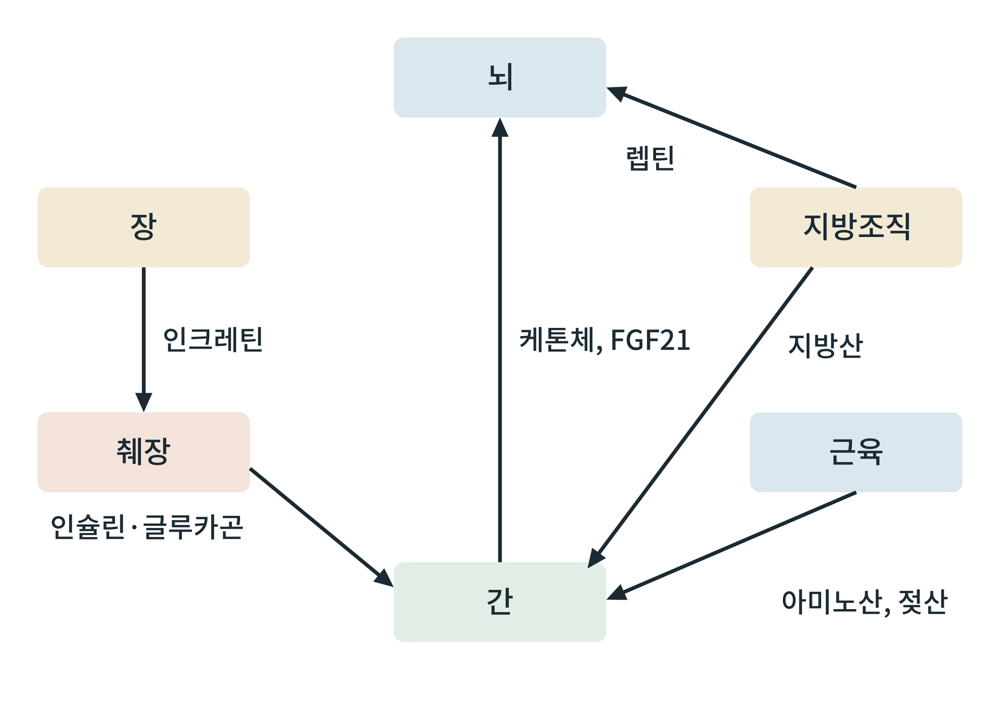

## 제35장 장기 간 대화: 식후와 공복에서 장기들이 주고받는 신호

> **이 장의 출발점** 1902년 영국 런던 대학의 윌리엄 베일리스(William Bayliss)와 어니스트 스탈링(Ernest Starling)은 마취한 개의 십이지장에 산을 넣고, 신경을 모두 끊은 뒤에도 췌장이 소화액을 내놓는다는 것을 보였다. 장 점막에서 어떤 물질이 혈액을 타고 췌장에 도착해 명령을 전한다는 뜻이었다. 이들은 이 물질을 세크레틴(secretin)이라 불렀고, 스탈링은 1905년 강연에서 이런 혈액 전달 물질을 호르몬(hormone)이라 부르자고 제안했다. 장기가 신경이 아니라 혈액 속 분자로 서로 말을 건다는 발상은 이 실험에서 출발한다. 이 장은 31~34장에서 살펴본 간, 근육, 지방조직, 뇌, 췌장이 식후와 공복에 어떤 분자로 대화하는지를 한 장의 지도로 모은다.

### 35.1 장기 간 대화의 기본 구조

장기 간 대화는 보내는 장기, 혈액 속 신호 분자, 받는 장기의 세 요소로 이루어진다. 신호 분자는 호르몬(인슐린, 글루카곤, 렙틴, 인크레틴), 대사산물(지방산, 케톤체, 아미노산, 젖산, 포도당), 그리고 근육이나 간이 분비하는 단백질(마이오카인, 헤파토카인)로 나눌 수 있다. 호르몬은 낮은 농도에서 수용체를 통해 작동하고, 대사산물은 연료이면서 동시에 신호이다. 같은 분자가 연료와 신호의 역할을 겸하는 점이 대사 신호 전달의 특징이다.

**그림 35-1. 식후와 공복의 장기 간 신호 지도.** 장은 인크레틴으로 췌장에 알리고, 췌장은 인슐린과 글루카곤으로 간에 지시하며, 지방조직은 렙틴으로 뇌에, 지방산으로 간에 신호를 보낸다. 근육은 아미노산과 젖산을 간에 보내고, 간은 케톤체와 FGF21(섬유아세포 성장인자 21, fibroblast growth factor 21)로 뇌에 공복 상태를 알린다.

그림 35-1에서 읽을 점은 간이 대부분의 화살이 모이는 중심이고 뇌가 두 화살이 모이는 또 하나의 중심이라는 것이다. 간은 연료 흐름을 조정하는 실행 기관에 가깝고, 뇌는 전체 에너지 수지를 판단하는 판정 기관에 가깝다. 이 그림은 대표적인 신호만 골랐으며 실제 신호 분자의 수는 훨씬 많고 방향도 양방향인 경우가 많다.

### 35.2 식후의 대화와 공복의 대화

식후에는 장이 인크레틴을 내놓고 췌장이 인슐린을 분비하여, 간은 포도당을 저장하고 지방을 합성하며, 근육은 포도당을 흡수하고, 지방조직은 지방산을 저장한다. 공복에는 인슐린이 내려가고 글루카곤이 상대적으로 우세해져, 간은 포도당을 내놓고 케톤체를 만들며, 지방조직은 지방산을 방출하고, 근육은 아미노산을 내놓는다. 같은 장기 지도 위에서 신호의 방향과 세기가 바뀌는 것이 식후-공복 전환이다(29장 대사 유연성 참조).

**표 35-1. 장기 간 신호의 요약.**

| 신호 | 보내는 곳 | 받는 곳 | 주 상태 | 대표 작용 |
|---|---|---|---|---|
| 인크레틴(GLP-1, GIP) | 장 | 췌장, 뇌 | 식후 | 포도당 의존 인슐린 분비 증폭, 포만 |
| 인슐린 | 췌장 β세포 | 간, 근육, 지방조직 | 식후 | 저장 촉진, 간 포도당 생산 억제 |
| 글루카곤 | 췌장 α세포 | 간 | 공복 | 글리코겐 분해, 포도당 신생 촉진 |
| 렙틴 | 지방조직 | 뇌(시상하부) | 에너지 저장량 반영 | 식욕 억제, 에너지 소비 조절 |
| 지방산 | 지방조직 | 간, 근육 | 공복 | 연료 공급, 케톤 생성 재료 |
| 아미노산, 젖산 | 근육 | 간 | 공복, 운동 | 포도당 신생 재료 |
| 케톤체 | 간 | 뇌, 근육 | 공복 | 포도당 대체 연료 |
| FGF21 | 간 | 뇌, 지방조직 | 공복, 영양 스트레스 | 대사 적응 신호로 보고됨 |

표 35-1에서 읽을 점은 한 장기가 보내는 신호와 받는 신호가 모두 있다는 것이다. 간은 인슐린과 글루카곤을 받는 동시에 케톤체와 FGF21을 내보낸다. 약물 설계의 관점에서 이는 한 신호 경로를 건드리면 다른 장기의 반응이 연쇄적으로 바뀐다는 뜻이며, 단일 표적 약물의 효과를 전신 수준에서 해석해야 하는 이유이다. FGF21의 사람 생리 역할은 동물 연구에 비해 확립도가 낮다.

### 35.3 피드백 고리와 신호의 실패

장기 간 대화는 피드백 고리로 안정된다. 혈당이 오르면 인슐린이 나와 혈당을 낮추고, 지방이 늘면 렙틴이 올라 식욕을 낮춘다. 비만에서는 이 고리가 무뎌진다. 인슐린 저항에서는 같은 인슐린에 대한 반응이 줄고, 렙틴 저항에서는 렙틴이 높아도 식욕 억제가 충분하지 않다고 설명된다. 신호가 약해진 원인이 수용체인지, 수용체 아래 경로인지, 신호가 도달하는 환경인지는 질환과 장기에 따라 달라 논쟁이 이어진다. 다음 8부는 이 신호 실패와 이를 교정하려는 개입을 다룬다.

### 이 장의 요점

- 장기들은 호르몬, 대사산물, 분비 단백질로 서로 신호를 주고받으며, 연료 분자가 신호를 겸한다.
- 간은 연료 흐름의 실행 중심, 뇌는 에너지 수지의 판정 중심으로 볼 수 있다.
- 식후와 공복은 같은 신호 지도에서 방향과 세기가 바뀐 상태이다.
- 비만에서는 인슐린, 렙틴 등 피드백 신호의 반응이 약해질 수 있으며, 기전은 논쟁 중이다.

### 7부 점검: 조직별 연료 흐름의 통합

**표 35-2. 7부 요약: 조직별 역할과 약물 설계상의 함의.**

| 조직 | 식후 역할 | 공복 역할 | 약물 설계상의 함의 |
|---|---|---|---|
| 간 | 포도당 저장, 지방 합성 | 포도당 생산, 케톤 생성 | 간 대사를 건드리는 약물은 전신 연료 흐름을 바꿈 |
| 근육 | 최대의 포도당 소비처(GLUT4) | 아미노산 공급, 지방산 산화 | 근육량 보존이 체중 감량 약물의 질적 평가 항목 |
| 지방조직 | 지방산 저장 | 지방분해, 지방산 방출 | 저장소이자 내분비 기관이므로 염증과 호르몬 신호 모두 고려 |
| 뇌 | 포도당 소비, 식욕 판정 | 케톤체 이용, 공복 신호 판정 | 중추 작용 약물은 식욕과 에너지 소비를 함께 바꿈 |
| 췌장 β세포 | 포도당 감지, 인슐린 분비 | 인슐린 분비 억제 | 감지 장치(KATP, GLP-1 수용체)가 약물 표적 |

표 35-2에서 읽을 점은 모든 약물 표적이 어느 한 조직에 국한되지 않는다는 것이다. 8부에서 다룰 인슐린 저항, 체중 설정점, 대사 개입 약물은 모두 이 조직 지도 위에서 해석한다.

#### 참고문헌

Bayliss, W. M., & Starling, E. H. (1902). The mechanism of pancreatic secretion. *The Journal of Physiology, 28*(5), 325–353. https://doi.org/10.1113/jphysiol.1902.sp000920

Cohen, P., & Spiegelman, B. M. (2016). Cell biology of fat storage. *Molecular Biology of the Cell, 27*(16), 2523–2527. https://doi.org/10.1091/mbc.E15-10-0749

Drucker, D. J. (2018). Mechanisms of action and therapeutic application of glucagon-like peptide-1. *Cell Metabolism, 27*(4), 740–756. https://doi.org/10.1016/j.cmet.2018.03.001

Fisher, F. M., & Maratos-Flier, E. (2016). Understanding the physiology of FGF21. *Annual Review of Physiology, 78*, 223–241. https://doi.org/10.1146/annurev-physiol-021115-105339

Friedman, J. M. (2019). Leptin and the endocrine control of energy balance. *Nature Metabolism, 1*(8), 754–764. https://doi.org/10.1038/s42255-019-0095-y
