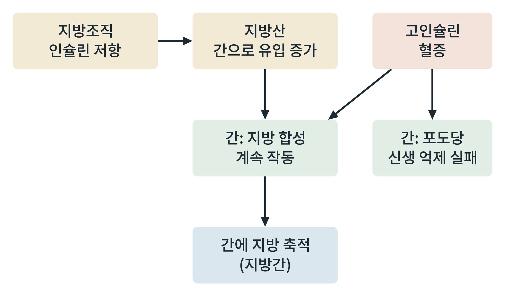

# 제8부 질병과 개입

## 제36장 인슐린 저항과 지방간

> **이 장의 출발점** 1936년 영국 런던의 해럴드 힘스워스(Harold Himsworth)는 당뇨병 환자에게 포도당과 인슐린을 함께 주사하고 혈당이 얼마나 떨어지는지를 비교했다. 어떤 환자는 소량의 인슐린에도 혈당이 크게 내려갔고, 어떤 환자는 같은 양에도 거의 반응하지 않았다. 힘스워스는 이를 인슐린 민감형과 인슐린 비민감형으로 나누어 보고했다. 인슐린이 부족한 것이 아니라 인슐린에 대한 몸의 반응이 무뎌진 당뇨병이 있다는 발견이며, 오늘의 인슐린 저항 개념의 출발점으로 흔히 인용된다. 이 장은 인슐린 저항이 장기마다 다르게 나타나는 방식과, 그것이 간의 지방 축적으로 이어지는 경로를 다룬다.

### 36.1 인슐린 저항의 정의

인슐린 저항(insulin resistance)은 같은 농도의 인슐린에 대해 표적 조직의 반응이 정상보다 작아진 상태이다. 근육에서는 포도당 흡수 감소로, 지방조직에서는 지방분해 억제 약화로, 간에서는 포도당 생산 억제 약화로 나타난다. 이는 31~34장에서 본 인슐린의 정상 작용이 조직마다 약해지는 것에 해당한다. 보상으로 췌장 β세포가 인슐린을 더 내놓아 혈중 인슐린이 높아지는 상태가 고인슐린혈증(hyperinsulinemia)이며, 혈당은 오랫동안 정상 범위에 머물 수 있다.

### 36.2 선택적 인슐린 저항: 간의 역설

간에서는 인슐린 저항이 모든 작용에 똑같이 나타나지 않는다. 포도당 신생을 억제하는 작용은 약해지는 반면, 지방 합성을 촉진하는 작용은 비교적 유지된다는 관찰이 보고되어 선택적 인슐린 저항(selective insulin resistance) 또는 간의 역설이라 불린다. 그 결과 고인슐린혈증이 있는 간은 포도당을 계속 만들어 혈당을 올리면서 동시에 지방을 계속 합성한다.

**그림 36-1. 인슐린 저항에서 지방간으로 가는 경로.** 지방조직의 인슐린 저항은 지방산의 간 유입을 늘리고, 고인슐린혈증은 간의 지방 합성을 계속 자극하면서 포도당 신생 억제는 실패하게 한다. 지방산 유입과 지방 합성이 겹쳐 간에 지방이 쌓인다.

그림 36-1에서 읽을 점은 지방산의 유입과 간 내부의 합성이 같은 방향의 힘이라는 것이다. 이 그림은 한 방향의 요약이며, 지방간이 인슐린 저항을 다시 악화시키는 되먹임도 있다고 보고된다. 두 현상 중 어느 쪽이 먼저인지는 개체와 연구에 따라 다르게 해석된다.

**표 36-1. 조직별 인슐린 저항의 표현형과 약물 설계상의 함의.**

| 조직 | 정상 인슐린 작용 | 저항 시 나타나는 변화 | 약물 설계상의 함의 |
|---|---|---|---|
| 근육 | 포도당 흡수(GLUT4) 촉진 | 포도당 흡수 감소 | 운동, 체중 감량이 민감도를 개선하는 방향 |
| 지방조직 | 지방분해 억제 | 지방산 방출 증가 | 지방산 유입 감소가 간 지방 감소에 연결 |
| 간(포도당 경로) | 포도당 신생 억제 | 억제 약화, 혈당 상승 | 메트포르민 등이 이 경로에 작용(38장) |
| 간(지방 경로) | 지방 합성 촉진 | 비교적 유지 | 지방 합성 효소, 전사인자가 표적 후보 |
| 췌장 β세포 | 보상성 분비 증가 | 장기적으로 기능 저하 | 34장의 감지 장치와 연결 |

표 36-1에서 읽을 점은 인슐린 저항이 하나의 병이 아니라 조직별 표현형의 묶음이라는 것이다. 따라서 어느 조직의 저항이 주된 문제인지에 따라 개입의 우선순위가 달라진다. 이 구분은 약물 효과를 평가할 때 조직별 지표(간 지방 함량, 포도당 생산, 근육 흡수)를 나누어 보아야 한다는 뜻이다.

### 36.3 지방간과 그 이름

간에 지방이 과도하게 쌓인 상태는 오랫동안 비알코올성 지방간 질환이라 불렸으나, 2023년 국제 합의에서 대사 이상과 연결한 이름으로 바뀌었다고 보고된다(대사 기능장애 연관 지방간 질환, MASLD). 단순 지방 축적에서 염증과 섬유화를 동반한 단계로 진행할 수 있으며, 단계가 올라갈수록 치료 표적과 평가 지표가 달라진다. 지방 합성, 지방산 산화, 지방 수출(VLDL 분비)의 균형이 무너질 때 지방이 쌓인다는 것이 기본 틀이다.

### 이 장의 요점

- 인슐린 저항은 조직마다 다른 표현형으로 나타나며, 고인슐린혈증이 보상으로 따른다.
- 간에서는 포도당 신생 억제는 약해지고 지방 합성은 유지되는 선택적 저항이 보고된다.
- 지방산 유입과 간 내부 지방 합성이 겹쳐 지방간이 생기며, 지방간은 다시 인슐린 저항을 악화시킬 수 있다.
- 선후 관계와 기전의 기여 크기는 논쟁 중이다.

#### 참고문헌

Brown, M. S., & Goldstein, J. L. (2008). Selective versus total insulin resistance: A pathogenic paradox. *Cell Metabolism, 7*(2), 95–96. https://doi.org/10.1016/j.cmet.2007.12.009

Himsworth, H. P. (1936). Diabetes mellitus: Its differentiation into insulin-sensitive and insulin-insensitive types. *The Lancet, 227*(5864), 127–130. https://doi.org/10.1016/S0140-6736(01)36646-3

Rinella, M. E., Lazarus, J. V., Ratziu, V., Francque, S. M., Sanyal, A. J., Kanwal, F., et al. (2023). A multisociety Delphi consensus statement on new fatty liver disease nomenclature. *Hepatology, 78*(6), 1966–1986. https://doi.org/10.1097/HEP.0000000000000520

Samuel, V. T., & Shulman, G. I. (2012). Mechanisms for insulin resistance: Common threads and missing links. *Cell, 148*(5), 852–871. https://doi.org/10.1016/j.cell.2012.02.017
