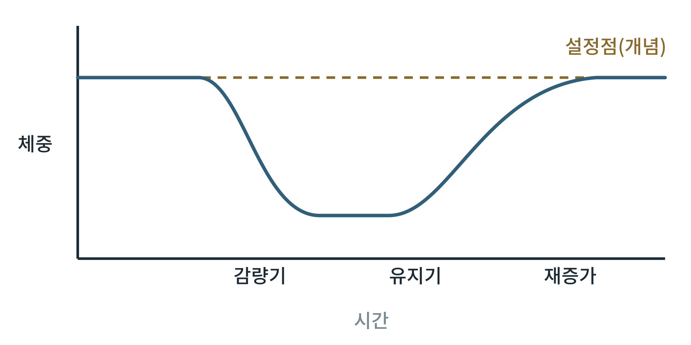

## 제37장 비만과 에너지 균형: 체중 설정점, 적응 열발생, 재증가

> **이 장의 출발점** 1944년부터 1945년까지 미국 미네소타 대학의 앤설 키스(Ancel Keys)와 동료들은 건강한 남성 자원자들에게 반년 가까이 열량을 크게 줄인 식사를 주고 몸과 마음의 변화를 기록했다. 체중은 줄었고 대사율도 함께 내려갔으며, 이어진 회복기에 자원자들은 원래 체중을 지나칠 만큼 먹으며 체중을 되찾았다. 이 연구는 1950년 『인간 기아의 생물학』으로 정리되었다. 줄어든 체중을 몸이 되돌리려 한다는 관찰은 이후 체중 설정점과 적응 열발생 논의의 출발점이 되었다. 이 장은 체중이 줄면 왜 다시 늘기 쉬운지를 에너지 균형의 틀로 정리한다.

### 37.1 에너지 균형의 기본 식

체중 변화는 섭취 에너지와 소비 에너지의 차이로 정리된다. 소비 에너지는 기초대사량, 음식 섭취에 따른 열 발생, 신체활동으로 나뉜다. 섭취가 소비보다 크면 남는 에너지가 지방과 제지방으로 저장된다. 다만 이 식은 회계의 틀일 뿐 원인을 설명하지는 않는다. 섭취와 소비는 서로 독립이 아니고, 체중이 변하면 둘 다 함께 변한다는 점이 핵심이다.

### 37.2 체중 설정점과 적응 열발생

체중이 줄면 렙틴이 내려가고 시상하부가 이를 에너지 저장량 부족으로 읽어 식욕을 올리고 에너지 소비를 낮춘다는 것이 설정점 개념의 생리적 설명이다(27장, 35장). 이때 줄어든 체중에서 예상되는 값보다 에너지 소비가 더 낮아지는 현상을 적응 열발생(adaptive thermogenesis)이라 부른다. 설정점이 고정된 값인지, 체중 증가 환경에서는 위로 이동하는 범위인지는 논쟁이 있으며, 설정점보다 안정점(settling point) 모형을 지지하는 해석도 있다.

**그림 37-1. 체중 감량과 재증가의 개념도.** 체중이 설정점에서 내려가면 식욕 증가와 에너지 소비 감소가 체중을 원래 수준으로 되돌리는 방향으로 작용한다. 점선은 개념적 설정점이며 실제 수치는 개인과 연구마다 다르다.

그림 37-1에서 읽을 점은 감량이 끝난 뒤 유지기에도 되돌리는 힘이 계속 작용한다는 것이다. 이 그림은 개념도이며 시간 축과 크기는 임의이다. 재증가의 속도와 정도는 감량 방법, 감량 폭, 약물 복용 중단 여부에 따라 다른 것으로 보고된다.

**표 37-1. 체중이 줄었을 때 되돌리는 힘의 구성.**

| 요소 | 방향 | 관여 신호 | 약물 설계상의 함의 |
|---|---|---|---|
| 식욕 | 증가 | 렙틴 감소, 위장 포만 신호 변화 | 식욕 신호를 직접 겨냥하는 약물(GLP-1 계열)의 근거 |
| 기초대사량 | 예상보다 더 감소 | 갑상선 호르몬, 교감신경 활성 변화 | 에너지 소비를 올리는 약물은 안전성 한계가 큼 |
| 신체활동 효율 | 같은 활동에 에너지 감소 | 근육 효율 변화 | 운동 병행의 근거 |
| 제지방 손실 | 소비 에너지 감소 요인 | 단백질 이화, 근육량 | 근육 보존이 재증가 방지의 평가 항목 |

표 37-1에서 읽을 점은 되돌리는 힘이 한 경로가 아니라 여러 경로의 합이라는 것이다. 한 경로만 막는 약물은 다른 경로의 보상으로 효과가 제한될 수 있다. 약물을 끊으면 체중이 다시 늘 수 있다는 임상 관찰은 이 틀로 해석되지만, 개별 약물의 재증가 크기는 해당 임상시험 원문으로 확인해야 한다.

### 이 장의 요점

- 체중은 섭취와 소비의 차이이지만, 둘은 체중 변화에 따라 함께 변하므로 식만으로 예측할 수 없다.
- 체중이 줄면 식욕은 늘고 에너지 소비는 예상보다 더 줄어 원래 체중으로 되돌리는 힘이 작용한다.
- 설정점이 고정인지 이동 가능한지는 논쟁 중이다.
- 약물 설계에서는 여러 보상 경로를 함께 고려해야 하며, 근육 보존이 평가 항목이 된다.

#### 참고문헌

Keys, A., Brožek, J., Henschel, A., Mickelsen, O., & Taylor, H. L. (1950). *The biology of human starvation* (Vols. 1–2). University of Minnesota Press.

Leibel, R. L., Rosenbaum, M., & Hirsch, J. (1995). Changes in energy expenditure resulting from altered body weight. *The New England Journal of Medicine, 332*(10), 621–628. https://doi.org/10.1056/NEJM199503093321001

Müller, M. J., Enderle, J., & Bosy-Westphal, A. (2016). Changes in energy expenditure with weight gain and weight loss in humans. *Current Obesity Reports, 5*(4), 413–423. https://doi.org/10.1007/s13679-016-0237-4

Speakman, J. R., Levitsky, D. A., Allison, D. B., Bray, M. S., de Castro, J. M., Clegg, D. J., et al. (2011). Set points, settling points and some alternative models: Theoretical options to understand how genes and environments combine to regulate body adiposity. *Disease Models & Mechanisms, 4*(6), 733–745. https://doi.org/10.1242/dmm.008698
