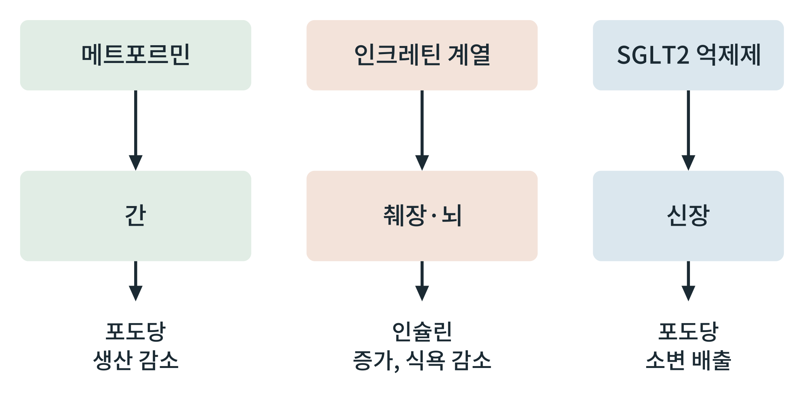

## 제38장 대사 개입 약물: 메트포르민, 인크레틴 계열, SGLT2 억제제

> **이 장의 출발점** 유럽에서 염소풀이라 불린 식물 갈레가(Galega officinalis)는 오래전부터 당뇨와 비슷한 증상에 민간요법으로 쓰였다고 전해진다. 이 식물에서 구아니딘 계열 물질이 알려졌고, 이를 바탕으로 만든 화합물 가운데 메트포르민이 1950년대 후반 프랑스의 장 스턴(Jean Sterne)에 의해 당뇨병 환자에게 쓰이는 약으로 보고되었다. 이후 인크레틴 계열과 SGLT2 억제제가 차례로 등장하며, 이들은 서로 다른 장기에서 서로 다른 경로로 포도당과 체중에 영향을 준다. 이 장은 2권의 대사 지도 위에서 이 세 계열이 어디를 건드리는지를 정리한다. 개별 약물의 임상 수치는 3권 실무편에서 원문 근거와 함께 다룬다.

### 38.1 세 계열의 작용 지점

메트포르민은 주로 간의 포도당 생산을 줄이는 것으로 설명되며, 정확한 분자 표적과 기전(미토콘드리아 호흡 억제, AMPK 활성화, 장내 작용 등)은 여전히 연구되고 논쟁 중이다. 인크레틴 계열은 GLP-1 수용체를 활성화하여 포도당 의존적으로 인슐린 분비를 늘리고 글루카곤을 억제하며 중추에서 식욕을 줄이는 것으로 설명된다(34장, 35장). SGLT2 억제제는 신장 근위세뇨관의 나트륨-포도당 공동수송체 2(sodium-glucose cotransporter 2)를 막아 포도당의 재흡수를 줄이고 소변으로 배출시킨다. 이 경로는 인슐린에 의존하지 않는다는 점이 특징이다.

**그림 38-1. 세 약물 계열의 표적 장기와 작용.** 메트포르민은 간에서 포도당 생산을, 인크레틴 계열은 췌장과 뇌에서 인슐린 분비와 식욕을, SGLT2 억제제는 신장에서 포도당 재흡수를 겨냥한다.

그림 38-1에서 읽을 점은 세 계열이 서로 다른 장기에서 시작하므로 작용이 겹치지 않고 보완될 수 있다는 것이다. 이 그림은 대표 작용만 단순화했으며 각 약물은 이 외의 작용도 보고되어 있다.

**표 38-1. 세 약물 계열의 비교.**

| 계열 | 주 표적 | 주 작용 | 체중에 대한 방향 | 주요 유의점(방향만 기술) |
|---|---|---|---|---|
| 메트포르민 | 간 | 포도당 생산 감소 | 대체로 중립 또는 소폭 감소로 보고 | 위장 증상, 신장 기능 저하 시 사용 제한 |
| 인크레틴 계열(GLP-1 수용체 작용제 등) | 췌장, 뇌, 위장관 | 인슐린 증가, 글루카곤 감소, 식욕 감소 | 감소 | 위장 증상, 근육량 보존 논의 |
| SGLT2 억제제 | 신장 | 포도당 소변 배출 | 감소 | 생식기 감염, 탈수 |

표 38-1에서 읽을 점은 작용 장기가 다르면 부작용의 양상도 달라진다는 것이다. 표의 방향은 일반적 요약이며, 크기와 안전성은 약물과 임상시험마다 다르므로 실제 수치는 해당 시험 원문으로 확인해야 한다. 이 표는 약물 선택의 처방이 아니라 작용 지점의 이해를 돕는 것이다.

### 38.2 약물 설계의 관점

세 계열은 모두 2권에서 다룬 신호 지도의 한 지점을 겨냥한다. 앞서 본 되돌리는 힘(37장)을 고려하면 한 지점만 막는 접근은 보상에 부딪히므로, 여러 수용체에 동시에 작용하려는 설계가 이어진다. 이는 3권에서 다룰 신약 설계의 출발점이다.

### 이 장의 요점

- 메트포르민은 간, 인크레틴 계열은 췌장·뇌, SGLT2 억제제는 신장을 주 표적으로 한다.
- 세 계열은 작용 장기가 달라 서로 보완될 수 있으나, 개별 효과 크기는 임상시험 원문으로 확인해야 한다.
- 메트포르민의 분자 기전은 아직 논쟁 중이다.

### 8부 점검: 질환과 개입의 연결

**표 38-2. 8부 요약: 병태 기전과 개입 지점.**

| 장 | 병태 기전 | 개입 지점 | 2권의 근거 장 |
|---|---|---|---|
| 36장 | 조직별 인슐린 저항, 선택적 간 저항 | 지방산 유입, 간 포도당·지방 경로 | 31~34장 |
| 37장 | 감량 후 되돌리는 힘(식욕, 에너지 소비) | 식욕 신호, 근육 보존 | 27장, 35장 |
| 38장 | 장기별 포도당 조절 | 간, 췌장·뇌, 신장 | 34장, 35장 |

표 38-2에서 읽을 점은 병태와 약물이 모두 2권의 신호 지도 위에 놓인다는 것이다. 다음 9부는 이 지도를 정량 모델과 도구로 옮기는 방법을 다룬다.

#### 참고문헌

Bailey, C. J. (2017). Metformin: Historical overview. *Diabetologia, 60*(9), 1566–1576. https://doi.org/10.1007/s00125-017-4318-z

Drucker, D. J. (2018). Mechanisms of action and therapeutic application of glucagon-like peptide-1. *Cell Metabolism, 27*(4), 740–756. https://doi.org/10.1016/j.cmet.2018.03.001

Rena, G., Hardie, D. G., & Pearson, E. R. (2017). The mechanisms of action of metformin. *Diabetologia, 60*(9), 1577–1585. https://doi.org/10.1007/s00125-017-4342-z

Vallon, V., & Thomson, S. C. (2017). Targeting renal glucose reabsorption to treat hyperglycaemia: The pleiotropic effects of SGLT2 inhibition. *Diabetologia, 60*(2), 215–225. https://doi.org/10.1007/s00125-016-4157-3
