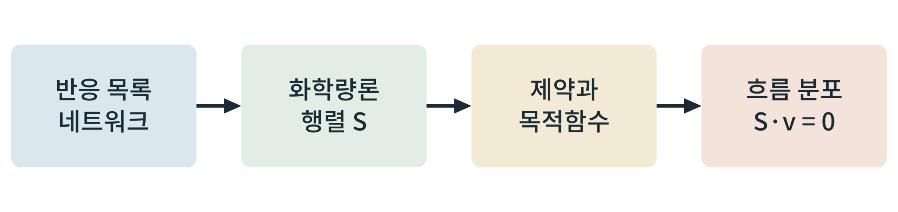

# 제9부 정량 모델링과 도구

## 제39장 대사 흐름 분석 (flux balance analysis)

> **이 장의 출발점** 1994년 미국 캘리포니아 대학 샌디에이고의 어데이 바르마(Amit Varma)와 베른하르트 팔손(Bernhard Palsson)은 대장균의 대사 반응을 화학량론 행렬 하나로 적고, 효소의 속도 상수를 하나도 모른 채 성장 속도와 부산물 분비를 예측해 보였다. 속도 상수 대신 물질 수지의 제약과 하나의 목적함수만 주면 된다는 방식이었다. 이것이 흐름 균형 분석(flux balance analysis, FBA)이며, 이후 사람 대사 네트워크로 확장되었다. 이 장은 2권에서 정성적으로 다룬 대사 지도를 계산 가능한 형태로 바꾸는 첫 도구를 소개한다.

### 39.1 화학량론 행렬과 정상상태

대사 네트워크의 각 반응은 대사물질을 소비하고 생성한다. 이를 대사물질 수 × 반응 수의 화학량론 행렬 S로 적고, 반응 속도(흐름)를 벡터 v로 두면, 세포 안 대사물질 농도가 시간에 따라 변하지 않는 정상상태는 S·v = 0으로 쓴다. 미지수(반응)가 식(대사물질)보다 많아 해가 무수히 많으므로, 각 흐름의 상한과 하한, 그리고 최대화할 목적함수(성장, ATP 생산 등)를 더해 하나의 최적 흐름 분포를 구한다. 이 선형계획 문제는 효소 속도 상수가 필요하지 않다는 점이 장점이면서, 농도와 조절을 직접 다루지 못한다는 점이 한계이다.

**그림 39-1. 흐름 균형 분석의 구성.** 반응 목록으로 네트워크를 만들고, 화학량론 행렬과 제약, 목적함수를 정한 뒤 정상상태 조건(S·v = 0) 아래에서 흐름 분포를 계산한다.

그림 39-1에서 읽을 점은 입력이 반응 목록과 제약이고 출력이 흐름 분포라는 것이다. 이 그림은 계산의 흐름만 보이며, 결과의 질은 네트워크 재구성의 정확성과 목적함수 선택에 크게 좌우된다.

### 39.2 식후와 공복 모드의 비교

같은 사람 대사 네트워크에서 입력 제약을 바꾸면 식후와 공복 상태를 구분해 계산할 수 있다. 식후 모드에서는 포도당과 아미노산의 흡수 상한을 열고 저장 반응을 허용하며, 공복 모드에서는 외부 포도당 흡수를 닫고 지방산 산화와 케톤 생성을 허용한다. 두 모드의 흐름 분포 차이가 22~30장에서 서술한 연료 전환의 정량적 대응이 된다. 다만 결과는 모델에 넣은 제약과 목적함수에 좌우되므로, 실험 측정과 대조하여 검증해야 한다.

**표 39-1. 흐름 균형 분석의 구성 요소와 주의점.**

| 요소 | 내용 | 주의점 |
|---|---|---|
| 네트워크 | 사람 대사 재구성(Recon 계열 등) | 재구성 버전에 따라 반응 수와 구조가 다름 |
| 제약 | 흡수 상한, 반응 방향, 흐름 한계 | 값의 근거가 필요, 임의 값은 결과를 왜곡 |
| 목적함수 | 성장, ATP 생산, 특정 대사물질 생산 | 조직과 상태에 따라 적절한 목적이 다름 |
| 도구 | COBRApy 등 오픈소스 | 입력 형식(SBML)과 해석기 선택에 따라 결과 재현성 확인 필요 |

표 39-1에서 읽을 점은 계산 도구보다 입력의 근거가 결과를 결정한다는 것이다. 약물 설계에서는 표적 효소의 흐름을 줄이는 가상 실험(유전자 결실 또는 억제 시뮬레이션)에 쓰이며, 결과는 후보 표적을 좁히는 가설로 다루고 확정 근거로 쓰지 않는다.

### 이 장의 요점

- 흐름 균형 분석은 화학량론 행렬과 제약, 목적함수로 정상상태의 흐름 분포를 계산한다.
- 효소 속도 상수가 필요 없지만, 농도와 조절은 직접 다루지 못한다.
- 입력 제약을 바꾸어 식후와 공복 모드를 비교할 수 있으며, 결과는 가설로 검증한다.

#### 참고문헌

Brunk, E., Sahoo, S., Zielinski, D. C., Altunkaya, A., Dräger, A., Mih, N., et al. (2018). Recon3D enables a three-dimensional view of gene variation in human metabolism. *Nature Biotechnology, 36*(3), 272–281. https://doi.org/10.1038/nbt.4072

Ebrahim, A., Lerman, J. A., Palsson, B. O., & Hyduke, D. R. (2013). COBRApy: COnstraints-Based Reconstruction and Analysis for Python. *BMC Systems Biology, 7*, Article 74. https://doi.org/10.1186/1752-0509-7-74

Orth, J. D., Thiele, I., & Palsson, B. Ø. (2010). What is flux balance analysis? *Nature Biotechnology, 28*(3), 245–248. https://doi.org/10.1038/nbt.1614

Varma, A., & Palsson, B. O. (1994). Stoichiometric flux balance models quantitatively predict growth and metabolic by-product secretion in wild-type *Escherichia coli* W3110. *Applied and Environmental Microbiology, 60*(10), 3724–3731. https://doi.org/10.1128/aem.60.10.3724-3731.1994
