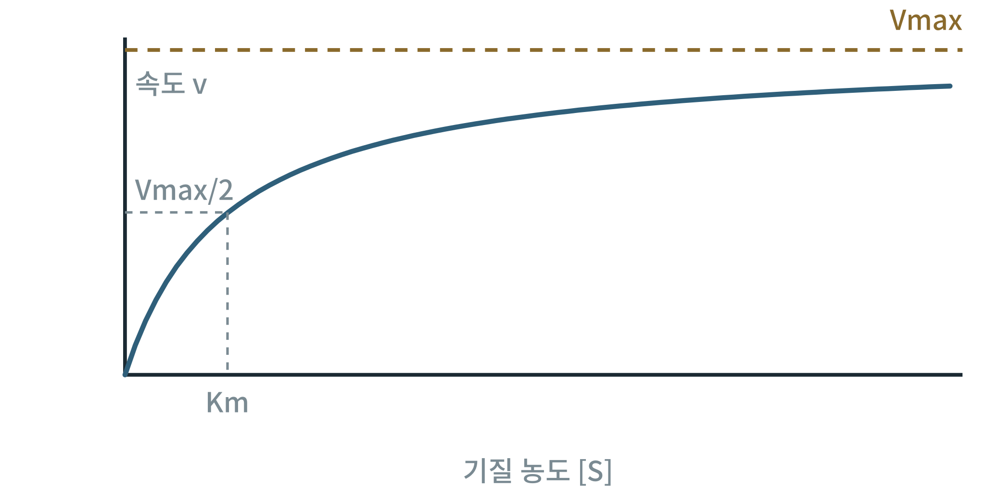

## 제40장 효소 속도론과 신호 모델

> **이 장의 출발점** 1913년 독일 베를린 대학의 레오노르 미카엘리스(Leonor Michaelis)와 모드 멘텐(Maud Menten)은 효소 인버타아제가 설탕을 분해하는 속도를 기질 농도별로 측정하고, 속도가 기질 농도에 따라 포화되는 곡선을 하나의 식으로 설명했다. 효소가 기질과 복합체를 만든 뒤 생성물을 내놓는다는 단순한 가정이었다. 그 후 1925년 브릭스(G. E. Briggs)와 홀데인(J. B. S. Haldane)이 정상상태 가정으로 식을 다시 도출했다. 이 장은 이 식에서 출발해 알로스테릭 조절과 상미분방정식 신호 모델까지 정량 모델의 기초를 정리한다.

### 40.1 미카엘리스-멘텐 식

효소 반응 속도 v는 기질 농도 [S]가 낮을 때는 [S]에 비례하고, 높을 때는 최대 속도 Vmax에 포화된다. 식은 v = Vmax[S]/(Km + [S])이며, Km은 속도가 Vmax의 절반이 되는 기질 농도이다. Km이 작으면 기질에 대한 친화도가 높다고 해석하는 것이 흔하지만, 엄밀히는 속도 상수의 조합이므로 해석에 주의가 필요하다.

**그림 40-1. 미카엘리스-멘텐 곡선.** 기질 농도가 늘면 속도는 Vmax에 접근해 포화되며, 속도가 Vmax의 절반이 되는 기질 농도가 Km이다.

그림 40-1에서 읽을 점은 같은 효소라도 기질 농도 구간에 따라 속도가 농도에 민감한 구간과 둔감한 구간이 나뉜다는 것이다. 생리적 기질 농도가 Km보다 훨씬 낮으면 농도 변화가 속도에 바로 반영되고, 훨씬 높으면 반영되지 않는다. 이 그림은 개념 곡선이며 축에 수치는 없다.

### 40.2 알로스테릭 조절과 상미분방정식 모델

대사 조절 효소는 단순한 쌍곡선이 아니라 S자형 반응을 보이는 경우가 많고, 이는 알로스테릭 조절과 협동성으로 설명된다. 신호 경로나 대사 경로는 이런 반응식을 연립한 상미분방정식으로 적어 시간에 따른 농도 변화를 계산할 수 있다. 오픈소스 도구로는 COPASI와 tellurium이 있으며, biospeed_db에 모은 효소 및 신호 반응 속도 자료를 매개변수의 출발점으로 쓸 수 있다.

**표 40-1. 정량 모델의 층위와 용도.**

| 층위 | 방정식 | 필요한 입력 | 용도 |
|---|---|---|---|
| 흐름 균형 분석 | 선형 제약, 최적화 | 네트워크, 제약 | 정상상태 흐름의 가설 생성(39장) |
| 미카엘리스-멘텐 식 | 포화 곡선 | Vmax, Km | 단일 효소의 농도-속도 관계 |
| 알로스테릭 식 | S자형 곡선 | 협동성, 조절 상수 | 조절 지점의 민감도 |
| 상미분방정식 | 연립 미분방정식 | 속도 상수, 초기 농도 | 시간에 따른 전환과 진동 |

표 40-1에서 읽을 점은 층위가 올라갈수록 필요한 입력이 많아지고 모델이 설명하는 현상이 풍부해진다는 것이다. 어느 층위를 쓸지는 질문에 따라 정하고, 입력이 없는 층위의 모델을 억지로 쓰지 않는다. 매개변수 값은 측정 조건(온도, pH, 조직)이 다르면 달라지므로 출처를 함께 기록한다.

### 이 장의 요점

- 미카엘리스-멘텐 식은 속도가 기질 농도에 따라 포화되는 관계를 Vmax와 Km 두 값으로 기술한다.
- 알로스테릭 조절은 S자형 반응을 만들어 조절 지점의 민감도를 높인다.
- 상미분방정식 모델은 COPASI, tellurium 등으로 계산하며, 매개변수는 측정 조건과 출처를 함께 기록한다.

#### 참고문헌

Briggs, G. E., & Haldane, J. B. S. (1925). A note on the kinetics of enzyme action. *Biochemical Journal, 19*(2), 338–339. https://doi.org/10.1042/bj0190338

Choi, K., Medley, J. K., König, M., Stocking, K., Smith, L., Gu, S., & Sauro, H. M. (2018). Tellurium: An extensible python-based modeling environment for systems and synthetic biology. *Biosystems, 171*, 74–79. https://doi.org/10.1016/j.biosystems.2018.07.006

Hoops, S., Sahle, S., Gauges, R., Lee, C., Pahle, J., Simus, N., et al. (2006). COPASI: A COmplex PAthway SImulator. *Bioinformatics, 22*(24), 3067–3074. https://doi.org/10.1093/bioinformatics/btl485

Michaelis, L., & Menten, M. L. (1913). Die Kinetik der Invertinwirkung. *Biochemische Zeitschrift, 49*, 333–369.
