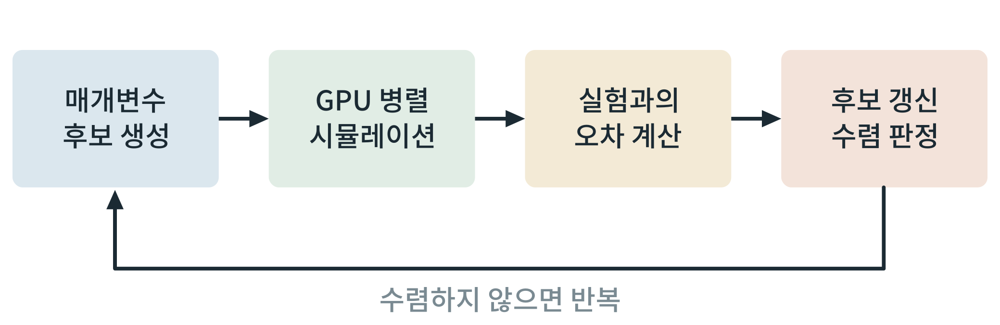

## 제41장 로컬 GPU와 도구 사용법

> **이 장의 출발점** 2007년 엔비디아(NVIDIA)가 그래픽 처리 장치(graphics processing unit, GPU)를 범용 계산에 쓸 수 있게 하는 프로그래밍 환경 CUDA를 공개했고, 2008년 닉콜스(John Nickolls)와 동료들이 이 병렬 프로그래밍 모델을 정리해 소개했다. 수천 개의 작은 계산 단위를 동시에 돌리는 방식은 그래픽을 위해 만들어졌지만, 같은 계산을 매개변수만 바꿔 수없이 반복하는 모델 적합에도 맞았다. 이 장은 정량 모델의 매개변수 추정을 병렬화하는 방법과, 3권 도구 장과 이어지는 사용 원칙을 정리한다.

### 41.1 매개변수 추정의 구조

모델의 속도 상수 같은 매개변수는 실험 자료와 모델 출력의 오차를 최소화하는 값을 찾아 정한다. 후보 매개변수를 만들고, 각 후보로 모델을 시뮬레이션하여 오차를 계산하고, 오차가 작은 쪽으로 후보를 갱신하는 과정을 수렴할 때까지 반복한다. 후보마다 시뮬레이션이 서로 독립이므로 병렬화에 적합하다. 생화학 경로의 매개변수 추정에서는 전역 최적화 방법의 비교 연구가 오래전부터 있었고, 방법에 따라 수렴 속도와 안정성이 다르다고 보고되어 있다.

**그림 41-1. GPU 병렬 매개변수 추정의 반복 구조.** 매개변수 후보를 만들고, 여러 후보를 GPU에서 병렬로 시뮬레이션하여 실험과의 오차를 계산한 뒤 후보를 갱신한다. 수렴하지 않으면 반복한다.

그림 41-1에서 읽을 점은 병렬화의 이득이 시뮬레이션 단계에 집중된다는 것이다. 오차 계산과 갱신은 상대적으로 가볍고, 전체 속도는 후보를 몇 개씩 동시에 돌릴 수 있는가와 후보당 시뮬레이션 비용에 좌우된다.

### 41.2 사용 원칙

로컬 GPU를 쓰는 이유는 비용과 자료 통제이다. 도구를 쓸 때는 첫째 결과를 재현할 수 있도록 입력, 난수 시드, 소프트웨어 버전을 함께 기록하고, 둘째 병렬 결과를 소규모 직렬 계산과 대조해 코드 오류를 점검하며, 셋째 추정된 매개변수의 불확실성을 함께 보고한다. 구체적인 도구 설치와 실행 절차는 3권의 도구 장에서 다룬다.

**표 41-1. 병렬 매개변수 추정의 점검 항목.**

| 항목 | 내용 | 이유 |
|---|---|---|
| 재현성 기록 | 입력 자료, 시드, 버전 | 같은 결과를 다시 얻기 위해 |
| 직렬 대조 | 소규모 문제를 직렬과 병렬로 비교 | 병렬 구현 오류를 잡기 위해 |
| 다중 시작점 | 여러 초기값에서 시작 | 지역 최적해에 갇히는 것을 점검 |
| 불확실성 | 매개변수 구간 또는 분포 | 값 하나만으로는 신뢰도를 알 수 없음 |

표 41-1에서 읽을 점은 계산 속도보다 검증 절차가 모델의 신뢰를 만든다는 것이다. 빠르게 얻은 매개변수가 실험으로 검증되지 않으면 가설로만 취급한다.

### 이 장의 요점

- 매개변수 추정은 후보 생성, 시뮬레이션, 오차 계산, 갱신의 반복이며, 시뮬레이션 단계가 병렬화에 적합하다.
- 재현성 기록, 직렬 대조, 다중 시작점, 불확실성 보고가 병렬 계산의 기본 점검 항목이다.
- 구체적인 도구 사용법은 3권에서 다룬다.

#### 참고문헌

Moles, C. G., Mendes, P., & Banga, J. R. (2003). Parameter estimation in biochemical pathways: A comparison of global optimization methods. *Genome Research, 13*(11), 2467–2474. https://doi.org/10.1101/gr.1262503

Nickolls, J., Buck, I., Garland, M., & Skadron, K. (2008). Scalable parallel programming with CUDA. *ACM Queue, 6*(2), 40–53. https://doi.org/10.1145/1365490.1365500
