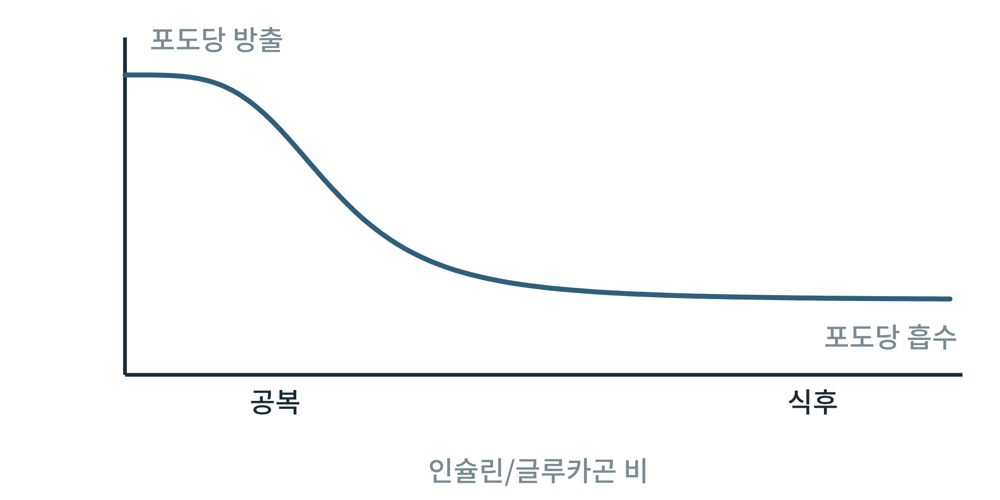

## 제42장 사례: 식후와 공복 전환의 수학 모델

> **이 장의 출발점** 1998년 미국 스탠퍼드 대학의 제임스 페럴(James Ferrell)과 에릭 매클레더(Eric Machleder)는 개구리 난모세포가 호르몬 자극을 받아 성숙하는 과정이 자극이 커질수록 서서히 진행되는 것이 아니라 어느 문턱을 넘으면 한꺼번에 일어나는 전부 아니면 전무 반응임을 보였고, 이를 신호 경로의 양성 되먹임과 협동성으로 설명했다. 문턱이 있는 반응은 연속적 입력을 거의 이진적 출력으로 바꾼다. 식후와 공복 사이에서 간이 포도당을 내놓다가 받아들이는 방향으로 바뀌는 전환도 이런 문턱 반응의 모양을 가진다. 이 장은 2권의 모델 도구를 이 전환 하나에 적용하는 사례를 보인다.

### 42.1 문제의 설정

관심 현상은 인슐린과 글루카곤의 비가 바뀔 때 간의 순 포도당 출입이 방출에서 흡수로 바뀌는 방식이다(23장, 29장, 31장). 가장 단순한 모델은 이 비를 입력으로, 순 포도당 방출을 출력으로 두고, 둘 사이를 S자형 감소 함수로 연결하는 것이다. 예를 들어 방출 J를 최대 방출 Jmax와 반응 문턱 K, 협동성 n으로 J = Jmax/(1 + (r/K)^n) 꼴로 둘 수 있다. 여기서 r는 인슐린/글루카곤 비이다. 협동성이 클수록 문턱 근처에서 전환이 가파르다.

**그림 42-1. 식후와 공복 전환의 개념 모델.** 인슐린/글루카곤 비가 낮은 공복에서는 간이 포도당을 방출하고, 비가 오르는 식후로 가면 방출이 줄어 흡수 쪽으로 바뀐다. 중간 구간에서 전환이 가파르다.

그림 42-1에서 읽을 점은 전환이 문턱 부근의 좁은 구간에 집중된다는 것이다. 이 그림은 개념 곡선이며 축 눈금과 매개변수 값은 의도적으로 쓰지 않았다. 매개변수는 근거 있는 측정값으로 추정하기 전에는 수치를 부여하지 않는다.

### 42.2 확장과 한계

이 단순 모델은 몇 방향으로 확장할 수 있다. 시간 지연을 넣어 호르몬 변화 뒤 간의 반응 지연을 표현하고(상미분방정식, 40장), 간 대사 네트워크의 제약을 바꾸어 같은 전환을 흐름 분포로 재현하며(39장), 실험 자료에 맞춰 매개변수를 병렬로 추정할 수 있다(41장). 한계는 분명하다. 한 장기의 한 출력만 다루므로 근육과 지방조직의 반응(32장, 33장)과 되먹임을 담지 못하고, 문턱과 협동성이 실제 사람 간에서 어떤 값인지는 이 모델이 말해 주지 않는다.

**표 42-1. 사례 모델의 확장 경로와 필요한 입력.**

| 확장 | 추가 요소 | 필요한 입력 | 3권에서의 위치 |
|---|---|---|---|
| 시간 지연 | 호르몬 변화 뒤 반응 지연 | 시간 경과 실험 자료 | 모델 구현 장 |
| 대사 네트워크 | 흐름 분포로 전환 재현 | 사람 대사 네트워크, 제약 | 도구 장 |
| 다장기 결합 | 근육, 지방조직, 췌장 | 장기별 반응 곡선 | 시뮬레이션 장 |
| 매개변수 추정 | 문턱, 협동성 | 인슐린·글루카곤 클램프 자료 | 도구 장 |

표 42-1에서 읽을 점은 확장 각각이 필요로 하는 실측 입력이 다르다는 것이다. 입력이 없으면 모델은 틀을 보여 줄 뿐이며, 약물 설계에 쓰려면 3권에서 근거 있는 자료로 매개변수를 정해야 한다.

### 이 장의 요점

- 식후와 공복 전환은 문턱이 있는 S자형 반응으로 단순화할 수 있다.
- 이 개념 모델은 시간 지연, 대사 네트워크, 다장기 결합으로 확장할 수 있다.
- 매개변수는 근거 있는 자료로 추정하기 전에는 수치를 부여하지 않는다.

### 9부 점검: 모델 층위와 도구

**표 42-2. 9부 요약: 장별 모델과 용도.**

| 장 | 모델 | 용도 | 한계 |
|---|---|---|---|
| 39장 | 흐름 균형 분석 | 정상상태 흐름 분포, 표적 후보 선별 | 농도·조절 미포함 |
| 40장 | 미카엘리스-멘텐, 상미분방정식 | 효소 속도, 시간 변화 | 매개변수 입력 필요 |
| 41장 | GPU 병렬 매개변수 추정 | 모델 적합 가속 | 검증 절차 필수 |
| 42장 | 문턱형 전환 사례 | 식후-공복 전환의 개념 모델 | 매개변수 미정 |

표 42-2에서 읽을 점은 도구가 질문에 맞게 선택되어야 한다는 것이다.

### 2권 전체 점검: 1권과의 연결

**표 42-3. 1권 원리편과 2권의 장별 연결.**

| 1권 장 | 주제 | 2권에서 이어지는 장 |
|---|---|---|
| 3장 | 호르몬 신호와 식욕 회로 | 27장, 29장 |
| 4장 | 수용체 신호전달 | 15장, 19장 |
| 5장 | 장기와 조직의 역할 | 31~34장 |
| 7장 | 에너지 감지 경로 | 19장, 21장 |
| 8장 | 대사 경로와 약물 표적 | 14장, 28장 |
| 9장 | 미토콘드리아와 에너지 대사 | 10~13장 |
| 13~15장 | 약물 계열과 설계 | 17~19장 |
| 16장 | 체중 조절의 생리 | 26장, 27장 |
| 17장 | 체중 재증가와 반응 차이 | 21장, 37장 |

표 42-3에서 읽을 점은 1권의 약물과 신호 이야기가 2권에서 세포 에너지 대사 수준의 근거로 내려간다는 것이다. 연결의 방향과 범위는 목차 v1의 대응을 따랐으며, 장 번호는 판이 바뀌면 다시 확인한다. 3권 실무편은 이 두 권을 근거로 신약 설계 절차와 도구 사용으로 넘어간다.

#### 참고문헌

Ferrell, J. E., Jr., & Machleder, E. M. (1998). The biochemical basis of an all-or-none cell fate switch in *Xenopus* oocytes. *Science, 280*(5365), 895–898. https://doi.org/10.1126/science.280.5365.895

Ferrell, J. E., Jr. (2002). Self-perpetuating states in signal transduction: Positive feedback, double-negative feedback and bistability. *Current Opinion in Cell Biology, 14*(2), 140–148. https://doi.org/10.1016/S0955-0674(02)00314-9
