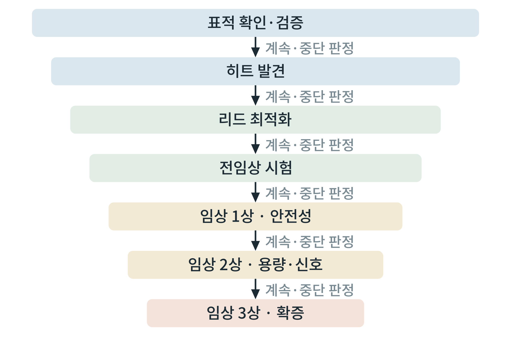

# 제1부 신약 연구의 설계

## 제1장 신약 연구의 단계와 의사결정

> **이 장의 출발점** 1960년 미국 식품의약국(Food and Drug Administration, FDA)에 들어온 지 얼마 되지 않은 의학 심사관 프랜시스 올덤 켈시(Frances Oldham Kelsey)는 독일에서 진정제와 입덧 완화제로 쓰이던 탈리도마이드(thalidomide)의 미국 판매 허가 신청서를 받았다. 제약사는 이미 유럽에서 널리 팔리고 있다는 사실을 앞세웠으나, 켈시는 제출된 자료에 신경 손상 가능성과 임신부 안전성을 뒷받침하는 근거가 부족하다고 보고 보완을 요구하며 승인을 미뤘다. 그 사이 유럽에서 신생아의 사지 기형이 보고되기 시작했고, 이 약은 미국에서 시판되지 않았다. 1962년 의회는 약이 안전할 뿐 아니라 효과가 있다는 증거를 시판 전에 제출하도록 하는 법 개정(Kefauver-Harris 수정안)을 통과시켰다. 오늘날 신약 연구가 단계마다 "여기서 계속할 것인가"를 증거로 묻는 구조를 갖게 된 데에는 이 사건이 놓여 있다. 이 장은 그 구조를 비만치료약물 연구에 옮겨, 연구자가 첫 가설에서 임상 진입까지 어떤 문을 몇 개 통과해야 하는지를 정리한다.

### 1.1 신약 연구는 "문이 달린 복도"이다

신약 연구는 하나의 긴 실험이 아니라 단계가 이어진 복도이고, 단계마다 문이 있다. 문은 "지금까지의 증거로 다음 단계에 자원을 투입할 만한가"를 묻는다. 문을 통과하지 못하면 연구를 멈추거나 되돌아가 설계를 고친다. 이 구조의 목적은 성공 확률을 높이는 것만이 아니라 **실패를 가능한 한 일찍, 싸게 알아내는 것**이다. 임상시험으로 갈수록 비용과 사람에 대한 위험이 커지므로, 실험실에서 알아낼 수 있는 실패는 임상에 가기 전에 알아내야 한다.

비만치료약물을 예로 들면 단계는 다음과 같이 흐른다. 먼저 **표적 확인과 검증**에서 어떤 수용체나 효소를 건드릴지 정하고, 그 표적이 체중 조절과 정말 인과적으로 이어지는지 확인한다. **히트 발견**에서는 표적에 결합하거나 활성을 바꾸는 물질을 찾고, **리드 최적화**에서 그 물질의 세기, 선택성, 체내 거동을 다듬는다. **전임상 시험**에서는 동물과 세포에서 효능과 독성을 평가하고, 시험관 내 대사와 약동학을 확인한다. 이 모든 자료가 임상시험계획 승인(investigational new drug application, IND; 한국에서는 식품의약품안전처의 임상시험계획 승인)의 근거가 된다. 이후 사람 대상 **1상(안전성과 약동학), 2상(용량 탐색과 효과 신호), 3상(확증)** 을 거쳐 시판 허가를 신청한다.

그림 1-1은 이 복도를 깔때기로 그린 것이다. 각 단계의 폭은 정량적 비율이 아니라, 단계가 넘어갈 때마다 후보가 줄어든다는 구조만 나타낸다. 단계별 통과율은 시대와 질환 영역, 표적 종류에 따라 크게 다르고, 대규모 분석에서도 영역별 차이가 보고되므로(Hay et al., 2014) 이 책은 특정 숫자를 일반화하지 않는다.

**그림 1-1. 신약 연구의 깔때기와 단계 사이의 판정.** 표적 확인에서 시판 허가까지 단계가 이어지고, 단계 사이마다 계속 또는 중단을 정하는 판정 지점이 있다. 폭은 후보가 줄어드는 구조만 나타내며 비율을 뜻하지 않는다.

그림 1-1에서 읽을 점은 두 가지이다. 첫째, 판정은 단계 끝에 한 번만 있는 것이 아니라 단계 사이마다 반복된다. 둘째, 뒤로 갈수록 한 번의 판정이 걸린 비용이 커지므로 앞 단계에서 "중단 기준"을 미리 정해 두는 것이 연구자를 지키는 가장 값싼 장치이다. 매몰 비용이 쌓인 뒤에는 중단 결정이 심리적으로 어렵기 때문이다.

### 1.2 단계별 산출물과 판정 기준

각 단계에서 연구자는 "무엇을 손에 쥐어야 문을 통과하는가"를 문서로 정해 두어야 한다. 표 1-1은 비만치료약물 연구에 맞춘 산출물과 판정 기준의 예이다. 구체적인 수치 기준은 표적과 약물 형태(주사 펩타이드, 경구 소분자 등)마다 다르므로, 연구 계획서에서 각자 정한다.

**표 1-1. 단계별 산출물과 판정 기준의 예.**

| 단계 | 핵심 질문 | 대표 산출물 | 통과 판정의 예 |
|---|---|---|---|
| 표적 확인·검증 | 이 표적이 체중 조절과 인과적으로 이어지는가 | 표적 점수표, 유전학 근거 요약, 발현 지도 | 독립된 근거 둘 이상이 같은 방향을 가리킴 |
| 히트 발견 | 표적을 건드리는 물질이 있는가 | 활성 물질 목록, 시험법 성능 지표 | 시험법이 재현되고 양성 대조와 구분됨 |
| 리드 최적화 | 세기, 선택성, 체내 거동이 쓸 만한가 | 구조-활성 관계표, 선택성 패널, 약동학 | 목표 제품 프로파일의 핵심 항목 충족 |
| 전임상 | 동물에서 효과가 있고 독성이 허용 범위인가 | 효능 시험, 독성 시험, 용량 설정 근거 | 효과가 용량에 따라 나타나고 안전역이 확보됨 |
| 임상 1상 | 사람에서 안전하고 약동학이 예측과 맞는가 | 안전성, 내약성, 약동학 자료 | 심각한 이상반응 없이 목표 노출에 도달 |
| 임상 2상 | 효과 신호와 용량이 있는가 | 용량-반응, 위약 대비 체중 변화 | 3상 용량 선택의 근거 확보 |
| 임상 3상 | 효과와 안전성이 확증되는가 | 확증 시험 결과, 장기 안전성 | 규제기관 기준 충족 |

표 1-1에서 읽을 점은 각 단계의 통과 판정이 "자료가 많다"가 아니라 **미리 정한 기준을 충족했는가**라는 점이다. 기준 없이 결과를 본 뒤에 기준을 맞추면 확증 편향이 들어간다. 이 책 3권 전체가 "입력, 도구, 출력, 판정 기준"을 한 묶음으로 서술하는 이유도 같다.

### 1.3 목표 제품 프로파일과 연구 계획서

연구를 시작하기 전에 써야 하는 문서가 두 가지이다. 하나는 **목표 제품 프로파일**(target product profile, TPP)로, 최종 약이 갖춰야 할 모습을 항목별로 적은 것이다. 다른 하나는 **연구 계획서**로, 현재 단계에서 무엇을 어떻게 검증할지를 적은 것이다. TPP는 "이 정도면 쓸 만한 약"의 기준을 먼저 세우게 해 주므로 단계별 판정 기준의 출처가 된다.

비만치료약물의 TPP에 들어갈 항목은 다음과 같다. 대상 환자군(비만, 과체중과 동반 질환), 투여 경로와 횟수(주 1회 주사, 매일 경구 등), 기대 체중 감소 폭과 그 판정 방식, 동반 대사 질환에 대한 효과(혈당, 지질, 간지방), 반드시 피해야 할 위험(심혈관, 정신과, 췌장 관련), 소화기계 이상반응의 허용 정도, 약을 끊은 뒤의 체중 회복에 대한 입장, 제조 단가와 보관 조건이다. 이 항목은 1권 5부에서 정리한 기존 약물의 한계표와 대응한다. 기존 약물이 채우지 못한 칸이 새 약의 존재 이유가 된다.

규제기관은 비만치료제의 효과를 판정하는 방식을 지침으로 밝히고 있다. 예를 들어 FDA의 체중 관리 제품 개발 지침은 효능 판정을 위약 대비 평균 체중 감소율의 차이, 또는 기저 체중의 5% 이상을 줄인 환자의 비율로 제시한 것으로 알려져 있다(U.S. Food and Drug Administration, 2007). 유럽의약품청(European Medicines Agency, EMA)도 체중 관리 의약품의 임상 평가 지침을 두고 있다(European Medicines Agency, 2016). 두 지침의 정확한 문구와 기준은 개정될 수 있으므로, 연구 계획서를 쓸 때는 **최신 판을 직접 열어 인용 문구를 확인**해야 한다. 한국에서는 식품의약품안전처가 임상시험 계획 승인과 시판 허가를 맡고, 국제적 조화를 위해 국제의약품규제조화위원회(International Council for Harmonisation, ICH) 지침을 참조한다.

연구 계획서는 최소한 다음 다섯 질문에 답해야 한다.

**표 1-2. 연구 계획서의 최소 구성.**

| 항목 | 답해야 할 질문 | 나쁜 예 | 좋은 예 |
|---|---|---|---|
| 가설 | 무엇이 어떻게 바뀐다고 믿는가 | "이 물질이 비만에 좋을 것이다" | "수용체 X의 활성화가 세포에서 cAMP를 올리고 인슐린 분비를 늘린다" |
| 목표 제품 프로파일 | 최종 약의 모습은 | 없음 | 투여 경로, 효과, 위험을 항목별로 기재 |
| 성공 기준 | 어떤 결과면 다음 단계로 가는가 | 결과를 본 뒤 정함 | 시작 전에 수치로 정함 |
| 중단 기준 | 어떤 결과면 멈추는가 | 정하지 않음 | 효과가 없거나 독성 신호 시 중단 |
| 방법과 통계 | 어떻게 재고 어떻게 판단하는가 | 표본 수를 "관례적으로" | 검정력으로 표본 수를 계산(3장) |

표 1-2에서 읽을 점은 "나쁜 예"의 대부분이 연구자가 일부러 그렇게 쓴 것이 아니라 **적을 때 불편해서 건너뛴 칸**이라는 점이다. 성공 기준과 중단 기준을 적는 일은 불편하지만, 이 두 칸이 연구의 자기기만을 막는다.

### 1.4 의사결정에서 자주 틀리는 곳

신약 연구의 판정에서 반복되는 오류를 알아 두면 계획서 설계가 쉬워진다. 첫째, **작은 표본의 우연한 성공**을 과대평가한다. 표본이 작은 연구는 우연히 큰 효과를 보일 확률이 높고, 이를 근거로 다음 단계를 설계하면 실패한다(Button et al., 2013). 둘째, **출판되는 결과만 보는 편향**이다. 기존 보고가 좋은 결과 중심이라는 점을 감안해야 한다(Ioannidis, 2005). 셋째, **표적 근거와 약물 근거를 혼동**한다. 표적이 질병과 연관된다는 근거와, 그 표적을 이 물질로 건드리면 효과가 난다는 근거는 다르다. 넷째, **분석 결정을 결과 이후에 바꾼다**. 어떤 분석을 할지 미리 적어 두지 않으면 유리한 쪽으로 기운다.

사람 유전학이 표적 근거를 강화한다는 것은 지금까지의 분석에서 일관되게 나온 결과이다. 인간 유전학적 지지가 있는 표적-적응증 쌍이 승인된 약에서 더 많이 발견된다는 보고가 있고(Nelson et al., 2015), 더 최근의 분석은 유전학 근거가 임상 성공과 연결되는 정도를 정교하게 추정했다(Minikel et al., 2024). 표적을 유전학적으로 검증하는 틀도 정리되어 있다(Plenge et al., 2013). 2장에서 이 근거를 표적 점수표에 넣는 방법을 다룬다.

### 1.5 실습 상자: 연구 계획서 한 장 만들기

**목표.** 자기 표적 하나에 대해 계획서 한 장(TPP + 표 1-2 다섯 항목)을 완성한다.

**입력.** 1권의 약물 한계표(5부 점검), 표적 후보 목록(4부 점검).

**도구.** 문서 편집기와 버전 관리(git). 3권 9장의 저장소 구조를 쓴다.

**절차.** ① 표적을 하나 고른다. ② TPP 항목(대상, 투여 경로, 효과, 위험, 단가)을 표 1-2 형식으로 채운다. ③ 현재 단계(예: 표적 검증)의 성공 기준과 중단 기준을 **수치로** 적는다. ④ 계획서를 저장소에 첫 커밋으로 올리고, 이후 기준을 바꾸려면 새 커밋과 사유를 남긴다.

**판정 기준.** 성공 기준과 중단 기준이 모두 수치로 적혀 있고, 결과를 보기 전에 커밋되어 있으면 통과이다.

**흔한 실패.** 성공 기준만 적고 중단 기준을 비워 두는 것, 기준을 "충분히 크다" 같은 말로 적는 것, 실험을 시작한 뒤에 계획서를 고치는 것.

### 이 장의 요점
신약 연구는 단계마다 계속 또는 중단을 정하는 문이 달린 복도이고, 실패를 일찍 알아내는 것이 목적이다. 각 단계의 통과 판정은 결과를 보기 전에 정한 기준을 충족했는가로 한다. 목표 제품 프로파일은 최종 약의 모습을 먼저 적어 단계별 기준의 출처가 되며, 연구 계획서는 가설, 성공 기준, 중단 기준, 방법과 통계를 반드시 포함한다. 작은 표본의 성공, 출판 편향, 표적 근거와 약물 근거의 혼동, 사후 분석 변경이 반복되는 오류이다. 규제 지침의 문구와 기준은 개정되므로 계획서를 쓸 때 최신 판을 직접 확인한다.

#### 참고문헌
Button, K. S., Ioannidis, J. P. A., Mokrysz, C., Nosek, B. A., Flint, J., Robinson, E. S. J., & Munafò, M. R. (2013). Power failure: Why small sample size undermines the reliability of neuroscience. *Nature Reviews Neuroscience, 14*(5), 365–376. https://doi.org/10.1038/nrn3475

European Medicines Agency. (2016). *Guideline on clinical evaluation of medicinal products used in weight management*. European Medicines Agency.

Hay, M., Thomas, D. W., Craighead, J. L., Economides, C., & Rosenthal, J. (2014). Clinical development success rates for investigational drugs. *Nature Biotechnology, 32*(1), 40–51. https://doi.org/10.1038/nbt.2786

Ioannidis, J. P. A. (2005). Why most published research findings are false. *PLoS Medicine, 2*(8), e124. https://doi.org/10.1371/journal.pmed.0020124

Minikel, E. V., Painter, J. L., Dong, C. C., & Nelson, M. R. (2024). Refining the impact of genetic evidence on clinical success. *Nature, 629*(8012), 624–629. https://doi.org/10.1038/s41586-024-07316-0

Nelson, M. R., Tipney, H., Painter, J. L., Shen, J., Nicoletti, P., Shen, Y., Floratos, A., Sham, P. C., Li, M. J., Wang, J., Cardon, L. R., Whittaker, J. C., & Sanseau, P. (2015). The support of human genetic evidence for approved drug indications. *Nature Genetics, 47*(8), 856–860. https://doi.org/10.1038/ng.3314

Plenge, R. M., Scolnick, E. M., & Altshuler, D. (2013). Validating therapeutic targets through human genetics. *Nature Reviews Drug Discovery, 12*(8), 581–594. https://doi.org/10.1038/nrd4051

U.S. Food and Drug Administration. (2007). *Guidance for industry: Developing products for weight management* (Draft guidance). U.S. Department of Health and Human Services.
