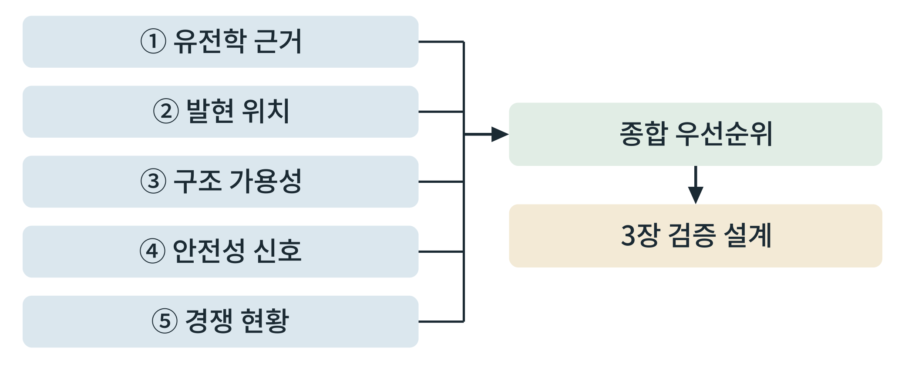
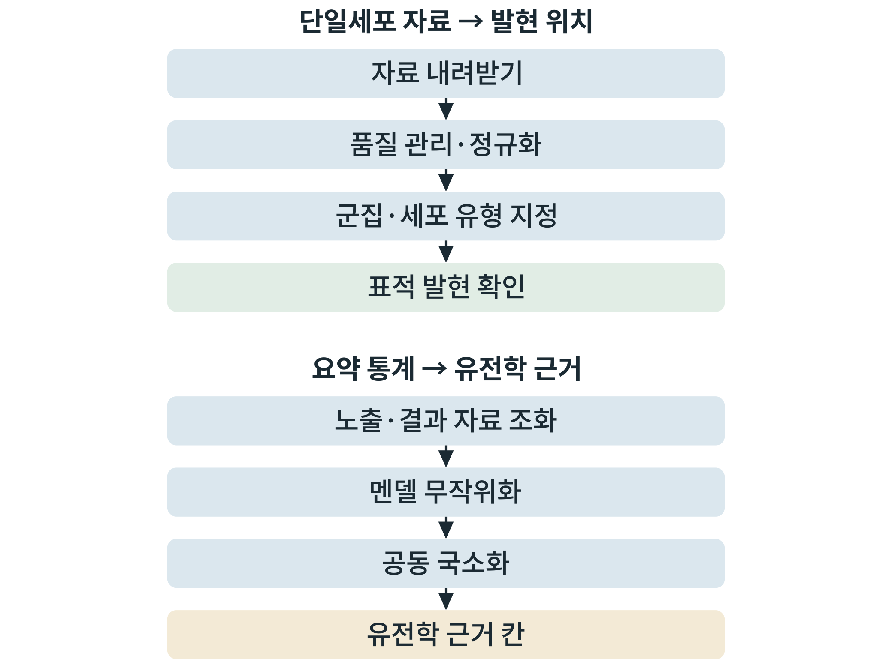

## 제2장 표적 발굴과 우선순위

> **이 장의 출발점** 1998년 같은 호의 『네이처 제네틱스』(Nature Genetics)에 두 연구진이 거의 같은 결론의 짧은 보고를 실었다. 영국 케임브리지의 연구진은 일찍부터 심한 비만을 보인 가족에서, 프랑스 연구진은 심한 비만 환자들에서 멜라노코르틴-4 수용체(melanocortin-4 receptor, MC4R) 유전자에 구조를 망가뜨리는 변이가 있음을 보고했다(Vaisse et al., 1998; Yeo et al., 1998). 쥐에서 이 수용체를 막으면 많이 먹고 살이 찐다는 것은 알려져 있었다. 이제 사람에서도 같은 유전자의 변이가 심한 비만으로 이어진다는 것이 확인된 것이다. 훗날 이 경로를 활성화하는 약이 특정 유전성 비만에 승인되기까지 이 발견은 "사람에서 일어난 자연 실험"이라는 근거로 남았다. 표적 발굴은 막연한 직관이 아니라 이처럼 서로 다른 증거가 한 방향을 가리키는지 확인하는 일이다. 이 장은 증거를 모아 점수로 정리하고, 공개 자료로 직접 재분석하는 방법을 서술한다.

### 2.1 표적 점수화의 틀

표적을 고를 때 연구자는 "그럴듯해 보이는 표적"과 "투자할 만한 표적"을 구분해야 한다. 이를 위해 증거를 몇 개의 축으로 나눠 각각 평가하고 종합한다. 이 책은 다섯 축을 쓴다.

첫째, **유전학 근거**: 사람에서 그 유전자의 변이가 체중이나 대사 형질과 연관되는가, 그 방향이 약으로 얻으려는 방향과 같은가. 둘째, **발현 위치**: 그 유전자가 체중 조절과 관련된 조직과 세포(시상하부, 뇌간, 췌장 섬, 지방, 장)에서 실제로 발현되는가. 셋째, **구조 가용성**: 표적의 3차원 구조가 알려져 있어 설계 계산이 가능한가. 넷째, **안전성 신호**: 표적을 건드릴 때 나타날 위험(다른 조직에서의 발현, 유전적 기능 상실 변이의 표현형)이 있는가. 다섯째, **경쟁 현황**: 이미 개발 중이거나 승인된 약이 있는가, 있다면 미충족 요구가 남아 있는가.

약으로 만들 수 있는 표적인지(druggability)는 별도로 따진다. 약물 표적이 될 가능성이 있는 유전체 영역을 체계적으로 정리한 연구가 있다(Finan et al., 2017). 단백질이 약물 결합 포켓을 가졌는지, 세포 표면에 노출되는지 등이 판단 요소이다.

**그림 2-1. 표적 점수화의 틀.** 다섯 축의 증거를 따로 평가한 뒤 종합 우선순위로 합치고, 종합 판정을 3장의 검증 설계로 넘긴다.



그림 2-1에서 읽을 점은 종합 점수 하나로 표적을 정하는 것이 아니라 **축별 평가를 보존한 채 종합한다**는 점이다. 유전학 근거가 강하고 구조는 알려지지 않은 표적과, 구조는 풍부하나 근거가 약한 표적은 종합 점수가 같아도 다음에 할 일이 다르다.

### 2.2 6개 표적의 점수표 예

표 2-1은 이 책 1~2부에서 다룬 표적 여섯 개를 다섯 축으로 평가한 예이다. 평가는 **"강함, 중간, 약함, 해당 없음"의 범주**로 적었고, 판단 근거는 공개 문헌이 뒷받침하는 일반적 사실에 한정했다. 독자가 자기 연구에 쓸 때는 각 칸을 자기가 수집한 근거로 직접 채우고 근거 출처를 함께 적어야 한다.

**표 2-1. 표적 점수표의 예(범주 평가와 근거 요지).**

| 표적 | 유전학 근거 | 발현 위치 | 구조 가용성 | 안전성 고려 | 경쟁 현황 |
|---|---|---|---|---|---|
| GLP1R (글루카곤 유사 펩타이드-1 수용체) | 강함: 변이와 대사 형질 연관, 약물 효과 확인 | 췌장 섬, 뇌(시상하부, 뇌간) | 강함: 펩타이드 결합 구조 다수 | 소화기계 이상반응 | 승인 약 다수, 경구화 경쟁 |
| GIPR (포도당 의존성 인슐린 분비 폴리펩타이드 수용체) | 중간: 체질량지수와 연관 위치 보고 | 췌장 섬, 지방 | 강함 | 작용 방향(활성화·차단) 논쟁 | 이중 작용제 승인 |
| GCGR (글루카곤 수용체) | 중간 | 간, 일부 조직 | 강함 | 혈당 상승, 지질 영향 | 다중 작용제 개발 중 |
| MC4R (멜라노코르틴-4 수용체) | 강함: 사람 변이가 심한 비만 유발 | 시상하부 | 강함 | 혈압, 심박, 성 기능 | 특정 유전성 비만에 승인 약 |
| GFRAL (GDF15 수용체) | 중간: 동물에서 기전 규명 | 뇌간(최후구역, 고립로핵) | 중간 | 오심, 식욕 감소의 지속성 | 개발 초기 |
| 아밀린 수용체 | 약함~중간 | 뇌간 등 | 중간 | 소화기계 이상반응 | 아밀린 유사체 개발 진행 |

표 2-1에서 읽을 점은 같은 "표적"이라도 **강점과 약점이 서로 다른 축에 있다**는 것이다. GLP1R은 대부분의 축이 강하지만 경쟁이 가장 치열하다. MC4R은 유전학 근거가 매우 강하지만 약으로 쓸 때 심혈관계 안전성이 걸림돌이 된다. GFRAL은 기전은 매력적이나 사람 유전학 근거와 임상 근거가 상대적으로 얇아, 3장의 검증 설계가 더 많은 몫을 해야 한다. (이 표의 각 칸은 범주 평가이며 정량 점수가 아니다. 정량 점수를 쓰려면 칸마다 근거 출처와 가중치를 연구 계획서에 명시한다.)

### 2.3 유전학 근거 만들기: 멘델 무작위화와 공동 국소화

사람 유전학 근거를 점수표에 넣으려면 공개 자료로 직접 분석해야 한다. 두 가지 도구가 핵심이다.

**멘델 무작위화**(Mendelian randomization)는 유전 변이를 도구로 삼아, 어떤 노출(예: 표적 유전자의 발현량)이 결과(예: 체질량지수)에 인과적 영향을 주는지 추정하는 방법이다. 유전 변이는 수정 때 무작위로 배분되므로 환경 교란에 덜 영향을 받는다는 점을 이용한다(Davey Smith & Ebrahim, 2003). 약물 표적에 적용하면 "이 유전자의 발현을 인위적으로 낮추거나 높인 효과"를 사람 자료로 미리 가늠하는 셈이다. 실제 분석은 노출과 결과의 요약 통계를 맞춰(조화, harmonization) 역분산 가중법 등으로 추정하고, 민감도 분석(MR-Egger, 가중 중앙값)으로 도구 변수의 가정이 깨졌는지 점검한다. 공개 자료와 소프트웨어 모음이 정비되어 있다(Hemani et al., 2018).

**공동 국소화**(colocalization)는 한 영역에서 발현량 변이와 질병 변이가 **같은 인과 변이**를 공유하는지를 베이즈 방법으로 판정한다. 두 신호가 가까이 있다는 사실만으로는 같은 변이 때문이라고 말할 수 없기 때문에 필요한 단계이다(Giambartolomei et al., 2014). 결과는 "두 형질이 같은 인과 변이를 공유한다는 가설의 사후 확률" 등으로 보고된다.

두 방법은 서로를 보완한다. 멘델 무작위화는 "방향과 크기"를, 공동 국소화는 "같은 변이인가"를 답한다. 둘이 모두 지지할 때 유전학 근거를 "강함"으로 쓴다. 한계도 분명하다. 도구 변수가 다른 경로로 결과에 영향을 주는 수평 다면발현, 인종 구성의 불일치, 연구마다 다른 표본 겹침은 추정을 왜곡하므로 결과를 단독 근거로 쓰지 않고 다른 축의 증거와 함께 해석한다.

**그림 2-2. 공개 자료 재분석의 두 흐름.** 위쪽은 단일세포 자료에서 표적 발현 세포를 확인하는 흐름이고, 아래쪽은 요약 통계로 멘델 무작위화와 공동 국소화를 수행하는 흐름이다. 두 흐름의 결과가 표적 점수표의 칸을 채운다.



그림 2-2에서 읽을 점은 두 흐름이 서로 다른 질문에 답하고 서로 다른 칸을 채운다는 것이다. 단일세포 분석은 "어느 세포에서 발현되는가"를 주어 발현 위치 축을, 요약 통계 분석은 인과 방향을 주어 유전학 근거 축을 채운다.

### 2.4 단일세포 자료로 발현 위치 확인하기

체중 조절 표적이 어느 세포에서 발현되는지는 조직 전체를 갈아 측정한 값으로는 알기 어렵다. 단일세포 RNA 서열분석(single-cell RNA sequencing) 자료는 세포 하나하나의 발현을 주므로, 시상하부의 어떤 뉴런 집단이 표적을 발현하는지를 구분해 준다. 공개 자료는 CELLxGENE, 유전자 발현 종합 저장소(Gene Expression Omnibus, GEO) 등에서 내려받고, 파이썬의 Scanpy로 분석하는 것이 표준 흐름이다(Wolf et al., 2018).

분석 흐름은 품질 관리, 정규화, 변이가 큰 유전자 선택, 차원 축소, 이웃 그래프와 군집화, 표지 유전자로 세포 유형 이름 붙이기, 표적 유전자 발현 확인 순이다. 같은 유전자를 다른 연구 자료에서 반복해 확인하는 것이 중요한데, 세포 유형 명명과 처리 방식이 연구마다 다르기 때문이다.

### 2.5 실습 상자 ① 점수표 만들기

**목표.** 자기 표적 후보 5~10개에 대해 표 2-1 형식의 점수표를 완성한다.

**입력.** 후보 목록, 각 후보의 문헌 근거(obesepharma_db 검색 결과, 5장), 공개 유전학 자료 요약.

**도구.** 스프레드시트 또는 CSV와 파이썬(pandas). 각 칸에 근거 인용(DOI)을 함께 저장한다.

**절차.** ① 행은 표적, 열은 다섯 축으로 한다. ② 칸마다 범주(강함, 중간, 약함, 해당 없음)와 **근거 문장의 출처**를 적는다. ③ 근거가 없는 칸은 비우지 말고 "미확인"으로 적는다. ④ 축별 평가를 보존한 채 종합 순위를 정하되, 종합 방식(가중치)은 점수를 보기 전에 적어 둔다.

**판정 기준.** 모든 칸에 출처 또는 "미확인"이 적혀 있고, 가중치가 결과 이전에 기록되어 있으면 통과이다.

**흔한 실패.** 출처 없이 인상으로 칸을 채우는 것, 점수가 마음에 들지 않아 가중치를 바꾸는 것, 경쟁 현황 축을 갱신하지 않아 이미 승인된 약을 놓치는 것.

### 2.6 실습 상자 ② 단일세포 분석 흐름

**목표.** 공개 단일세포 자료에서 표적 유전자를 발현하는 세포 집단을 찾는다.

**입력.** 공개 자료의 `.h5ad` 파일(CELLxGENE에서 내려받음).

**도구.** 파이썬, Scanpy(아래 인수 이름은 버전에 따라 다를 수 있으므로 설치한 버전의 문서를 확인한다).

**명령(요지).**
```
import scanpy as sc
adata = sc.read_h5ad("hypothalamus.h5ad")
sc.pp.filter_cells(adata, min_genes=200)
sc.pp.normalize_total(adata, target_sum=1e4)
sc.pp.log1p(adata)
sc.pp.highly_variable_genes(adata, n_top_genes=2000)
sc.pp.pca(adata); sc.pp.neighbors(adata)
sc.tl.leiden(adata); sc.tl.umap(adata)
sc.pl.dotplot(adata, ["MC4R","GLP1R","GFRAL"], groupby="leiden")
```

**출력.** 군집별 표적 발현을 보여 주는 점도표.

**판정 기준.** 같은 표적이 독립된 두 자료에서 같은 세포 유형에 나타나면 발현 위치 축을 "강함"으로 쓴다.

**흔한 실패.** 품질 관리 기준 없이 군집을 해석하는 것, 군집 이름을 표지 유전자로 확인하지 않고 붙이는 것, 한 자료만으로 결론을 내리는 것.

### 2.7 실습 상자 ③ 요약 통계 분석 흐름

**목표.** 표적 유전자 발현량 변이가 체질량지수에 인과적 영향을 주는지 추정하고, 신호를 공유하는지 확인한다.

**입력.** 노출(발현량 유전 변이 요약 통계)과 결과(체질량지수 요약 통계).

**도구.** R의 TwoSampleMR(멘델 무작위화)와 coloc(공동 국소화). 함수 이름과 인수는 설치한 버전의 문서로 확인한다.

**절차.** ① 노출의 도구 변수를 고르고, 결과 자료와 **조화**한다(대립유전자 방향 일치). ② 역분산 가중법으로 효과를 추정하고, MR-Egger와 가중 중앙값으로 민감도를 확인한다. ③ 같은 영역에서 공동 국소화를 수행해 두 신호가 같은 인과 변이를 공유할 사후 확률을 얻는다. ④ 두 결과의 방향이 약으로 얻으려는 방향과 같은지 점검한다.

**판정 기준.** 멘델 무작위화 추정이 일관되고 민감도 분석에서 뒤집히지 않으며, 공동 국소화가 같은 변이 가설을 지지하면 유전학 근거를 "강함"으로 쓴다.

**흔한 실패.** 대립유전자 방향을 맞추지 않고 분석하는 것, 도구 변수가 하나뿐인데 민감도 분석을 건너뛰는 것, 표본이 겹치는 자료를 독립으로 취급하는 것.

### 이 장의 요점
표적은 유전학, 발현 위치, 구조, 안전성, 경쟁의 다섯 축을 따로 평가한 뒤 종합한다. 축별 평가를 보존해야 표적마다 다음에 할 일이 구분된다. 유전학 근거는 멘델 무작위화로 인과 방향을, 공동 국소화로 같은 변이 공유를 확인하며, 둘이 함께 지지할 때 강한 근거가 된다. 발현 위치는 단일세포 자료를 독립된 두 자료에서 반복 확인한다. 점수표의 모든 칸에는 출처 또는 "미확인"을 적고, 가중치는 결과를 보기 전에 정한다.

#### 참고문헌
Davey Smith, G., & Ebrahim, S. (2003). "Mendelian randomization": Can genetic epidemiology contribute to understanding environmental determinants of disease? *International Journal of Epidemiology, 32*(1), 1–22. https://doi.org/10.1093/ije/dyg070

Finan, C., Gaulton, A., Kruger, F. A., Lumbers, R. T., Shah, T., Engmann, J., Galver, L., Kelley, R., Karlsson, A., Santos, R., Overington, J. P., Hingorani, A. D., & Casas, J. P. (2017). The druggable genome and support for target identification and validation in drug development. *Science Translational Medicine, 9*(383), eaag1166. https://doi.org/10.1126/scitranslmed.aag1166

Giambartolomei, C., Vukcevic, D., Schadt, E. E., Franke, L., Hingorani, A. D., Wallace, C., & Plagnol, V. (2014). Bayesian test for colocalisation between pairs of genetic association studies using summary statistics. *PLoS Genetics, 10*(5), e1004383. https://doi.org/10.1371/journal.pgen.1004383

Hemani, G., Zheng, J., Elsworth, B., Wade, K. H., Haberland, V., Baird, D., Laurin, C., Burgess, S., Bowden, J., Langdon, R., Tan, V. Y., Yarmolinsky, J., Shihab, H. A., Timpson, N. J., Evans, D. M., Relton, C., Martin, R. M., Davey Smith, G., Gaunt, T. R., & Haycock, P. C. (2018). The MR-Base platform supports systematic causal inference across the human phenome. *eLife, 7*, e34408. https://doi.org/10.7554/eLife.34408

Vaisse, C., Clement, K., Guy-Grand, B., & Froguel, P. (1998). A frameshift mutation in human MC4R is associated with a dominant form of obesity. *Nature Genetics, 20*(2), 113–114. https://doi.org/10.1038/2407

Wolf, F. A., Angerer, P., & Theis, F. J. (2018). SCANPY: Large-scale single-cell gene expression data analysis. *Genome Biology, 19*, 15. https://doi.org/10.1186/s13059-017-1382-0

Yeo, G. S. H., Farooqi, I. S., Aminian, S., Halsall, D. J., Stanhope, R. G., & O'Rahilly, S. (1998). A frameshift mutation in MC4R associated with dominantly inherited human obesity. *Nature Genetics, 20*(2), 111–112. https://doi.org/10.1038/2404
