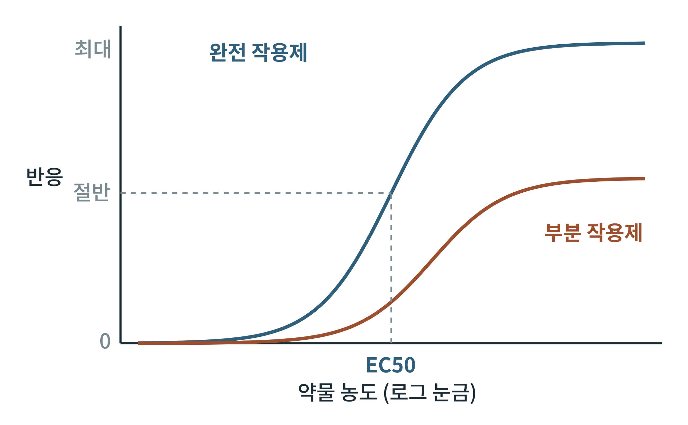
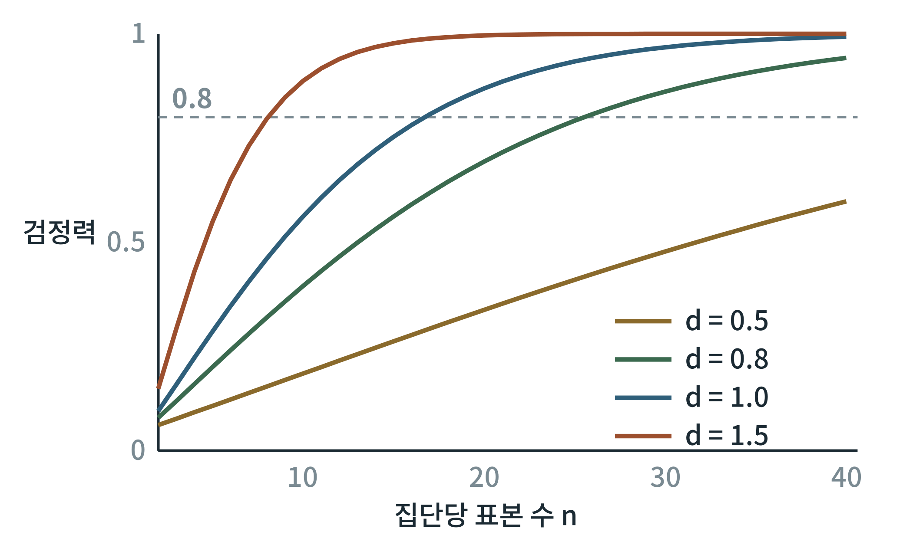

## 제3장 실험 검증의 설계와 통계

> **이 장의 출발점** 1920년대 영국 로담스테드 농업시험장(Rothamsted Experimental Station)에서 통계학자 로널드 피셔(Ronald A. Fisher)는 비료 시험 자료를 정리하다가, 밭의 어느 구획에 어떤 처리를 줄지를 사람이 고르면 결과가 처리 효과인지 고른 사람의 취향인지 가릴 수 없다는 결론에 이르렀다. 그의 해법은 처리를 **무작위로 배정**하는 것이었고, 이는 1935년 『실험의 설계』(The Design of Experiments)로 정리되었다(Fisher, 1935). 홍차에 우유를 먼저 넣었는지 나중에 넣었는지 맛으로 가려낸다는 부인의 일화도 이 책에서 실험 설계의 사례로 쓰였다(Salsburg, 2001 참조). 표적을 골랐다면 다음 질문은 "그 표적이 정말 살 빼는 효과의 원인인가"이고, 이 질문에 답하는 것은 데이터의 양보다 **실험을 설계하는 방식**이다. 이 장은 세포 시험, 동물 시험, 용량-반응, 표본 수, 다중 비교를 다룬다.

### 3.1 검증은 어떤 질문에 답하는가

표적 검증 실험은 세 질문에 답해야 한다. ① 약 후보가 표적에 **작용하는가**(세포 수준의 활성). ② 그 작용이 **체중과 대사의 변화로 이어지는가**(동물 수준의 효과). ③ 그 효과가 **표적을 통해서인가**(대조와 특이성). 세 질문은 순서가 있으나 한 번에 끝나지 않는다. 앞 단계의 결과가 다음 단계의 설계를 바꾸므로, 연구 계획서에 각 단계의 중단 기준을 미리 적는다(1장 1.5절).

### 3.2 시험 패널과 기대 곡선

표 3-1은 비만 표적 후보를 검증할 때 흔히 쓰는 시험의 구성과, 각 시험이 답하는 질문을 정리한 것이다. 수치 판정 기준은 표적과 시험계마다 다르므로 표에 적지 않고, 계획서에서 시험계별로 정한다.

**표 3-1. 표적 검증 시험 패널.**

| 단계 | 시험 | 측정값 | 답하는 질문 | 필수 대조 |
|---|---|---|---|---|
| 세포 | 이차 전달자 측정(cAMP 등) | 용량-반응 곡선, 효능과 역가 | 표적에 작용하는가 | 용매, 양성 대조 약물 |
| 세포 | 베타-어레스틴 모집 | 용량-반응 곡선 | 신호 경로 편향이 있는가 | 용매, 기준 작용제 |
| 세포 | 표적 없는 세포주 | 같은 측정 | 표적 특이적인가 | 모세포주(표적 미발현) |
| 세포/섬 | 포도당 의존 인슐린 분비 | 분비량 | 대사 효과로 이어지는가 | 용매, 양성 대조 |
| 동물 | 식이 유발 비만 모델 | 체중, 섭식량, 체성분 | 체중 감량 효과가 있는가 | 용매, 쌍섭식 대조 |
| 동물 | 포도당 내성 시험 | 혈당 곡선 | 대사 개선이 있는가 | 용매 |

표 3-1에서 읽을 점은 모든 시험에 **대조군**이 짝을 이룬다는 것이다. 용매 대조는 약 이외의 요인(용매, 주사 스트레스)의 효과를, 양성 대조는 시험계가 제대로 작동하는지를, 표적 없는 세포주는 효과가 표적을 통한 것인지를 가려 준다. 대조가 빠진 양성 결과는 해석할 수 없다.

### 3.3 용량-반응 곡선

세포 시험의 핵심 산출물은 약물 농도에 따른 반응을 나타낸 **용량-반응 곡선**이다. 결합 평형을 설명한 힐의 식(Hill, 1910)이 곡선 모양의 기초이며, 실무에서는 바닥, 꼭대기, 절반 효과 농도, 기울기의 네 모수를 갖는 **4모수 로지스틱 모형**을 적합한다(Motulsky & Christopoulos, 2004).

**그림 3-1. 용량-반응 곡선의 구조.** 파란 곡선은 완전 작용제, 주황 곡선은 최대 반응이 더 낮은 부분 작용제이다. 절반 효과 농도(EC50)는 완전 작용제가 최대 반응의 절반에 이르는 농도이다. 축의 수치는 개념 설명을 위한 것이며 실제 값이 아니다.



그림 3-1에서 읽을 점은 **역가**(potency)와 **효능**(efficacy)이 다른 양이라는 것이다. 역가는 곡선이 가로축에서 놓인 위치(EC50)이고, 효능은 곡선이 이르는 최대 높이이다. 부분 작용제는 오른쪽에 놓이면서 꼭대기도 낮다. 약 후보를 비교할 때 EC50만 보면 최대 효과가 낮은 후보를 좋게 평가하는 오류가 생긴다. 두 값을 모두 보고, 적합의 신뢰구간도 함께 적는다.

실무 요령은 다음과 같다. 농도는 로그 간격으로 최소 8~10점을 잡고, 곡선의 바닥과 꼭대기 양쪽 평탄부가 포함되도록 농도 범위를 정한다. 한 번의 실험은 독립 반복(다른 날, 다른 세포 계대)으로 최소 세 번 반복하고, 같은 평판의 중복 웰은 독립 반복으로 세지 않는다.

### 3.4 시험이 믿을 만한가: 시험계의 품질

시험계 자체가 흔들리면 약 후보의 평가도 흔들린다. 대량 선별 분야에서 쓰는 **Z′ 인자**(Z-prime factor)는 양성 대조와 음성 대조의 평균 차이를 두 대조의 변동 폭과 비교하여 시험계의 분리 능력을 하나의 수로 나타낸다(Zhang et al., 1999). 값이 클수록 두 대조가 잘 갈라진다. 해석 기준과 적용 한계는 원 논문과 Assay Guidance Manual(Markossian et al., 2004–)을 확인하고, 이 책에서는 계획서에 기준값을 미리 적도록 요구한다.

### 3.5 표본 수: 검정력 분석

동물 시험에서 가장 흔한 설계 오류는 표본 수가 너무 적어 진짜 효과를 놓치는 것이다. **검정력**(power)은 실제로 효과가 있을 때 그것을 통계적으로 찾아낼 확률이다. 관례적으로 80%(또는 90%)를 목표로 한다. 검정력은 효과 크기, 변동, 표본 수, 유의 수준에 따라 정해진다. 효과 크기는 코헨의 d(두 집단 평균 차이를 표준편차로 나눈 값)로 나타낸다(Cohen, 1988).

**그림 3-2. 집단당 표본 수에 따른 검정력.** 두 집단 비교(양측 t 검정, 유의 수준 0.05)에서 효과 크기 d별 검정력 곡선이다. 점선은 검정력 0.8이다.



그림 3-2에서 읽을 점은 효과 크기가 작을수록 곡선이 눕고, 같은 검정력을 얻는 데 훨씬 많은 표본이 필요하다는 것이다. 표 3-2는 같은 계산에서 얻은 집단당 표본 수이다.

**표 3-2. 집단당 필요 표본 수(양측 t 검정, 유의 수준 0.05).**

| 효과 크기 d | 검정력 80% | 검정력 90% |
|---|---|---|
| 0.5 | 64 | 86 |
| 0.8 | 26 | 34 |
| 1.0 | 17 | 23 |
| 1.5 | 9 | 11 |
| 2.0 | 6 | 7 |

표 3-2는 비중심 t 분포로 직접 계산한 값이다. 이 표를 쓸 때 주의할 점은 d를 **사전에 정해야 한다**는 것이다. 결과를 본 뒤 d를 추정하여 표본 수를 정당화하는 것은 검정력 분석이 아니다. 예비 시험이나 문헌의 변동을 근거로 d를 정하고, 그 근거를 계획서에 적는다. 또한 탈락 동물을 예상해 여유를 둔다.

### 3.6 무작위, 눈가림, 가짜 반복

피셔의 교훈은 동물 시험에도 그대로 적용된다. 동물을 군에 배정할 때는 난수표 등으로 **무작위** 배정하고, 측정하는 사람이 어느 군인지 모르게 **눈가림**한다. 케이지 효과도 중요하다. 같은 케이지의 동물은 서로 영향을 주므로 케이지를 단위로 배정하거나 분석에 반영해야 한다. 같은 동물에서 여러 번 잰 값, 같은 평판의 중복 웰을 독립 표본으로 세는 **가짜 반복**(pseudoreplication)은 유의 수준을 부풀린다. 독립 단위가 무엇인지 계획서에 명시한다.

동물 시험의 보고 지침으로 ARRIVE 2.0이 있다(Percie du Sert et al., 2020). 표본 수 산정, 무작위, 눈가림, 제외 기준을 보고 항목으로 요구하므로, 계획서 단계에서 이 목록을 채우면 논문 단계의 부담이 줄어든다.

### 3.7 다중 비교

여러 용량군, 여러 측정 변수를 한꺼번에 검정하면 우연히 유의한 결과가 나올 확률이 커진다. 대책은 두 가지이다. 첫째, **주 결과 변수 하나**를 사전에 정한다(예: 4주 체중 변화율). 둘째, 나머지 검정에는 다중 비교 보정을 적용한다. 본페로니(Bonferroni) 보정은 단순하나 보수적이고, 홀름(Holm, 1979) 방법은 같은 오류율 통제에서 더 강력하다. 많은 검정에서 거짓 발견의 비율을 통제하려면 벤자미니-호크베르크 방법이 쓰인다(Benjamini & Hochberg, 1995). 어떤 방법을 쓸지는 결과를 보기 전에 정한다.

### 3.8 실습 상자 ① 용량-반응 곡선 적합

**목표.** 세포 시험 자료에서 EC50, 최대 반응, 기울기와 그 신뢰구간을 얻는다.

**입력.** 농도(로그 간격 8~10점)별 반응, 독립 반복 3회 이상, 용매와 양성 대조 웰.

**도구.** 파이썬(scipy.optimize.curve_fit) 또는 R(drc 패키지). 함수·인수는 설치 버전의 문서로 확인한다.

**명령(요지).**
```
import numpy as np
from scipy.optimize import curve_fit
def f4(x, bottom, top, logec50, hill):
    return bottom + (top-bottom)/(1+10**((logec50-x)*hill))
popt, pcov = curve_fit(f4, logconc, resp, p0=[min(resp), max(resp), np.median(logconc), 1.0])
```

**출력.** 네 모수 추정값과 표준오차, 적합 곡선 그림.

**판정 기준.** 곡선의 바닥·꼭대기가 자료 범위에 포함되고, 독립 반복 간 logEC50 변동이 계획서에 정한 범위 이내이면 통과이다.

**흔한 실패.** 평탄부 없이 곡선 중간만 재는 것, 중복 웰을 독립 반복으로 세는 것, 양성 대조 없이 결과를 해석하는 것.

### 3.9 실습 상자 ② 표본 수 산정

**목표.** 동물 시험의 집단당 표본 수를 사전에 정당화한다.

**입력.** 기대 효과 크기 d(예비 시험 또는 문헌 근거), 유의 수준, 목표 검정력, 예상 탈락률.

**도구.** 파이썬(scipy의 비중심 t 분포) 또는 R(pwr 패키지).

**명령(요지).**
```
from scipy import stats
import numpy as np
def power(n, d, alpha=0.05):
    df = 2*n-2; nc = d*np.sqrt(n/2); tc = stats.t.ppf(1-alpha/2, df)
    return 1 - stats.nct.cdf(tc, df, nc) + stats.nct.cdf(-tc, df, nc)
n = next(k for k in range(2, 500) if power(k, 1.0) >= 0.8)
```

**출력.** 집단당 표본 수와 탈락 보정 후 최종 수.

**판정 기준.** d의 근거가 결과를 보기 전에 기록되어 있으면 통과이다.

**흔한 실패.** 결과를 보고 d를 정하는 것, 탈락을 고려하지 않는 것, 다중 용량군의 비교 수를 계산에 넣지 않는 것.

### 3.10 제1부 점검

1부(1~3장)의 끝에서 독자가 손에 쥐어야 할 산출물을 표 3-3에 정리한다. 이 다섯 가지가 갖춰져야 2부의 실무(서열, 구조, 설계)로 넘어간다.

**표 3-3. 1부 산출물과 점검 기준.**

| 산출물 | 담고 있어야 할 것 | 통과 기준 |
|---|---|---|
| ① 연구 계획서 한 장 | 질문, 중단 기준, 단계별 판정 | 단계마다 계속·중단 기준이 있다 |
| ② 표적 점수표 | 다섯 축 평가, 출처, 가중치 | 모든 칸에 출처 또는 "미확인" |
| ③ 발현·유전학 근거 | 단일세포 분석, 멘델 무작위화·공동 국소화 | 독립 두 자료 또는 방법에서 일치 |
| ④ 검증 설계 | 시험 패널, 대조, 주 결과 변수 | 대조·주 결과 변수가 사전 기록 |
| ⑤ 표본 수 산정서 | d의 근거, 탈락 보정 | 결과 이전에 작성 |

표 3-3에서 읽을 점은 다섯 산출물이 모두 **결과를 보기 전에** 작성되는 문서라는 것이다. 사전 기록이 연구 전체의 신뢰를 지탱한다.

### 이 장의 요점
검증은 작용 여부, 효과 여부, 표적 경유 여부의 세 질문에 답해야 하며, 모든 시험에 대조가 짝을 이룬다. 용량-반응 곡선은 역가와 효능을 함께 보고한다. 표본 수는 효과 크기를 사전에 정해 검정력 분석으로 산정하고, 무작위, 눈가림, 독립 단위 명시, 주 결과 변수 지정, 다중 비교 보정을 계획서에 사전 기록한다.

#### 참고문헌
Benjamini, Y., & Hochberg, Y. (1995). Controlling the false discovery rate: A practical and powerful approach to multiple testing. *Journal of the Royal Statistical Society: Series B, 57*(1), 289–300. https://doi.org/10.1111/j.2517-6161.1995.tb02031.x

Cohen, J. (1988). *Statistical power analysis for the behavioral sciences* (2nd ed.). Lawrence Erlbaum Associates.

Fisher, R. A. (1935). *The design of experiments*. Oliver & Boyd.

Hill, A. V. (1910). The possible effects of the aggregation of the molecules of haemoglobin on its dissociation curves. *The Journal of Physiology, 40*(Suppl.), iv–vii.

Holm, S. (1979). A simple sequentially rejective multiple test procedure. *Scandinavian Journal of Statistics, 6*(2), 65–70.

Markossian, S., Grossman, A., Baskir, H., et al. (Eds.). (2004–). *Assay guidance manual*. Eli Lilly & Company and the National Center for Advancing Translational Sciences. https://www.ncbi.nlm.nih.gov/books/NBK53196/

Motulsky, H., & Christopoulos, A. (2004). *Fitting models to biological data using linear and nonlinear regression: A practical guide to curve fitting*. Oxford University Press.

Percie du Sert, N., Hurst, V., Ahluwalia, A., Alam, S., Avey, M. T., Baker, M., et al. (2020). The ARRIVE guidelines 2.0: Updated guidelines for reporting animal research. *PLoS Biology, 18*(7), e3000410. https://doi.org/10.1371/journal.pbio.3000410

Salsburg, D. (2001). *The lady tasting tea: How statistics revolutionized science in the twentieth century*. W. H. Freeman.

Zhang, J.-H., Chung, T. D. Y., & Oldenburg, K. R. (1999). A simple statistical parameter for use in evaluation and validation of high throughput screening assays. *Journal of Biomolecular Screening, 4*(2), 67–73. https://doi.org/10.1177/108705719900400206
