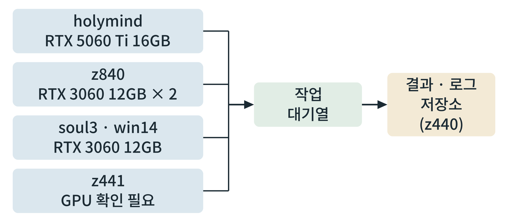

# 제2부 오픈 데이터, 오픈소스, 로컬 GPU 도구상자

이 부 전체가 도구 사용법이다. 각 장은 "무엇인가 → 왜 필요한가 → 설치·접속 → 최소 예제 → 흔한 실패 → 이용 조건 주의"의 순서로 쓴다. 도구의 버전과 인수 이름은 바뀌므로, 명령은 요지를 보이는 것이며 설치한 버전의 문서로 확인한다.

## 제4장 로컬 GPU 연구 환경 만들기

> **이 장의 출발점** 2007년 일리노이 대학 연구진은 그래픽 처리 장치(graphics processing unit, GPU)로 분자 모형 계산을 가속한 결과를 발표했다(Stone et al., 2007). 컴퓨터 게임의 화면을 그리던 칩이, 같은 계산을 수없이 되풀이하는 과학 계산에 맞는다는 것이 확인된 것이다. 그 뒤 분자동역학 프로그램은 GPU에서 돌아가도록 다시 쓰였고, 오픈소스 분자동역학 도구 OpenMM도 그 흐름에서 나왔다(Eastman et al., 2017). 이전에는 슈퍼컴퓨터 사용권이 있어야 하던 계산을 이제는 연구실 책상 밑의 컴퓨터가 한다. 이 장은 그 컴퓨터를 신약 설계용 계산 환경으로 만드는 방법을 서술한다. 어떤 계산에 GPU가 필요한지, 메모리(VRAM)가 작업의 크기를 어떻게 정하는지, 장비를 어떻게 나눠 쓰는지, 그리고 성능을 어떻게 직접 재는지를 다룬다.

### 4.1 GPU가 필요한 계산과 필요 없는 계산

GPU는 같은 연산을 수많은 데이터에 동시에 적용하는 일에 강하다. 표 4-1은 이 책에서 다루는 계산을 GPU 필요 여부로 나눈 것이다.

**표 4-1. 계산 종류별 GPU 필요 여부.**

| 계산 | GPU | 이유 |
|---|---|---|
| 분자동역학 | 필요 | 원자 수만 개의 힘을 짧은 간격으로 되풀이 계산 |
| 도킹 대량 스크리닝 | 필요(소규모는 CPU 가능) | 화합물 수만큼 독립 계산을 병렬로 수행 |
| 구조 예측(딥러닝 기반) | 필요 | 신경망 추론 |
| 생성모델·단백질 설계 | 필요 | 신경망 추론·학습 |
| 로컬 언어모델 | 필요 | 큰 신경망 추론, 메모리 요구가 큼 |
| 통계, 데이터 정리, 단일세포 기본 분석 | 불필요(일부 가속 가능) | 표 형태 자료 처리 |
| 신호 경로 상미분방정식 시뮬레이션 | 대체로 불필요 | 방정식 수가 작음 |

표 4-1에서 읽을 점은 GPU가 **모든 계산을 빠르게 하는 것이 아니라**, 병렬화가 되는 계산만 빠르게 한다는 것이다. 통계 분석에 GPU를 기대하면 실망한다. 계산마다 어느 장비에 보낼지 정하는 것이 4.4절의 일이다.

### 4.2 VRAM이 정하는 작업 규모

GPU 메모리(VRAM)는 한 번에 올릴 수 있는 작업의 크기를 정한다. 12 GB와 16 GB 카드에서 흔히 부딪히는 한계는 세 가지이다.

첫째, **분자동역학의 시스템 크기**이다. 막단백질은 지질 이중층과 물 분자까지 포함하므로 원자 수가 많아진다. 원자 수가 늘면 계산 시간이 늘고, 메모리도 늘어난다. 이 책은 한계 크기를 장비에서 직접 재어 표 4-3에 기록한다(4.5절).

둘째, **도킹의 배치 크기**이다. 한 번에 올리는 화합물 수를 줄이면 메모리를 덜 쓰지만, 전체 시간이 길어진다.

셋째, **모델 크기와 정밀도**이다. 신경망 모델의 가중치가 차지하는 메모리는 대략 매개변수 수에 정밀도별 바이트 수를 곱한 값이다. 16비트 부동소수점은 매개변수당 2바이트이므로 70억 매개변수 모델은 14 GB 안팎이고, 4비트 양자화는 매개변수당 약 0.5바이트이므로 같은 모델이 3.5 GB 안팎이다. 여기에 입력 길이에 따라 늘어나는 작업 메모리(활성값, 문맥 저장 공간)가 더해지므로 실제 요구는 이보다 크다. 같은 모델이라도 양자화하면 작은 카드에서 돌릴 수 있으나, 정확도가 약간 달라질 수 있으므로 정밀도를 바꾼 뒤에는 같은 시험 질문으로 결과를 비교한다.

### 4.3 운영체제, 드라이버, 컨테이너

이 책의 계산 환경은 **리눅스**를 기본으로 한다. 대부분의 과학 도구가 리눅스에서 먼저 지원되기 때문이다. 구성은 세 층이다. ① GPU 드라이버와 CUDA 도구 모음, ② 환경 관리(conda 또는 mamba), ③ 컨테이너(Docker 또는 Apptainer). 환경 관리는 도구마다 필요한 라이브러리 버전이 달라 충돌하는 문제를 막고, 컨테이너는 같은 환경을 다른 장비에서 그대로 재현하게 한다. 도구가 한 환경을 요구하면 환경 하나를 만들어 쓰는 것이 원칙이며, 한 환경에 모든 도구를 넣지 않는다.

### 4.4 장비 배치 전략

보유 장비는 GPU 종류와 VRAM이 다르므로 역할을 나눈다. 표 4-2는 배치 안이며, 실측 뒤에 확정한다.

**표 4-2. 장비별 GPU와 권장 작업(안).**

| 장비 | GPU | 권장 작업(안) |
|---|---|---|
| holymind | RTX 5060 Ti 16 GB | 구조 예측, 생성모델, 로컬 언어모델(가장 큰 VRAM) |
| z840 | RTX 3060 12 GB × 2 | 분자동역학 두 건 병렬, 도킹 대량 스크리닝 |
| soul3, win14 | RTX 3060 12 GB 각 1 | ADMET 예측, 소규모 도킹, 단일세포 분석 |
| z441 | 확인 필요 | 신호 모델 시뮬레이션, 환경 구성 시험 |
| z440 | 12 GB 1 | 서버 역할 유지(계산 금지), 데이터 서빙 |

**그림 4-1. 작업 흐름과 장비 연결.** 계산 장비들이 작업 대기열에서 일을 받아 처리하고, 결과와 로그는 한 저장소로 모인다.



그림 4-1에서 읽을 점은 **계산 장비와 저장소를 분리**한다는 것이다. 계산 장비는 실패하거나 재설치될 수 있으므로, 결과와 로그는 반드시 저장소(그림에서는 z440)로 옮겨 둔다. 작업은 대기열에 파일 한 줄(작업 명세)로 넣고, 장비가 한 건씩 가져가게 하면 야간 실행과 장애 복구가 쉬워진다. 실패한 작업은 로그에 남기고 다시 대기열에 넣는다.

### 4.5 실측하기

장비 성능은 사양표가 아니라 **실제 시험 계산**으로 정한다. 같은 시험 계산을 장비마다 돌려 표 4-3 양식으로 기록한다.

**표 4-3. 실측 결과 기록 양식.**

| 시험 작업 | 장비 | 입력 크기 | 소요 시간 | 최대 VRAM 사용 | 도구·버전 | 측정일 |
|---|---|---|---|---|---|---|
| 분자동역학 짧은 구간 | (장비명) | 원자 수 | (실측) | (실측) | (버전) | (날짜) |
| 도킹 1,000건 | (장비명) | 화합물 수 | (실측) | (실측) | (버전) | (날짜) |
| 구조 예측 1건 | (장비명) | 서열 길이 | (실측) | (실측) | (버전) | (날짜) |
| 언어모델 응답 | (장비명) | 모델·정밀도 | (실측) | (실측) | (버전) | (날짜) |

표 4-3에서 읽을 점은 모든 칸이 **실측값과 도구 버전, 날짜**를 요구한다는 것이다. 값이 없는 칸을 추정으로 채우지 않는다. 이 양식은 11장의 사례 계산에서도 같은 형태로 쓴다.

### 4.6 실습 상자 환경 점검과 벤치마크

**목표.** 장비의 GPU, 드라이버, 컨테이너, 계산 도구가 작동하는지 확인하고 기록한다.

**입력.** 리눅스 장비, 관리자 권한이 필요한 설치는 장비 관리자가 미리 수행.

**도구.** `nvidia-smi`, Docker 또는 Apptainer, 파이썬, OpenMM.

**명령(요지).**
```
nvidia-smi --query-gpu=name,memory.total,driver_version --format=csv
docker run --rm --gpus all <CUDA 이미지> nvidia-smi
python -c "import torch; print(torch.cuda.is_available())"
python -m openmm.testInstallation
```

**출력.** 장비의 GPU 이름, VRAM, 드라이버 버전, 컨테이너 안에서의 GPU 인식 여부, 도구 설치 시험 결과.

**판정 기준.** 컨테이너 안과 밖에서 같은 GPU가 보이고, 도구의 설치 시험이 오류 없이 끝나면 통과이다. 결과를 표 4-3 양식으로 저장한다.

**흔한 실패.** 드라이버와 CUDA 도구 모음의 버전 불일치, 컨테이너에서 GPU를 넘기는 옵션 누락, 한 환경에 도구를 모두 설치하여 버전이 충돌하는 것, 측정 없이 사양표만 믿는 것.

### 이 장의 요점
GPU는 병렬화되는 계산(분자동역학, 도킹, 구조 예측, 생성모델, 언어모델)만 빠르게 한다. VRAM은 시스템 크기, 배치 크기, 모델 크기를 정하며, 모델 가중치 메모리는 매개변수 수 × 정밀도별 바이트로 어림하되 작업 메모리가 더해진다. 환경은 리눅스, 환경 관리, 컨테이너의 세 층으로 구성하고, 계산 장비와 결과 저장소를 분리한다. 성능은 사양이 아니라 실측값, 도구 버전, 날짜를 적은 표로 정한다.

#### 참고문헌
Eastman, P., Swails, J., Chodera, J. D., McGibbon, R. T., Zhao, Y., Beauchamp, K. A., Wang, L.-P., Simmonett, A. C., Harrigan, M. P., Stern, C. D., Wiewiora, R. P., Brooks, B. R., & Pande, V. S. (2017). OpenMM 7: Rapid development of high performance algorithms for molecular dynamics. *PLoS Computational Biology, 13*(7), e1005659. https://doi.org/10.1371/journal.pcbi.1005659

Stone, J. E., Phillips, J. C., Freddolino, P. L., Hardy, D. J., Trabuco, L. G., & Schulten, K. (2007). Accelerating molecular modeling applications with graphics processors. *Journal of Computational Chemistry, 28*(16), 2618–2640. https://doi.org/10.1002/jcc.20829
