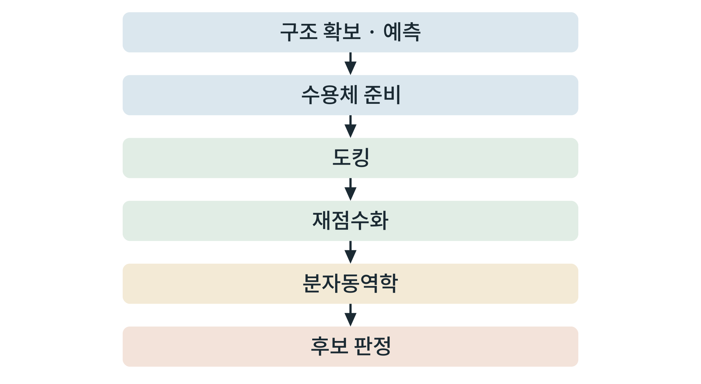

## 제6장 오픈소스 I: 구조, 도킹, 분자동역학

> **이 장의 출발점** 1982년 캘리포니아 대학 샌프란시스코(UCSF)의 어빙 쿤츠(Irwin D. Kuntz) 연구진은 작은 분자가 큰 분자의 홈에 맞는지를 기하학적으로 따지는 방법을 발표했다(Kuntz et al., 1982). 이것이 도킹(docking) 프로그램 DOCK의 출발이다. 열쇠 모양과 자물쇠 구멍의 모양을 맞춰 보는 단순한 발상이 수십 년 동안 다듬어져, 지금은 수용체 구조 하나에 화합물 수만~수백만 개를 맞춰 보는 일이 연구실 컴퓨터에서 이루어진다. 이 장은 구조를 확보하고, 화합물을 맞춰 보고(도킹), 맞춘 결과가 시간이 흐를 때도 유지되는지 확인하는(분자동역학) 세 단계의 오픈소스 도구를 다룬다.

### 6.1 구조 확보와 예측

도킹과 분자동역학은 수용체의 3차원 구조에서 시작한다. 구조는 세 경로로 얻는다. ① 실험 구조(5장의 PDB). ② 딥러닝 예측 구조(AlphaFold DB 등, 5장). ③ 직접 예측. 직접 예측에는 ColabFold를 로컬에서 돌리는 LocalColabFold(Mirdita et al., 2022), OpenFold, Boltz, Chai-1 등이 있고, 구조 비교와 유사 구조 검색에는 Foldseek, 서열 검색에는 MMseqs2가 쓰인다. 구조를 눈으로 확인하고 그림을 만드는 데는 PyMOL과 UCSF ChimeraX를 쓴다.

예측 구조를 쓸 때의 원칙은 **신뢰도를 먼저 보는 것**이다. 예측 도구는 위치별 신뢰도 점수를 함께 내므로, 결합 부위 잔기의 신뢰도가 낮으면 그 구조로 도킹한 결과를 신뢰하지 않는다. 또한 예측 구조는 리간드가 없는 형태이거나 막 환경이 없는 형태일 수 있어, 활성형과 비활성형의 구분이 필요한 G 단백질 연결 수용체에서는 실험 구조와 비교하여 입체 구조 상태를 확인한다.

### 6.2 도킹

도킹은 리간드를 수용체의 결합 부위에 놓을 수 있는 자세들을 만들고, 각 자세에 점수를 매긴다. 대표 도구는 AutoDock Vina(Trott & Olson, 2010), 그 GPU 구현인 AutoDock-GPU와 Uni-Dock, 신경망 점수를 쓰는 GNINA(McNutt et al., 2021), 확산 모형 기반의 DiffDock이다. 이 점수는 결합 자유에너지의 **어림값**이다. 순위를 매기는 데는 쓸 수 있으나, 실험 친화도를 그대로 예측하지 않는다.

도킹 결과를 해석하는 원칙은 세 가지이다. ① **재현 시험**: 구조에 이미 결합해 있는 리간드를 뽑아 다시 도킹하여, 원래 자세를 되찾는지 확인한다. 되찾지 못하면 그 설정은 이 표적에 쓸 수 없다. ② **음성 대조**: 알려진 비결합 분자(유인 분자)를 함께 도킹하여, 점수가 결합 분자와 구분되는지 본다. ③ **재점수화**: 한 도구의 순위만 믿지 않고, 다른 점수 함수로 상위 후보를 다시 점수화한다.

### 6.3 분자동역학

도킹은 한 장의 정지 사진이다. 분자동역학(molecular dynamics)은 원자들이 시간에 따라 움직이는 모습을 계산하여, 도킹 자세가 유지되는지, 결합 부위의 물과 지질이 어떻게 작용하는지를 본다. 오픈소스 도구로는 OpenMM(Eastman et al., 2017), GROMACS(Abraham et al., 2015)가 대표적이다. 궤적 분석에는 MDAnalysis(Michaud-Agrawal et al., 2011), 자유에너지 계산에는 OpenFE와 PLUMED, 힘장 매개변수에는 OpenFF를 쓴다.

수용체는 막단백질이므로 계에 **지질 이중층, 물, 이온**이 들어간다. 이 계를 만드는 데는 웹 서비스 CHARMM-GUI(Jo et al., 2008; Lee et al., 2016)가 널리 쓰이며, 만든 입력 파일을 GROMACS나 OpenMM에서 돌린다. 계산은 보통 에너지 최소화, 온도·압력 평형화, 생산 구간의 순서로 진행한다. 평형화 단계를 생략하면 결과가 계의 초기 상태에 좌우된다.

**표 6-1. 도구별 입력, 출력, GPU 요구.**

| 단계 | 도구 | 입력 | 출력 | GPU |
|---|---|---|---|---|
| 구조 예측 | LocalColabFold, OpenFold, Boltz, Chai-1 | 서열 | 구조, 신뢰도 점수 | 필요 |
| 구조 검색·비교 | Foldseek, MMseqs2 | 구조·서열 | 유사 구조·서열 목록 | 선택 |
| 시각화 | PyMOL, ChimeraX | 구조 파일 | 그림, 측정값 | 불필요 |
| 도킹 | Vina, AutoDock-GPU, Uni-Dock, GNINA, DiffDock | 수용체, 리간드, 결합 부위 상자 | 자세, 점수 | Vina는 CPU, 나머지는 필요하거나 선택 |
| 분자동역학 | OpenMM, GROMACS | 계 구성 파일 | 궤적, 에너지 | 필요 |
| 계 구성 | CHARMM-GUI(웹) | 수용체, 지질 선택 | 입력 파일 묶음 | 불필요 |
| 궤적·자유에너지 | MDAnalysis, OpenFE, PLUMED | 궤적 | 분석값 | 선택 |

**그림 6-1. 구조 기반 계산 파이프라인.** 구조를 확보한 뒤 준비 단계를 거쳐 도킹하고, 재점수화와 분자동역학으로 후보를 걸러 판정한다.



그림 6-1에서 읽을 점은 뒤로 갈수록 **계산이 비싸지고 후보 수가 줄어든다**는 것이다. 도킹은 많은 후보에 싸게, 분자동역학은 소수 후보에 비싸게 쓴다. 각 단계는 앞 단계의 오류를 걸러 내지 못하고 이어받으므로, 첫 단계(구조 준비)의 품질 점검이 가장 중요하다.

### 6.4 실습 상자 ① 수용체 구조 준비

**목표.** 내려받은 구조에서 누락 원자와 수소를 채우고 불필요한 분자를 정리하여 계산 입력을 만든다.

**입력.** 5장에서 내려받은 구조 파일.

**도구.** PDBFixer(OpenMM 계열), PyMOL 또는 ChimeraX(확인용).

**절차.** ① 구조를 눈으로 열어 리간드, 물, 첨가제, 여러 사슬 중 필요한 부분을 정한다. ② 누락된 잔기와 원자를 채우고 수소를 더한다(pH 조건을 기록). ③ 결합 부위 잔기의 양성자화 상태를 점검한다. ④ 준비한 구조와 변경 내용을 기록한다.

**판정 기준.** 구조 정리 과정의 모든 변경이 기록되고, 결합 부위 잔기에 누락이 없으면 통과이다.

**흔한 실패.** 원래 리간드를 지우지 않고 도킹하는 것, 수소를 안 더하는 것, 변경을 기록하지 않아 재현할 수 없는 것.

### 6.5 실습 상자 ② 도킹 한 번

**목표.** 한 리간드를 수용체에 도킹하고, 재현 시험으로 설정을 검증한다.

**입력.** 준비한 수용체 파일, 리간드 파일, 결합 부위 상자 좌표와 크기.

**도구.** AutoDock Vina(명령행). 옵션 이름은 설치한 버전의 문서로 확인한다.

**명령(요지).**
```
vina --receptor receptor.pdbqt --ligand ligand.pdbqt \
     --center_x <x> --center_y <y> --center_z <z> \
     --size_x <a> --size_y <b> --size_z <c> --out out.pdbqt
```

**출력.** 자세 파일과 점수.

**판정 기준.** 결정 구조의 원래 리간드를 같은 설정으로 도킹했을 때 원래 자세와 가까운 자세가 상위에 나오면 통과이다(일치 기준은 계획서에 미리 정한다).

**흔한 실패.** 상자를 결합 부위에 맞추지 않는 것, 재현 시험 없이 새 리간드의 점수를 믿는 것, 점수를 실험 친화도로 읽는 것.

### 6.6 실습 상자 ③ 짧은 분자동역학

**목표.** 작은 계를 에너지 최소화하고 짧게 돌려 계산이 작동하는지 확인한다.

**입력.** 용매가 포함된 계 구성 파일(막단백질은 CHARMM-GUI가 만든 입력).

**도구.** OpenMM.

**명령(요지, 가용성 시험용 용매 계).**
```
from openmm.app import *; from openmm import *; from openmm.unit import *
pdb = PDBFile('system.pdb')
ff = ForceField('amber14-all.xml', 'amber14/tip3pfb.xml')
system = ff.createSystem(pdb.topology, nonbondedMethod=PME, nonbondedCutoff=1*nanometer, constraints=HBonds)
integ = LangevinMiddleIntegrator(300*kelvin, 1/picosecond, 0.004*picoseconds)
sim = Simulation(pdb.topology, system, integ); sim.context.setPositions(pdb.positions)
sim.minimizeEnergy()
sim.reporters.append(StateDataReporter('log.csv', 1000, step=True, potentialEnergy=True, temperature=True))
sim.step(10000)
```

**출력.** 에너지와 온도 기록 파일.

**판정 기준.** 에너지가 발산하지 않고 온도가 설정값 주위에서 유지되면 통과이다. 시간과 VRAM 사용량을 4장 표 4-3에 기록한다.

**흔한 실패.** 막단백질에 용매 전용 힘장을 쓰는 것, 평형화를 생략하는 것, 짧은 한 번의 궤적으로 결론을 내리는 것(반복 실행과 여러 초기 조건이 필요하다).

### 이 장의 요점
구조는 실험 구조, 예측 구조, 직접 예측의 세 경로로 얻으며 예측 구조는 위치별 신뢰도를 먼저 본다. 도킹은 점수가 어림값이므로 재현 시험, 음성 대조, 재점수화로 검증하며, 분자동역학은 자세의 유지와 환경을 확인한다. 뒤 단계일수록 계산이 비싸고 후보 수는 줄어든다. 모든 단계의 변경과 설정을 기록해 재현할 수 있게 한다.

#### 참고문헌
Abraham, M. J., Murtola, T., Schulz, R., Páll, S., Smith, J. C., Hess, B., & Lindahl, E. (2015). GROMACS: High performance molecular simulations through multi-level parallelism from laptops to supercomputers. *SoftwareX, 1–2*, 19–25. https://doi.org/10.1016/j.softx.2015.06.001

Eastman, P., Swails, J., Chodera, J. D., McGibbon, R. T., Zhao, Y., Beauchamp, K. A., et al. (2017). OpenMM 7: Rapid development of high performance algorithms for molecular dynamics. *PLoS Computational Biology, 13*(7), e1005659. https://doi.org/10.1371/journal.pcbi.1005659

Jo, S., Kim, T., Iyer, V. G., & Im, W. (2008). CHARMM-GUI: A web-based graphical user interface for CHARMM. *Journal of Computational Chemistry, 29*(11), 1859–1865. https://doi.org/10.1002/jcc.20945

Kuntz, I. D., Blaney, J. M., Oatley, S. J., Langridge, R., & Ferrin, T. E. (1982). A geometric approach to macromolecule-ligand interactions. *Journal of Molecular Biology, 161*(2), 269–288. https://doi.org/10.1016/0022-2836(82)90153-X

Lee, J., Cheng, X., Swails, J. M., Yeom, M. S., Eastman, P. K., Lemkul, J. A., et al. (2016). CHARMM-GUI input generator for NAMD, GROMACS, AMBER, OpenMM, and CHARMM/OpenMM simulations using the CHARMM36 additive force field. *Journal of Chemical Theory and Computation, 12*(1), 405–413. https://doi.org/10.1021/acs.jctc.5b00935

McNutt, A. T., Francoeur, P., Aggarwal, R., Masuda, T., Meli, R., Ragoza, M., Sunseri, J., & Koes, D. R. (2021). GNINA 1.0: Molecular docking with deep learning. *Journal of Cheminformatics, 13*, 43. https://doi.org/10.1186/s13321-021-00522-2

Michaud-Agrawal, N., Denning, E. J., Woolf, T. B., & Beckstein, O. (2011). MDAnalysis: A toolkit for the analysis of molecular dynamics simulations. *Journal of Computational Chemistry, 32*(10), 2319–2327. https://doi.org/10.1002/jcc.21787

Mirdita, M., Schütze, K., Moriwaki, Y., Heo, L., Ovchinnikov, S., & Steinegger, M. (2022). ColabFold: Making protein folding accessible to all. *Nature Methods, 19*, 679–682. https://doi.org/10.1038/s41592-022-01488-1

Trott, O., & Olson, A. J. (2010). AutoDock Vina: Improving the speed and accuracy of docking with a new scoring function, efficient optimization, and multithreading. *Journal of Computational Chemistry, 31*(2), 455–461. https://doi.org/10.1002/jcc.21334
