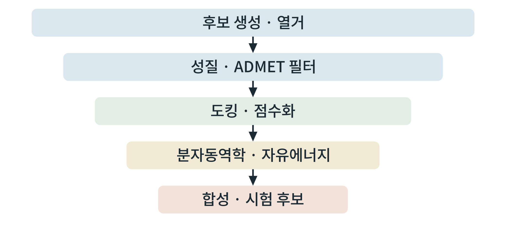

## 제7장 오픈소스 II: 화학정보, AI 설계, 신호 모델링

> **이 장의 출발점** 1988년 데이비드 와이닝어(David Weininger)는 분자를 한 줄의 글자로 적는 표기법 SMILES(Simplified Molecular-Input Line-Entry System)를 발표했다(Weininger, 1988). 고리와 가지가 있는 분자의 그림이 `CC(=O)Oc1ccccc1C(=O)O` 같은 문자열로 바뀌자, 분자를 파일에 저장하고 검색하고 컴퓨터가 읽는 일이 간단해졌다. 오늘의 화학정보 도구와 인공지능 설계 도구는 모두 이 "분자를 글자나 숫자로 바꾸는" 일에서 출발한다. 이 장은 분자를 다루는 기본 도구(RDKit), 활성과 성질을 예측하고 후보를 설계하는 도구, 단백질·펩타이드를 설계하는 도구, 그리고 신호 경로를 방정식으로 모델링하는 도구를 다룬다.

### 7.1 화학정보: RDKit와 Open Babel

화학정보(cheminformatics)의 기본 도구는 오픈소스 RDKit이다. SMILES를 읽어 분자 객체로 만들고, 분자량과 지방친화도(logP) 같은 성질, 구조 지문(fingerprint), 부분 구조 검색, 유사도 계산을 수행한다. Open Babel은 파일 형식 변환에 강하다. 7장의 모든 도구는 분자 표기의 정규화(같은 분자를 같은 문자열로 만드는 일)에서 시작하므로, 자료를 합칠 때 SMILES를 표준형으로 통일하고 입체 화학과 염의 처리 규칙을 기록한다.

### 7.2 예측과 설계

**성질·활성 예측.** DeepChem은 화학 자료에 신경망을 적용하는 틀을, Chemprop은 분자를 그래프로 보고 성질을 예측하는 방향성 메시지 전달 신경망을 제공한다(Yang et al., 2019). ADMET-AI는 흡수, 분포, 대사, 배설, 독성(ADMET) 성질을 예측하는 도구이다(Swanson et al., 2024). 예측 모형을 쓸 때의 원칙은 **학습 자료의 범위 안에서만 믿는 것**이다. 학습 자료와 구조가 크게 다른 분자에 대한 예측은 신뢰할 수 없고, 같은 자료에서 무작위로 나눈 시험 집합의 성능은 새로운 골격에서의 성능보다 낙관적이다. 평가는 **골격 단위 분할** 같은 보수적 방식으로 한다.

**합성 경로.** AiZynthFinder는 후보 분자의 합성 경로를 역방향으로 탐색한다. 제안된 경로는 화학자가 검토해야 하는 출발점이다.

**생성 설계.** REINVENT 4는 강화학습과 생성모델로 조건을 만족하는 새 분자를 만든다(Loeffler et al., 2024). 생성모델이 낸 분자는 합성 가능성, 특허 침해 가능성, 기존 약물과의 유사성을 별도로 점검해야 한다.

### 7.3 단백질·펩타이드 설계

비만 치료제는 GLP-1 계열처럼 펩타이드가 많으므로, 단백질 설계 도구가 중요하다. RFdiffusion은 확산 모형으로 단백질 골격을 생성하고(Watson et al., 2023), ProteinMPNN은 골격에 맞는 서열을 설계한다(Dauparas et al., 2022). BindCraft는 표적에 결합하는 단백질을 설계하는 흐름을 제공한다. 이들은 결합제 후보를 제시하는 도구이며, 설계된 서열이 실제로 접히고 결합하는지는 구조 예측 재검증과 실험으로 확인해야 한다.

### 7.4 신호 모델링

2권에서 다룬 신호 경로를 정량 모형으로 만들려면 상미분방정식으로 쓴다. COPASI(Hoops et al., 2006)는 그래픽 환경에서 모형을 만들고 시뮬레이션과 매개변수 추정을 수행한다. tellurium은 Antimony라는 읽기 쉬운 문법으로 모형을 쓰고 파이썬에서 돌린다(Choi et al., 2018). BioNetGen은 수용체처럼 결합 상태가 조합적으로 늘어나는 계를 규칙으로 쓰고, Virtual Cell은 공간 구조를 포함한 모형에 쓰이며, JAX·PyTorch 기반 미분방정식 도구는 모형을 자동 미분하여 매개변수를 효율적으로 추정하게 한다.

모형 구축의 순서는 ① 경로 그림에서 반응 목록으로, ② 반응 속도식과 매개변수로, ③ 실험 자료에 대한 적합과 불확실성 평가로 이어진다. 매개변수가 자료로 결정되지 않는(식별 불가능한) 경우를 점검하는 것이 핵심이며, 10장에서 사례로 다룬다.

**표 7-1. 도구별 용도와 GPU 요구.**

| 영역 | 도구 | 용도 | GPU |
|---|---|---|---|
| 화학정보 | RDKit, Open Babel | 분자 표기, 성질, 유사도, 형식 변환 | 불필요 |
| 예측 | DeepChem, Chemprop, ADMET-AI | 성질·ADMET·활성 예측 | 학습에는 필요, 추론은 대체로 선택 |
| 합성 | AiZynthFinder | 합성 경로 탐색 | 선택 |
| 생성 | REINVENT 4 | 분자 생성 | 필요 |
| 단백질 설계 | RFdiffusion, ProteinMPNN, BindCraft | 골격·서열·결합제 설계 | 필요 |
| 신호 모델링 | COPASI, tellurium, BioNetGen, Virtual Cell | 상미분방정식, 규칙 기반 모형 | 불필요 |
| 미분 가능 모델링 | JAX, PyTorch | 자동 미분, 매개변수 추정 | 선택 |

**그림 7-1. 설계에서 선별까지의 깔때기.** 생성·열거한 많은 후보를 값싼 필터에서 비싼 계산으로 단계적으로 걸러 소수의 합성·시험 후보로 좁힌다.



그림 7-1에서 읽을 점은 6장의 원리가 그대로 이어진다는 것이다. **싼 계산이 먼저, 비싼 계산이 나중**이다. 각 단계의 기준은 결과를 보기 전에 정하고, 단계마다 탈락한 후보 수를 기록하여 깔때기가 편향되지 않았는지 점검한다.

### 7.5 실습 상자 ① 분자 표현과 성질 계산

**목표.** SMILES에서 분자 객체를 만들고 성질을 계산한다.

**입력.** 분자 한 개의 SMILES(예제는 일반적인 아스피린).

**도구.** 파이썬, RDKit.

**명령(요지).**
```
from rdkit import Chem
from rdkit.Chem import Descriptors, Crippen
m = Chem.MolFromSmiles('CC(=O)Oc1ccccc1C(=O)O')
print(Chem.MolToSmiles(m), Descriptors.MolWt(m), Crippen.MolLogP(m))
```

**출력.** 표준형 SMILES, 분자량, 계산 logP.

**판정 기준.** 분자 객체가 만들어지고(None이 아님) 표준형이 같은 분자의 다른 표기에서도 같으면 통과이다.

**흔한 실패.** 읽기 실패(None)를 확인하지 않는 것, 입체 화학과 염을 처리하지 않고 중복 분자를 남기는 것.

### 7.6 실습 상자 ② 활성 예측의 평가

**목표.** 5장에서 정리한 활성 자료로 간단한 예측 모형을 만들고, 골격 단위 분할로 평가한다.

**입력.** 정리된 활성 자료(화합물 SMILES, 단일 측정 종류의 활성값).

**도구.** RDKit, 임의의 기계학습 라이브러리(예: scikit-learn) 또는 Chemprop.

**절차.** ① SMILES를 표준화하고 지문으로 변환한다. ② 골격(Bemis-Murcko) 단위로 학습 집합과 시험 집합을 나눈다. ③ 모형을 학습하고 시험 집합에서 오차와 순위 상관을 계산한다. ④ 무작위 분할의 성능과 비교한다.

**판정 기준.** 분할 방식과 성능이 함께 기록되고, 골격 분할 성능이 무작위 분할보다 낮으면 그 차이를 결과에 보고하면 통과이다.

**흔한 실패.** 무작위 분할 성능만 보고하는 것, 시험 집합이 학습 집합과 같은 골격을 공유하는 것, 측정 종류를 섞는 것.

### 7.7 실습 상자 ③ 미분방정식 모델 한 개

**목표.** 리간드-수용체 결합의 가장 단순한 모형을 쓰고 시뮬레이션한다.

**입력.** 반응식과 설명용 매개변수(아래 값은 모형 작동 확인용 가상 값이며 실제 측정값이 아니다).

**도구.** 파이썬, tellurium.

**명령(요지).**
```
import tellurium as te
r = te.loada('''
  L + R -> LR; kon*L*R
  LR -> L + R; koff*LR
  kon = 1; koff = 0.1; L = 1; R = 1; LR = 0
''')
res = r.simulate(0, 50, 200)
```

**출력.** 시간에 따른 L, R, LR 곡선.

**판정 기준.** 질량 보존(R+LR가 일정)이 유지되고 평형에서 LR/(L·R)이 kon/koff에 가까우면 통과이다.

**흔한 실패.** 단위가 서로 다른 매개변수를 섞는 것, 자료 없이 매개변수를 정하고 결론을 내리는 것.

### 이 장의 요점
RDKit이 분자 표기와 성질 계산의 기본이며, 예측 모형은 학습 자료 범위 안에서만 믿고 골격 단위 분할로 평가한다. 생성 설계와 단백질 설계는 후보를 제안하는 도구이며 합성 가능성, 독창성, 구조 재검증, 실험 확인이 따라야 한다. 신호 경로는 상미분방정식으로 쓰고 매개변수의 식별 가능성을 점검한다. 설계에서 선별까지는 싼 계산이 먼저인 깔때기로 운영한다.

#### 참고문헌
Choi, K., Medley, J. K., König, M., Stocking, K., Smith, L., Gu, S., & Sauro, H. M. (2018). Tellurium: An extensible Python-based modeling environment for systems and synthetic biology. *Biosystems, 171*, 74–79. https://doi.org/10.1016/j.biosystems.2018.07.006

Dauparas, J., Anishchenko, I., Bennett, N., Bai, H., Ragotte, R. J., Milles, L. F., et al. (2022). Robust deep learning–based protein sequence design using ProteinMPNN. *Science, 378*(6615), 49–56. https://doi.org/10.1126/science.add2187

Hoops, S., Sahle, S., Gauges, R., Lee, C., Pahle, J., Simus, N., et al. (2006). COPASI: A COmplex PAthway SImulator. *Bioinformatics, 22*(24), 3067–3074. https://doi.org/10.1093/bioinformatics/btl485

Loeffler, H. H., He, J., Tibo, A., Janet, J. P., Voronov, A., Mervin, L. H., & Engkvist, O. (2024). Reinvent 4: Modern AI–driven generative molecule design. *Journal of Cheminformatics, 16*, 20. https://doi.org/10.1186/s13321-024-00812-5

Swanson, K., Walther, P., Leitz, J., Mukherjee, S., Wu, J. C., Shivnaraine, R. V., & Zou, J. (2024). ADMET-AI: A machine learning ADMET platform for evaluation of large-scale chemical libraries. *Bioinformatics, 40*(7), btae416. https://doi.org/10.1093/bioinformatics/btae416

Watson, J. L., Juergens, D., Bennett, N. R., Trippe, B. L., Yim, J., Eisenach, H. E., et al. (2023). De novo design of protein structure and function with RFdiffusion. *Nature, 620*, 1089–1100. https://doi.org/10.1038/s41586-023-06415-8

Weininger, D. (1988). SMILES, a chemical language and information system. 1. Introduction to methodology and encoding rules. *Journal of Chemical Information and Computer Sciences, 28*(1), 31–36. https://doi.org/10.1021/ci00057a005

Yang, K., Swanson, K., Jin, W., Coley, C., Eiden, P., Gao, H., et al. (2019). Analyzing learned molecular representations for property prediction. *Journal of Chemical Information and Modeling, 59*(8), 3370–3388. https://doi.org/10.1021/acs.jcim.9b00237
