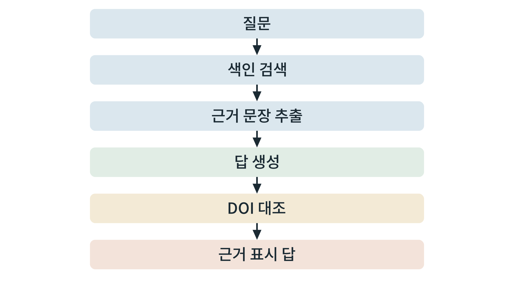

## 제8장 로컬 언어모델과 문헌 DB 활용

> **이 장의 출발점** 대규모 언어모델은 그럴듯한 문장을 쓰는 데 뛰어나지만, 존재하지 않는 논문을 만들어 내는 일이 있다. 이를 자연어 생성 분야에서는 환각(hallucination)이라 부르며, 그 원인과 유형을 정리한 종합 논문이 있다(Ji et al., 2023). 2020년 연구진은 모델이 답하기 전에 외부 문서를 먼저 찾아 그 내용을 근거로 쓰게 하는 **검색 증강 생성**(retrieval-augmented generation, RAG)을 제안했다(Lewis et al., 2020). 신약 연구에서 이 문제는 곧바로 책임의 문제가 된다. 인용이 틀린 보고서는 후속 연구를 잘못된 길로 보낸다. 이 장은 본 책이 수집한 문헌 DB(obesepharma_db)를 로컬 언어모델과 연결하되, **모든 답이 근거 문장과 서지로 되돌아가 확인되도록** 하는 방법을 서술한다.

### 8.1 obesepharma_db의 구조

obesepharma_db는 비만 치료 약물의 생리학, 세포학, 생화학, 유전학, 단백질학 논문의 서지, 초록, 전문, PDF를 모은 DB이다. 구조는 크게 네 표로 이해하면 된다. ① 논문 표(식별자, DOI, 제목, 저자, 연도, 초록), ② 전문 표(논문별 본문), ③ PDF 표(원본 파일과 해시), ④ 검색·수집 이력 표(어떤 질의로 어떤 시점에 수집했는지). 논문마다 하나의 식별자를 두고 DOI를 열쇠로 외부 서지 자료와 대조한다. 수집 규모와 수집 현황은 계속 바뀌므로, 책의 서술에는 숫자를 쓰지 않고 실습 때 `SELECT COUNT(*)`로 직접 확인한다.

질의 예시는 다음과 같다. "GLP1R 편향 작용제를 다룬 논문"은 제목·초록의 키워드와 연도로 좁히고, "특정 변이와 체중의 관계"는 전문에서 해당 문장을 찾아 읽는다. 키워드 검색만으로 부족하면 8.3절의 벡터 검색을 함께 쓴다.

### 8.2 로컬 언어모델 서비스

로컬 언어모델은 장비의 GPU에서 모델을 직접 돌리는 방식이다. 논문 원고나 미공개 자료를 외부 서비스에 보내지 않아도 된다는 점이 장점이고, 모델 크기가 VRAM에 묶인다는 점이 한계이다. 서비스 도구는 Ollama(간편한 설치와 명령행), vLLM(여러 요청을 효율적으로 처리하는 서버)이 대표적이다. 질문과 문서 조각을 숫자 벡터로 바꾸는 **임베딩 모델**은 언어모델과 별도로 선택한다.

**표 8-1. 모델 크기별 가중치 메모리 어림값.**

| 매개변수 수 | 16비트(매개변수당 2바이트) | 8비트(1바이트) | 4비트(약 0.5바이트) |
|---|---|---|---|
| 30억 | 약 6 GB | 약 3 GB | 약 1.5 GB |
| 70억 | 약 14 GB | 약 7 GB | 약 3.5 GB |
| 130억 | 약 26 GB | 약 13 GB | 약 6.5 GB |
| 700억 | 약 140 GB | 약 70 GB | 약 35 GB |

표 8-1은 매개변수 수에 바이트 수를 곱한 **가중치 메모리의 어림값**이며, 입력 길이에 따른 작업 메모리가 추가로 필요하다(4장 4.2절). 12 GB와 16 GB 카드에서는 중간 크기 모델을 양자화하여 쓰는 것이 현실적이고, 큰 모델은 여러 장에 나누거나 쓰지 않는다. 정밀도를 낮추면 답이 달라질 수 있으므로 같은 시험 질문 묶음으로 비교한 뒤 채택한다.

### 8.3 검색 증강 생성

RAG는 네 단계로 이루어진다. ① **쪼개기**: 전문을 문단 단위의 조각으로 나누고, 조각마다 논문 식별자와 위치를 붙인다. ② **색인**: 조각을 임베딩 벡터로 바꾸어 벡터 색인에 저장한다. ③ **검색**: 질문을 같은 방식으로 벡터로 바꾸어 가장 가까운 조각을 찾는다. ④ **답 생성**: 찾은 조각을 모델의 입력에 넣고, 조각에 있는 내용으로만 답하게 한다.

**그림 8-1. 문헌 질의응답 흐름.** 질문에서 색인 검색으로 근거 문장을 찾고, 그 근거로 답을 만든 뒤 DOI를 대조하여 근거가 표시된 답으로 내보낸다.



그림 8-1에서 읽을 점은 **답 생성 뒤에 확인 단계가 있다**는 것이다. 모델이 쓴 문장은 근거 조각과 대조할 수 있어야 하고, 인용한 서지는 DOI로 확인되어야 한다.

### 8.4 환각을 막는 절차

환각을 막는 습관을 절차로 만든다. ① 모델에게 **근거 조각 밖의 내용은 쓰지 말고, 근거가 없으면 모른다고 답하라**고 지시한다. ② 모든 문장에 근거 조각의 식별자(논문, 위치)를 붙이게 한다. ③ 인용한 DOI가 실제로 존재하는지, 제목과 저자와 연도가 일치하는지를 외부 서지 서비스(예: Crossref)에 조회하여 자동으로 대조한다. ④ 대조에 실패한 인용은 답에서 삭제한다. ⑤ 사람이 근거 조각을 직접 읽어 보고 문장이 그 조각의 내용을 넘어서지 않는지 확인한다. 자동 대조는 서지의 존재를 확인할 뿐 내용의 정확성까지 보증하지 않으므로 ⑤를 생략하지 않는다.

### 8.5 실습 상자 ① 색인 만들기

**목표.** 전문 조각을 만들어 벡터 색인에 저장한다.

**입력.** obesepharma_db에서 뽑은 논문 전문(식별자, DOI, 본문).

**도구.** 파이썬, 임베딩 라이브러리(예: sentence-transformers), 벡터 색인(예: FAISS). 모델 이름은 사용 허가와 크기를 확인하여 고른다.

**명령(요지).**
```
from sentence_transformers import SentenceTransformer
import faiss, numpy as np
chunks = [...]            # (논문식별자, 위치, 텍스트) 목록
model = SentenceTransformer('<임베딩 모델 이름>')
vecs = model.encode([c[2] for c in chunks], normalize_embeddings=True)
index = faiss.IndexFlatIP(vecs.shape[1]); index.add(np.asarray(vecs, dtype='float32'))
```

**출력.** 색인과 조각 목록(논문 식별자와 위치).

**판정 기준.** 알려진 문장의 일부를 질문으로 넣으면 그 문장이 속한 조각이 상위에 검색되면 통과이다.

**흔한 실패.** 조각마다 출처를 붙이지 않는 것, 너무 긴 조각으로 근거가 흐려지는 것, 임베딩 모델을 바꾸고 색인을 다시 만들지 않는 것.

### 8.6 실습 상자 ② 질문하고 근거 문장 확인하기

**목표.** 질문에 대한 답과 근거 조각을 받고, 인용 DOI를 대조한다.

**입력.** 질문, 8.5절의 색인, 로컬 언어모델 서비스.

**도구.** Ollama 또는 vLLM의 서버 주소, Crossref의 DOI 조회(`https://api.crossref.org/works/<DOI>`).

**절차.** ① 질문으로 상위 조각을 찾는다. ② 조각만을 근거로 답하도록 지시문을 만들어 모델에 보낸다. ③ 답의 모든 인용 DOI를 Crossref에 조회하여 제목, 저자, 연도가 DB와 일치하는지 확인한다. ④ 일치하지 않는 인용은 삭제하고 기록한다. ⑤ 근거 조각을 사람이 읽고 답이 조각을 넘어서지 않는지 확인한다.

**판정 기준.** 답의 모든 문장에 근거 조각이 있고 모든 인용이 대조를 통과하면 통과이다.

**흔한 실패.** 근거 없는 문장을 두는 것, 자동 대조만 믿고 사람의 확인을 생략하는 것, 모델이 만든 서지를 DB에 되먹이는 것(오염).

### 이 장의 요점
로컬 언어모델은 자료를 외부로 보내지 않는 장점이 있으나 VRAM이 크기를 정한다. 문헌 질의응답은 쪼개기, 색인, 검색, 근거 기반 답 생성의 RAG로 구성하고, 모든 문장에 근거 조각을 붙인다. 환각은 근거 밖 서술 금지, 근거 표시, DOI 자동 대조, 실패 인용 삭제, 사람의 확인으로 막는다.

#### 참고문헌
Ji, Z., Lee, N., Frieske, R., Yu, T., Su, D., Xu, Y., Ishii, E., Bang, Y. J., Madotto, A., & Fung, P. (2023). Survey of hallucination in natural language generation. *ACM Computing Surveys, 55*(12), Article 248. https://doi.org/10.1145/3571730

Lewis, P., Perez, E., Piktus, A., Petroni, F., Karpukhin, V., Goyal, N., et al. (2020). Retrieval-augmented generation for knowledge-intensive NLP tasks. *Advances in Neural Information Processing Systems, 33*, 9459–9474.
