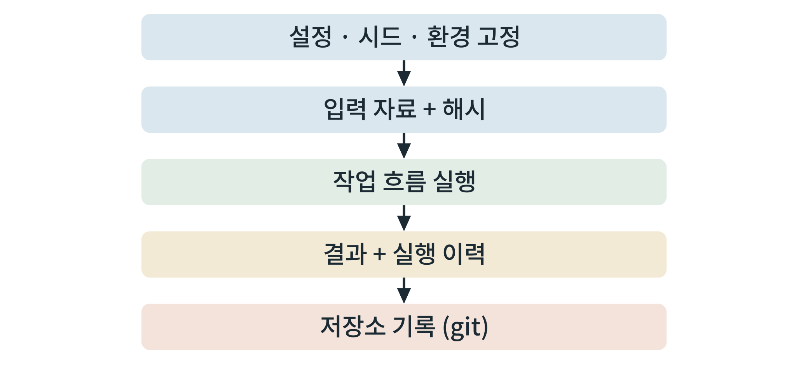

## 제9장 재현 가능한 연구 흐름

> **이 장의 출발점** 2016년 『네이처』(Nature)는 연구자 1,500명을 대상으로 한 설문 결과를 실었다. 응답자의 대다수가 다른 연구자의 실험을 재현하려다 실패한 경험이 있다고 답했고, 상당수는 자신의 실험도 재현하지 못한 적이 있다고 했다(Baker, 2016). 계산 연구라고 다르지 않다. 도구 버전이 달라지고, 난수가 다르고, 입력 파일이 슬쩍 바뀌어서 같은 분석이 다른 결과를 내는 일은 흔하다. 계산 연구의 재현성을 높이는 실용 규칙은 이미 정리되어 있다(Sandve et al., 2013). 이 장은 그 규칙을 이 책의 도구상자에 맞게 구체화한다. 작업 흐름 도구, 버전 관리, 환경 고정, 난수 시드, 입력 해시, 실행 이력, 파일 이름 규칙을 다룬다.

### 9.1 재현 가능하다는 것

재현 가능한 연구 흐름이란 **같은 입력과 같은 환경에서 같은 결과를 다시 얻을 수 있고, 다른 사람이 그 입력과 환경을 구할 수 있는 것**이다. 필요한 조건은 다섯 가지이다. ① 입력 자료가 고정되어 있고 해시로 확인된다(5장). ② 도구 버전과 환경이 고정되어 있다(4장). ③ 난수를 쓰는 계산은 시드를 기록한다. ④ 분석 단계가 사람의 손이 아니라 스크립트와 작업 흐름으로 정의되어 있다. ⑤ 실행 이력이 남는다.

### 9.2 작업 흐름 도구

여러 단계를 이어서 돌리는 분석은 작업 흐름 도구로 정의한다. Snakemake는 파이썬 기반으로 규칙(입력 → 출력 → 명령)을 적으면 필요한 단계만 다시 실행한다(Mölder et al., 2021). Nextflow는 데이터 흐름 방식으로 여러 장비와 컨테이너에서 흐름을 실행하는 데 강하다(Di Tommaso et al., 2017). 이 책은 소규모에는 Snakemake를 권한다. 작업 흐름 도구의 이점은 **어느 결과가 어느 입력에서 나왔는지가 코드로 남는다**는 것이다.

### 9.3 버전 관리와 환경 고정

코드, 설정, 작업 흐름 정의는 git으로 관리한다. 큰 자료 파일은 git에 넣지 않고 해시와 경로만 기록한다. 환경은 conda(또는 mamba) 환경 정의 파일과 컨테이너 이미지의 식별자로 고정한다. 결과를 낸 시점의 git 커밋 식별자를 결과 파일 옆에 기록하면, 나중에 그 결과를 낸 코드를 정확히 되찾는다.

### 9.4 난수와 결과 기록

난수를 쓰는 단계(데이터 분할, 모형 초기화, 분자동역학의 초기 속도)는 시드를 설정 파일에 두고 결과에 기록한다. 같은 시드로 같은 결과가 나오지 않는 계산(예: GPU 병렬 합산의 순서 의존)도 있으므로, 이 경우에는 **여러 시드로 반복하여 분포를 보고**한다.

결과 기록은 두 가지로 한다. 하나는 **실행 이력 표**이다. 실행마다 한 줄에 실행 일시, git 커밋, 입력 해시, 설정 파일, 장비, 도구 버전, 소요 시간, 결과 경로를 적는다. 다른 하나는 **파일 이름 규칙**이다. 이름에 단계, 대상, 버전 또는 날짜를 넣고 밑줄 대신 하이픈이나 붙여쓰기를 쓴다. 같은 이름으로 덮어쓰지 않는다.

**표 9-1. 재현성 점검표.**

| 항목 | 점검 내용 | 통과 기준 |
|---|---|---|
| 입력 | 원본 보존, 출처·날짜·해시 기록 | 해시가 일치한다 |
| 환경 | 도구 버전, 컨테이너 식별자 | 환경 정의로 재구성된다 |
| 난수 | 시드 기록, 비결정 계산의 반복 | 시드가 설정 파일에 있다 |
| 흐름 | 단계가 스크립트와 작업 흐름으로 정의 | 한 명령으로 전체가 재실행된다 |
| 기록 | 실행 이력, 커밋 식별자 | 결과에서 코드와 입력으로 되짚을 수 있다 |
| 검증 | 처음부터 다시 돌려 결과 비교 | 결과가 허용 범위에서 일치한다 |

표 9-1에서 읽을 점은 마지막 항목, **처음부터 다시 돌려 보는 것**이다. 기록이 완벽해 보여도 실제로 다른 곳에서 재실행하지 않으면 재현성은 확인되지 않는다.

**그림 9-1. 재현 가능한 저장소의 흐름.** 설정과 환경을 고정하고, 해시가 적힌 입력으로 작업 흐름을 실행하여, 결과와 실행 이력을 남기고 저장소에 기록한다.



그림 9-1에서 읽을 점은 흐름의 **양 끝이 기록**이라는 것이다. 시작은 고정된 설정, 끝은 저장소에 기록된 결과이다. 중간 단계는 그 사이를 사람의 손이 아니라 작업 흐름이 이어 준다. 저장소에는 설정(`config/`), 입력 사본과 해시(`data/`), 작업 흐름(`workflow/`), 환경 정의(`env/`), 결과(`results/`), 이력(`logs/`) 폴더를 둔다.

### 9.5 실습 상자 작은 파이프라인 한 개를 재현 가능하게 만들기

**목표.** 두 단계 분석(입력 정리 → 성질 계산)을 Snakemake로 정의하고, 다른 폴더에서 재실행해 결과가 일치함을 확인한다.

**입력.** 5장의 정리된 화합물 목록, 7장의 RDKit 성질 계산 스크립트.

**도구.** Snakemake, conda 환경 정의, git.

**명령(요지).**
```
rule all:
    input: "results/props.csv"
rule clean:
    input: "data/raw/compounds.csv"
    output: "data/clean/compounds.csv"
    shell: "python scripts/clean.py {input} {output}"
rule props:
    input: "data/clean/compounds.csv"
    output: "results/props.csv"
    shell: "python scripts/props.py {input} {output}"
```

**절차.** ① 위 규칙으로 흐름을 정의하고 `snakemake -c1`로 실행한다. ② 입력 해시와 git 커밋을 실행 이력에 기록한다. ③ 저장소를 다른 폴더(가능하면 다른 장비)에 복제하여 같은 명령으로 재실행한다. ④ 두 결과 파일의 해시를 비교한다.

**출력.** 결과 파일, 실행 이력, 두 실행의 해시 비교.

**판정 기준.** 두 결과의 해시(또는 허용 범위 내 수치)가 일치하면 통과이다.

**흔한 실패.** 경로를 절대 경로로 적어 다른 장비에서 실행되지 않는 것, 환경 정의 없이 설치된 패키지에 의존하는 것, 결과 파일을 같은 이름으로 덮어써 이력이 사라지는 것.

### 9.6 제2부 점검

2부(4~9장)의 끝에서 독자가 갖춰야 할 것은 데이터 사본, 환경, 도구 사용법, 재현 흐름이다(산출물 6). 다음 표로 점검한다.

**표 9-2. 2부 산출물과 점검 기준.**

| 산출물 | 담고 있어야 할 것 | 통과 기준 |
|---|---|---|
| 환경 점검 기록 | GPU, 드라이버, 컨테이너, 실측표 | 4장 표 4-3이 채워져 있다 |
| 데이터 사본 | 원본·정리본·로컬 DB, 출처·날짜·해시 | 모든 사본에 출처와 해시가 있다 |
| 도구 사용 기록 | 수용체 준비, 도킹, 짧은 분자동역학, 성질 계산 | 각 단계의 판정 기준을 통과했다 |
| 문헌 도구 | 색인과 근거 표시 질의응답 | 모든 인용이 DOI 대조를 통과했다 |
| 재현 흐름 | 작업 흐름, 실행 이력 | 다른 곳에서 재실행하여 일치했다 |

표 9-2에서 읽을 점은 이 다섯 산출물이 3부의 사례 계산의 **입력**이라는 것이다. 환경과 자료와 흐름이 갖춰져야 10장의 신호 모델과 11장의 후보 탐색이 같은 방식으로 재현된다.

### 이 장의 요점
재현 가능하다는 것은 같은 입력과 환경에서 같은 결과를 다시 얻을 수 있고 다른 사람이 입력과 환경을 구할 수 있다는 뜻이다. 입력은 해시로, 환경은 정의 파일과 컨테이너로, 난수는 시드로, 단계는 작업 흐름으로, 결과는 실행 이력과 커밋 식별자로 고정한다. 마지막에는 처음부터 다시 돌려 결과를 비교한다.

#### 참고문헌
Baker, M. (2016). 1,500 scientists lift the lid on reproducibility. *Nature, 533*, 452–454. https://doi.org/10.1038/533452a

Di Tommaso, P., Chatzou, M., Floden, E. W., Barja, P. P., Palumbo, E., & Notredame, C. (2017). Nextflow enables reproducible computational workflows. *Nature Biotechnology, 35*, 316–319. https://doi.org/10.1038/nbt.3820

Mölder, F., Jablonski, K. P., Letcher, B., Hall, M. B., Tomkins-Tinch, C. H., Sochat, V., et al. (2021). Sustainable data analysis with Snakemake. *F1000Research, 10*, 33. https://doi.org/10.12688/f1000research.29032.2

Sandve, G. K., Nekrutenko, A., Taylor, J., & Hovig, E. (2013). Ten simple rules for reproducible computational research. *PLoS Computational Biology, 9*(10), e1003285. https://doi.org/10.1371/journal.pcbi.1003285
