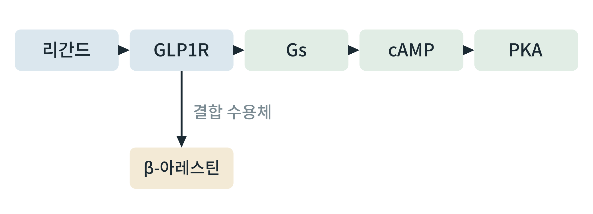
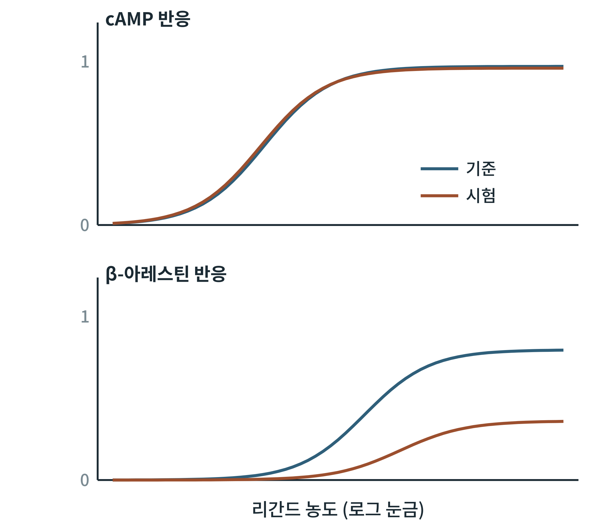

# 제3부 구현 사례

3부는 앞의 도구들을 한 연구 질문에 묶어 처음부터 끝까지 재현하는 두 사례이다. 각 사례는 입력 파일, 코드, 출력 그림·표, 판정 기준을 모두 싣는다. 코드와 가상 자료 파일은 저장소의 `code3/case1`, `code3/case2` 폴더에 있다.

## 제10장 사례 1: GLP-1 수용체 신호 모델과 편향 작용제 정량

> **이 장의 출발점** 2007년 『약리학 및 실험치료학 저널』(Journal of Pharmacology and Experimental Therapeutics)에 실린 한 종설은 수용체약리학의 오래된 가정 하나를 흔들었다. 한 수용체에 작용하는 약물은 그 수용체의 모든 신호 경로를 같은 비율로 켠다는 가정이다. 실제로는 같은 수용체에서 어떤 약물은 G 단백질 경로를 더 켜고 다른 약물은 어레스틴 경로를 더 켠다. 이 현상은 기능적 선택성 또는 편향 작용(biased agonism)이라 불리며, 그 개념과 정량 방법이 정리되었다(Urban et al., 2007). 비만 치료 약물에서도 GLP-1 수용체를 어느 경로로 얼마나 켜느냐가 효과와 부작용을 가를 수 있다는 가설이 제기되어 있다. 이 장은 그 가설을 검토하기 위한 계산의 처음 단계, 즉 **두 경로의 반응 곡선에서 편향의 크기를 수치로 뽑고, 신호 경로를 방정식으로 쓴 모델로 반응을 예측하는 것**을 실제 코드로 재현한다.

### 10.1 문제 정의와 가설

**질문.** 시험 리간드가 기준 리간드에 비해 GLP1R의 cAMP 경로와 β-아레스틴 경로를 다른 비율로 켜는가, 그렇다면 그 차이는 얼마인가.

**가설과 판정 기준(결과를 보기 전에 기록).** ① 편향 계수의 95% 신뢰구간이 0(편향 없음)을 포함하지 않으면 편향이 있다고 본다. ② 모든 곡선에서 적합의 잔차가 무작위로 흩어져야 한다. ③ 독립 반복 3회 이상.

### 10.2 입력 자료와 가상 자료의 쓰임

실제 연구에서는 같은 세포계에서 기준 리간드와 시험 리간드를 두 경로에서 시험한 용량-반응 자료가 입력이다. 공개 자료(ChEMBL, IUPHAR/BPS Guide to Pharmacology)나 논문 그림에서 추출한 곡선을 쓸 수도 있으나, **다른 실험실·다른 세포계의 값을 한 편향 계산에 섞으면 계 편향이 편향 계수에 섞여 들어간다**는 점에 주의한다.

이 책의 코드는 처음에 **알려진 참값에서 만든 가상 자료**로 분석 코드를 시험한다. 참값을 아는 자료에서 분석이 참값을 되찾으면 코드가 맞다는 것을 확인할 수 있고, 이후 실제 자료로 바꾸어 같은 코드를 돌린다. 아래 수치는 모두 가상 자료에서 나온 것이며 실제 약물의 값이 아니다. `gensynth.py`가 가상 자료를 만든다(시드 고정, 10개 농도, 3회 반복, 오차 표준편차 0.03).

### 10.3 작용 모형과 편향 계수

수용체 반응을 설명하는 **작용 모형**(operational model)은 효능을 두 요소로 나눈다. 리간드의 수용체 친화도(해리 상수 KA)와 리간드-수용체 복합체가 반응을 일으키는 능력 τ(전달 계수)이다(Black & Leff, 1983). 전달 기울기를 1로 두면 반응은

E = Em · τ · [A] / (KA + [A](1 + τ))

로 쓰인다. 여기서 Em은 계가 낼 수 있는 최대 반응이다. 이 식의 로지스틱 형태로 곡선을 적합하면 최대 반응 Emax = Em·τ/(1+τ), 절반 효과 농도 EC50 = KA/(1+τ)를 얻고, 두 값에서 τ/KA = Emax/(Em·EC50)이 나온다. **τ/KA는 친화도와 효능이 섞인 하나의 값이면서 리간드가 경로를 켜는 총합 능력**이며, Em이 같은 경로에서는 기준 리간드와의 차이에서 Em이 소거된다(Kenakin et al., 2012).

편향 계수는 두 번의 차이로 얻는다. 먼저 각 경로에서 시험 리간드와 기준 리간드의 log(τ/KA) 차이(Δlog(τ/KA))를 구하고, 다음으로 두 경로의 Δ를 뺀다.

ΔΔlog(τ/KA) = Δlog(τ/KA)cAMP − Δlog(τ/KA)β-아레스틴

값이 0이면 편향이 없고, 양수이면 시험 리간드가 기준 리간드에 비해 cAMP 경로로 치우쳐 있다. 10을 거듭제곱한 값은 편향 배수이다.

**그림 10-1. 이 사례의 신호 경로.** 리간드가 GLP1R에 결합하면 Gs와 cAMP, PKA로 가는 경로와, 결합한 수용체에 β-아레스틴이 모이는 경로가 갈라진다.



그림 10-1에서 읽을 점은 두 경로가 **같은 결합 수용체에서 출발한다**는 것이다. 그래서 두 경로의 반응 차이는 수용체 결합량의 차이가 아니라 결합 수용체가 각 경로를 켜는 효율의 차이로 해석한다.

### 10.4 가상 자료의 분석 결과

`fitom.py`는 각 곡선을 기울기 1의 로지스틱으로 적합하고, ΔΔlog(τ/KA)를 계산하며, 곡선마다 측정점을 복원 추출(부트스트랩 2,000회)하여 95% 신뢰구간을 구한다. 표 10-1은 가상 자료의 참값과 적합 결과이다.

**표 10-1. 가상 자료의 참값과 적합 결과(Em = 1).**

| 곡선 | 참 Emax | 적합 Emax | 참 logEC50 | 적합 logEC50 |
|---|---|---|---|---|
| 기준·cAMP | 0.909 | 0.919 | −10.04 | −9.98 |
| 시험·cAMP | 0.909 | 0.909 | −10.04 | −10.03 |
| 기준·β-아레스틴 | 0.760 | 0.755 | −8.62 | −8.65 |
| 시험·β-아레스틴 | 0.334 | 0.342 | −8.18 | −8.17 |

**그림 10-2. 가상 자료의 적합 곡선.** 위는 cAMP 반응, 아래는 β-아레스틴 반응이다. 파란 곡선은 기준 리간드, 주황 곡선은 시험 리간드이다.



그림 10-2에서 읽을 점은 cAMP 경로에서는 두 리간드의 곡선이 겹치고, β-아레스틴 경로에서는 시험 리간드의 곡선이 낮고 오른쪽에 있다는 것이다. 이 가상 자료는 시험 리간드가 β-아레스틴 쪽으로만 전달 능력이 낮도록(참 τ가 기준의 약 6분의 1) 만들어졌으므로, 이 패턴이 설계된 편향이다. 계산 결과 ΔΔlog(τ/KA)는 0.86(95% 신뢰구간 0.69~1.05), 편향 배수는 약 7.3이었다. 참값은 0.8(배수 약 6.3)이며 신뢰구간 안에 들어 있다. 즉 코드가 설계된 편향을 되찾았다. 실제 자료에서 이 숫자를 해석할 때는 신뢰구간의 폭(자료 양과 잡음에 의존)을 함께 보고한다.

### 10.5 신호 모델과 매개변수 탐색

반응 곡선은 한 시점의 정적 요약이다. 시간에 따른 반응과 세포 안의 신호 전달을 보려면 경로를 상미분방정식으로 쓴다. `glp1ode.py`는 가장 단순한 모델이다. 리간드 L이 자유 수용체 R과 결합해 LR이 되고, LR이 Gs를 활성화하며, 활성 Gs가 cAMP를 만들고, cAMP는 분해 효소(PDE)에 의해 분해된다.

d[LR]/dt = kon·L·R − koff·LR
d[Gs]/dt = kact·LR·(Gt − Gs) − kinact·Gs
d[cAMP]/dt = kac·Gs − kpde·cAMP

모든 매개변수는 설명용 가상 값이다. 네 용량(10⁻¹⁰~10⁻⁷ M)에서 cAMP 최고값은 0.20, 0.93, 1.39, 1.42(임의 단위)로, 낮은 용량에서 가파르게 오르다 높은 용량에서 포화하는 용량-반응 모양이 나온다. 이어 활성화 속도 kact와 분해 속도 kpde를 각각 0.1~10 범위의 15점 로그 격자(225개 조합)로 훑으면 같은 용량(10⁻⁸ M)에서 cAMP 최고값이 약 0.03에서 9.8까지 달라진다. 이는 **반응의 크기가 수용체 쪽 매개변수와 신호 소거 쪽 매개변수에 모두 민감하다**는 것을 보여 준다. 모델을 자료에 맞출 때 이 둘이 따로 결정되지 않으면(식별 불가능성) 한 곡선에서 둘을 모두 추정하려는 시도는 실패한다. 이때는 PDE 억제제를 쓴 실험처럼 한쪽을 따로 건드리는 자료가 필요하다.

이 모델은 225개 조합을 CPU에서 약 14초에 돌렸다(장비 실측은 표 4-3 양식으로 따로 기록). 조합이 수만 개 이상으로 늘면 JAX 또는 PyTorch로 방정식을 쓰고 GPU에서 배치로 풀어 탐색 시간을 줄일 수 있다.

### 10.6 해석과 한계

편향 계수가 크다고 해서 그 약이 **체중 감소나 부작용에서 다르다**고 결론지을 수 없다. 근거를 나누어 적는다.

첫째, **세포계의 한계**이다. 과발현 세포주는 수용체 수가 많아 신호 증폭이 크고, 어떤 경로는 포화되어 약물 간 차이가 가려질 수 있다. 같은 약물도 세포계에 따라 편향이 달라진다.

둘째, **기준 리간드 선택**이다. 편향은 항상 기준 리간드에 대한 상대값이다. 기준을 바꾸면 값이 바뀐다.

셋째, **번역의 간극**이다. 세포의 cAMP와 β-아레스틴 반응이 생체에서 식욕, 위 배출, 인슐린 분비, 오심 같은 결과로 어떻게 이어지는지는 별도의 증거가 필요하다. GLP1R 신호의 편향과 수용체 이동(trafficking)의 차이가 효능에 영향을 줄 수 있다는 보고가 있으나(Jones et al., 2018), 사람에서의 임상 효과로 일반화되었는지는 따로 확인해야 한다. 이 책은 편향 계수를 **후보를 구분하는 도구**로 쓰되, 효과의 예측값으로 쓰지 않는다.

### 10.7 이 사례를 자기 연구로 바꾸는 법

① `gensynth.py` 대신 자기 실험의 CSV(`ligand, pathway, replicate, logconc, response`)를 같은 열 이름으로 저장한다. ② `fitom.py`를 그대로 돌린다. ③ 곡선의 평탄부가 없으면(최대 반응이 포화되지 않으면) 적합이 불안정하므로 농도 범위를 넓혀 다시 잰다. ④ 반응 단위(비율, 발광 등)가 경로마다 다르면 각 경로에서 기준 리간드의 최대 반응으로 정규화하는 규칙을 계획서에 미리 적는다. ⑤ 신호 모델은 자기 표적의 반응식을 `rhs` 함수에 쓰고, 실험으로 정해진 매개변수와 정해지지 않은 매개변수를 구분한다.

### 10.8 실습 상자 사례 1 전체 재현

**목표.** 가상 자료에서 편향 계수를 되찾고, 신호 모델을 돌린다.

**입력.** `code3/case1/gensynth.py`, `fitom.py`, `glp1ode.py`.

**도구.** 파이썬(numpy, scipy).

**명령.**
```
python3 gensynth.py
python3 fitom.py
python3 glp1ode.py
```

**출력.** `synth-dr.csv`, `fit-result.json`(편향 계수와 신뢰구간), `ode-result.json`.

**판정 기준.** 편향 계수 추정이 참값(0.8)을 95% 신뢰구간 안에 포함하고, 같은 시드로 재실행했을 때 같은 결과가 나오면 통과이다. 실행 이력(커밋, 시드, 도구 버전)을 9장의 표에 기록한다.

**흔한 실패.** 평탄부 없는 곡선의 적합, 경로마다 다른 정규화, 반복 없이 점추정만 보고하는 것, 가상 값을 실제 값처럼 인용하는 것.

### 이 장의 요점
편향 작용은 같은 수용체의 두 경로를 약물이 다른 비율로 켜는 현상이며, 작용 모형의 log(τ/KA)를 두 번 빼서(ΔΔ) 수치로 비교한다. 참값을 아는 가상 자료로 분석 코드를 먼저 검증하고, 신호 모델은 매개변수의 식별 가능성을 점검하며 훑는다. 편향 계수는 세포계와 기준 리간드에 의존하며 체중 감소나 부작용의 예측값이 아니다.

#### 참고문헌
Black, J. W., & Leff, P. (1983). Operational models of pharmacological agonism. *Proceedings of the Royal Society of London. Series B, Biological Sciences, 220*(1219), 141–162. https://doi.org/10.1098/rspb.1983.0093

Jones, B., Buenaventura, T., Kanda, N., Chabosseau, P., Owen, B. M., Scott, R., et al. (2018). Targeting GLP-1 receptor trafficking to improve agonist efficacy. *Nature Communications, 9*, 1602. https://doi.org/10.1038/s41467-018-03941-2

Kenakin, T., Watson, C., Muniz-Medina, V., Christopoulos, A., & Novick, S. (2012). A simple method for quantifying functional selectivity and agonist bias. *ACS Chemical Neuroscience, 3*(3), 193–203. https://doi.org/10.1021/cn200111m

Urban, J. D., Clarke, W. P., von Zastrow, M., Nichols, D. E., Kobilka, B., Weinstein, H., et al. (2007). Functional selectivity and classical concepts of quantitative pharmacology. *Journal of Pharmacology and Experimental Therapeutics, 320*(1), 1–13. https://doi.org/10.1124/jpet.106.104463
