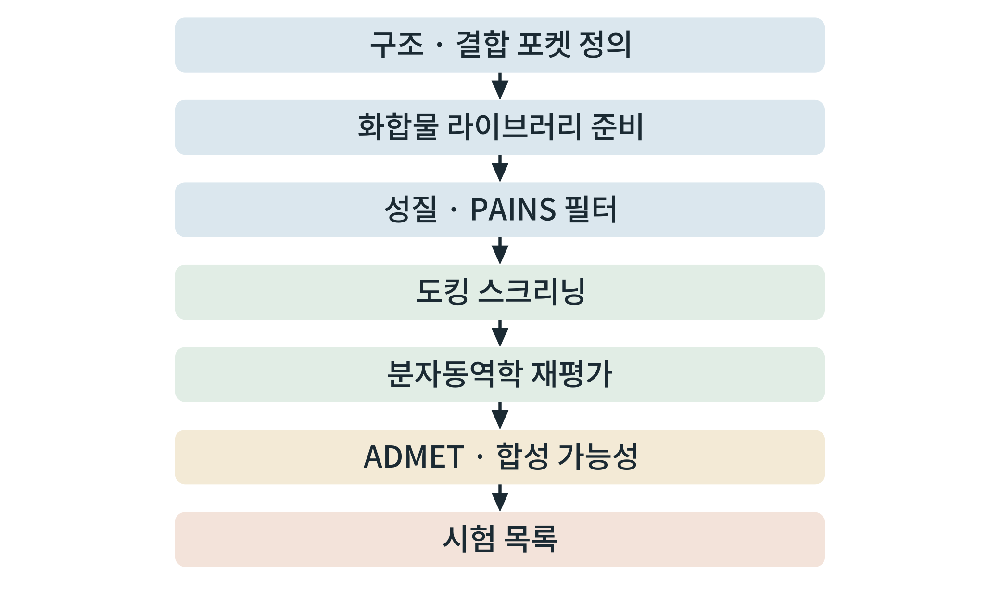

## 제11장 사례 2: 구조 기반 소분자 작용제 후보 탐색

> **이 장의 출발점** 1990년대 중반 화이자(Pfizer)의 화학자 크리스토퍼 리핀스키(Christopher A. Lipinski)는 경구 투여 약물 후보가 왜 그렇게 많이 중도 탈락하는지를 조사했다. 그는 흡수가 나쁜 화합물이 분자량, 지방친화도, 수소결합 주개와 받개의 수에서 공통된 경향을 보인다는 점을 정리하여 1997년에 발표했고, 이것이 "5의 규칙"(rule of five)으로 알려졌다(Lipinski et al., 2001). 이 규칙은 합격 기준이 아니라 **경고 신호**였다. 많은 약물이 규칙을 벗어나기도 한다. 그러나 이 사례에서 보듯 후보를 걸러 내는 모든 필터는 같은 정신으로 써야 한다. 필터는 다음 단계의 비용을 줄이는 장치일 뿐, 약이 될 분자를 보증하는 것이 아니다. 이 장은 B군 수용체의 소분자 결합 포켓을 대상으로, 후보를 만들고 걸러 시험 목록을 만드는 전 과정을 다룬다.

### 11.1 문제 정의: 펩타이드를 대신할 경구 소분자 작용제

GLP-1 계열의 주사 펩타이드는 효과가 확인되었으나 투여 경로와 제조 면에서 한계가 있다(1권 13~15장). 경구 소분자 작용제는 그 대안이다. 소분자는 펩타이드와 달리 수용체의 세포 바깥 영역 전체를 덮기 어렵고, 막 안쪽 깊은 포켓이나 다른 결합 부위를 이용해야 한다. 그래서 이 문제는 **결합 포켓의 정의가 결과를 좌우하는 문제**이다.

**질문.** 공개 구조의 소분자 결합 포켓에 맞고 성질이 경구 약물 범위에 있는 후보를 어떻게 우선순위로 정리하는가.

**판정 기준(결과 이전에 기록).** ① 양성 대조(알려진 소분자 작용제)의 재도킹이 원래 자세를 되찾는다. ② 유인 분자와의 비교에서 점수가 활성 분자를 구분한다(AUC와 농축 계수를 기록). ③ 분자동역학에서 상위 후보가 사전에 정한 시간 동안 포켓에 남는다. ④ 단계마다 탈락 수를 기록한다.

### 11.2 구조 준비

공개된 극저온전자현미경 구조 중 **소분자 작용제가 결합한 활성형 GLP1R 구조**를 고른다. 구조는 PDB와 GPCRdb(5장)에서 검색하며, 이 책은 특정 식별자를 고정하지 않는다. 구조의 판과 식별자는 선택 시점에 기록한다. 선택 기준은 ① 소분자 리간드가 결합한 구조인가, ② 활성형인가(G 단백질 또는 모사체 결합), ③ 해상도와 포켓 주변 밀도 품질이다.

포켓은 구조 속 리간드의 위치를 중심으로 상자를 정의한다. 6장의 구조 준비 절차(누락 원자 채움, 수소 추가, 양성자화 상태 점검)를 따르고, **원래 리간드를 따로 저장하여 양성 대조로 쓴다.** 도킹 설정은 양성 대조를 재도킹하여 원래 자세를 되찾는지로 먼저 검증한다.

### 11.3 화합물 라이브러리와 성질 필터

라이브러리는 공개 구매 가능 화합물 데이터베이스(예: ZINC; Sterling & Irwin, 2015)나 ChEMBL의 화합물에서 가져온다. 이용 조건과 내려받은 날짜를 5장의 방식으로 기록한다. 라이브러리 표준화(SMILES 정규화, 염 제거, 중복 제거) 뒤에 **성질 필터**를 적용한다. 필터는 분자량, 지방친화도(logP), 수소결합 주개·받개 수, 회전 가능 결합 수의 범위를 두며 PAINS(여러 시험에서 거짓 양성을 내는 구조 경고)를 표시한다.

`code3/case2/propfilter.py`가 이 단계를 수행한다. 입력은 `id, smiles` 두 열의 CSV이고, 출력은 성질과 통과 여부이다. 작동 시험으로 일반 약물 세 개와 읽기에 실패하는 표기 하나를 넣어 돌렸더니, 읽기 실패 1개를 걸러 내고 두 분자가 통과했으며 카페인은 지방친화도 하한(−1) 미만(−1.03)이어서 탈락했다. 이 예는 기준이 **경계에서 임의적**임을 보여 준다. 기준은 계획서에 미리 적고, 기준을 바꾸면 이유를 기록한다.

### 11.4 도킹 스크리닝

필터를 통과한 화합물을 6장의 도구(Vina 또는 GPU 도구)로 도킹한다. 이 단계에서 가장 흔한 실수는 **점수 분포를 보지 않는 것**이다. 점수를 정렬해 상위만 보면 구조적으로 비슷한 화합물이 상위를 차지하거나, 큰 분자가 점수에 유리한 편향이 순위에 반영되었는지 알 수 없다. 두 점검을 한다.

첫째, **활성-유인 분자 평가**이다. 알려진 활성 분자와 성질은 비슷하되 구조가 다른 유인 분자를 섞어 도킹하고, 점수로 활성 분자가 구분되는지 본다. 유인 분자 집합은 DUD-E 같은 공개 집합을 참고하여 만들 수 있다(Mysinger et al., 2012). 구분력은 수용자 조작 특성 곡선 아래 면적(AUC)과 상위 x%의 농축 계수(enrichment factor, EF)로 보고한다. `enrich.py`가 이를 계산한다. 평가에는 점수의 초기 구분력이 중요하므로 AUC만 보지 않고 초기 회수율 지표를 함께 본다(Truchon & Bayly, 2007). 이 코드는 가상 점수(활성 평균 −8.0, 유인 평균 −7.0, 표준편차 1.0)로 작동을 시험했고 AUC 0.78, EF1% 5.9를 얻었다. 이는 코드 시험용 숫자이며 실제 도킹 성능이 아니다.

둘째, **구조적 다양성 점검**이다. 상위 후보를 골격으로 묶어 대표를 고른다. 한 골격이 상위를 독점하면 시험 자원이 한 가지에 쏠린다.

### 11.5 분자동역학 재평가

상위 후보(수십 개 수준)를 6장의 절차로 막 환경에서 분자동역학에 넣는다. 사전에 정한 시간 동안 리간드가 포켓에 머무는지, 포켓 잔기와의 주요 접촉이 유지되는지를 본다. 한 번의 궤적은 우연일 수 있으므로 **초기 조건을 달리한 반복**을 하고, 결과를 평균과 범위로 보고한다. 결합 자유에너지를 추정하는 방법(OpenFE, PLUMED)은 계산 비용이 크므로 소수 후보에 적용하며, 오차 추정을 반드시 함께 보고한다. 자유에너지 계산이 양성 대조를 재현하는지 먼저 확인한다.

### 11.6 ADMET 예측과 합성 가능성

분자동역학을 통과한 후보에 ADMET 예측(7장)과 합성 가능성 평가를 적용한다. 예측 모형이 학습한 자료의 범위를 벗어난 후보는 "예측 불가"로 표시한다. 합성 경로 탐색(AiZynthFinder)이 경로를 찾지 못한 후보는 구매 가능성 또는 유사체를 대안으로 찾는다. 최종 목록에는 후보별로 각 단계의 값(점수, 접촉 유지율, 예측 성질, 합성 경로 유무)을 한 줄로 적는다.

**표 11-1. 단계별 입력, 출력, 판정 기준, 기록할 수.**

| 단계 | 입력 | 출력 | 판정 기준 | 기록할 수 |
|---|---|---|---|---|
| 구조·포켓 | 공개 구조 | 준비된 수용체, 양성 대조 | 양성 대조 재도킹이 원래 자세를 되찾음 | 구조 식별자, 판 |
| 라이브러리 | 공개 라이브러리 | 표준화된 화합물 | 읽기 실패 0 또는 기록 | 입력 수, 탈락 수 |
| 성질 필터 | 표준화 화합물 | 통과 목록, PAINS 표시 | 사전 기준 | 통과 수, 경고 수 |
| 도킹 | 통과 화합물 | 점수, 자세 | 활성-유인 평가 통과 | AUC, EF |
| 분자동역학 | 상위 후보 | 궤적, 접촉 유지율 | 사전 기준 시간 동안 유지 | 반복 수, 유지율 |
| ADMET·합성 | 통과 후보 | 예측 성질, 경로 | 사전 기준 | 예측 불가 수 |
| 시험 목록 | 위 모든 단계 | 우선순위 목록 | 단계별 값이 모두 기록됨 | 최종 후보 수 |

**그림 11-1. 사례 2의 계산 깔때기.** 포켓 정의에서 시작해 필터, 도킹, 분자동역학, ADMET·합성 평가를 거쳐 시험 목록으로 좁힌다.



그림 11-1에서 읽을 점은 7장의 깔때기가 이 사례에서 **실제 단계와 기록 항목**으로 구체화되었다는 것이다. 표 11-1의 마지막 열이 깔때기의 편향을 점검하는 근거가 된다.

### 11.7 실험으로 넘기는 방법

시험 목록은 3장의 검증 설계와 이어진다. 시험 순서는 값싸고 빠른 것에서 비싼 것으로 정한다. ① 결합 시험(표적 결합 여부), ② 세포 기능 시험(cAMP 등, 용량-반응, 10장의 편향 분석), ③ 표적 없는 세포주에서의 특이성 시험, ④ 대사 안정성·투과성 같은 약동 시험, ⑤ 동물 시험(표본 수와 대조는 3장). 각 단계는 계획서에 계속·중단 기준을 미리 적는다. 계산 순위와 실험 결과가 어긋나는 경우의 기록을 모아 다음 라운드의 점수 함수와 필터를 고치는 데 쓴다.

### 11.8 실측 소요 시간 기록

표 11-2는 4장 표 4-3 양식으로 이 사례의 계산을 장비별로 재어 기록하는 칸이다. 값은 실측 뒤에 채운다.

**표 11-2. 사례 2 실측 소요 시간 기록(작성 대기).**

| 단계 | 장비 | 입력 크기 | 소요 시간 | 최대 VRAM | 도구·버전 | 측정일 |
|---|---|---|---|---|---|---|
| 성질 필터 | (장비명) | 화합물 수 | (실측) | (실측) | RDKit (버전) | (날짜) |
| 도킹 | (장비명) | 화합물 수 | (실측) | (실측) | (도구·버전) | (날짜) |
| 분자동역학 | (장비명) | 원자 수 | (실측) | (실측) | (도구·버전) | (날짜) |

### 11.9 실습 상자 사례 2 재현

**목표.** 성질 필터와 도킹 평가 코드를 작동시키고, 자기 표적으로 바꾸어 실행할 준비를 한다.

**입력.** `code3/case2/propfilter.py`, `enrich.py`, 시험용 `testin.csv`.

**도구.** 파이썬, RDKit, scikit-learn, 도킹 도구(6장).

**명령.**
```
python3 propfilter.py testin.csv testout.csv
python3 enrich.py
```

**출력.** 성질 표(통과 여부, PAINS 경고), 가상 점수의 AUC와 EF.

**판정 기준.** 읽기 실패가 기록되고 성질 기준이 문서화되어 있으며, 실제 도킹 점수로 바꾼 뒤에는 양성 대조 재도킹과 활성-유인 평가가 사전 기준을 통과하면 통과이다.

**흔한 실패.** 양성 대조 재도킹 없이 도킹을 시작하는 것, 점수 상위만 보고 다양성을 점검하지 않는 것, 단계별 탈락 수를 기록하지 않아 편향을 점검할 수 없는 것, 한 번의 분자동역학 궤적으로 결론을 내리는 것.

### 3부 점검
독자가 두 사례를 자기 표적과 자기 화합물로 바꾸어 재현할 수 있어야 한다. 점검은 ① 사례 1의 코드가 가상 자료의 참값을 되찾고 자기 자료로 같은 입력 열 이름으로 돌아가는가, ② 사례 2의 필터와 평가 코드가 작동하고 양성 대조와 유인 분자가 준비되었는가, ③ 모든 단계의 기준이 결과 이전에 기록되고 실행 이력이 남는가이다.

### 이 장의 요점
소분자 후보 탐색은 결합 포켓 정의, 라이브러리 준비, 성질 필터, 도킹, 분자동역학 재평가, ADMET·합성 평가의 깔때기이며, 각 단계의 기준과 탈락 수를 결과 이전에 기록한다. 도킹은 양성 대조 재도킹과 활성-유인 평가로 검증하고 구조적 다양성을 점검한다. 분자동역학은 반복과 오차를 보고한다. 계산 순위는 3장의 검증 설계에 따라 값싼 시험에서 비싼 시험으로 넘긴다.

#### 참고문헌
Lipinski, C. A., Lombardo, F., Dominy, B. W., & Feeney, P. J. (2001). Experimental and computational approaches to estimate solubility and permeability in drug discovery and development settings. *Advanced Drug Delivery Reviews, 46*(1–3), 3–26. https://doi.org/10.1016/S0169-409X(00)00129-0

Mysinger, M. M., Carchia, M., Irwin, J. J., & Shoichet, B. K. (2012). Directory of useful decoys, enhanced (DUD-E): Better ligands and decoys for better benchmarking. *Journal of Medicinal Chemistry, 55*(14), 6582–6594. https://doi.org/10.1021/jm300687e

Sterling, T., & Irwin, J. J. (2015). ZINC 15 – Ligand discovery for everyone. *Journal of Chemical Information and Modeling, 55*(11), 2324–2337. https://doi.org/10.1021/acs.jcim.5b00559

Truchon, J.-F., & Bayly, C. I. (2007). Evaluating virtual screening methods: Good and bad metrics for the "early recognition" problem. *Journal of Chemical Information and Modeling, 47*(2), 488–508. https://doi.org/10.1021/ci600426e
