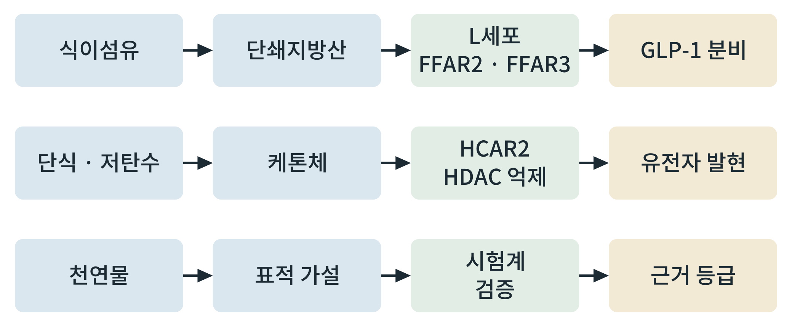

# 제4부 종합

## 제12장 약물 밖의 신호: 식이섬유, 단식, 케톤체, 천연물

> **이 장의 출발점** 2012년 영국 연구진은 장 내용물의 발효 산물인 단쇄지방산이 장 L세포에서 GLP-1 분비를 일으킨다고 보고했다. 이들은 수용체 FFAR2(유리 지방산 수용체 2)를 통해 이 작용이 일어난다는 증거를 쥐 실험에서 제시했다(Tolhurst et al., 2012). 비만 치료약이 인공적으로 켜는 GLP-1 신호를 몸이 스스로 켜는 경로가 있다는 뜻이다. 이 발견은 두 질문을 낳는다. 식이섬유와 식사 구성이 이 경로를 사람에서 의미 있는 크기로 켜는가, 그리고 단식, 케톤체, 천연물 같은 약물 밖의 수단은 어떤 근거 수준에서 말할 수 있는가. 이 장은 약물 밖의 신호를 같은 눈금(근거 수준)으로 늘어놓고, 각각이 어디까지 말해 주는지를 서술한다.

### 12.1 근거 수준이라는 눈금

같은 "효과가 있다"는 말도 근거의 종류에 따라 무게가 다르다. 이 책은 근거를 다섯 단계로 나누어 적는다. 근거 수준은 평가 체계(GRADE 등)의 원칙에 따라 연구 설계, 비뚤림 위험, 비일관성, 비직접성, 부정확성을 함께 보며 정하는 것이지만(Guyatt et al., 2008), 여기서는 연구 종류별 위치를 대략 나누어 쓴다.

**표 12-1. 근거 수준 사다리.**

| 단계 | 근거 종류 | 말할 수 있는 것 | 말할 수 없는 것 |
|---|---|---|---|
| 1 | 세포·분자 시험 | 경로의 가능성, 작용 기전 | 사람의 효과 |
| 2 | 동물 시험 | 생체에서의 방향성 | 사람에서의 크기 |
| 3 | 사람 관찰 연구 | 연관성 | 인과 |
| 4 | 무작위 대조 임상시험 | 시험 조건에서의 효과 | 다른 집단·조건으로의 일반화 |
| 5 | 여러 임상시험의 종합 | 효과의 일관성과 크기 | 개별 환자에서의 효과 |

표 12-1에서 읽을 점은 약물 밖의 신호 대부분이 **1~3단계에 머물러 있다**는 것이다. 이 책은 어떤 신호에 대해서도 단계를 넘어서는 서술을 하지 않는다. 기전이 아름다워도 1단계는 1단계이다.

### 12.2 영양 신호가 내인성 GLP-1을 켜는 경로

식이섬유는 소장에서 소화되지 않고 대장에서 장내 미생물에 의해 발효되어 아세트산, 프로피온산, 부티르산 같은 **단쇄지방산**(short-chain fatty acids)이 된다. 이들이 L세포의 수용체 FFAR2·FFAR3에 결합하여 GLP-1 분비를 자극한다는 기전이 세포와 동물에서 보고되었다(Tolhurst et al., 2012). 지방산과 단백질 분해산물을 감지하는 다른 수용체들(예: 긴사슬 지방산 수용체 GPR120; Hirasawa et al., 2005)도 장의 호르몬 분비에 관여한다고 알려져 있다.

이 경로의 근거는 주로 1~2단계이다. 사람에서 식이섬유 섭취가 혈중 GLP-1을 실제로 얼마나 올리는지, 그 크기가 체중 변화로 이어지는지는 별도의 임상 자료가 필요하다. 또한 이 경로로 올라가는 GLP-1의 양과 약물 용량의 효과를 **직접 비교할 수 없다.** 약물은 분해에 저항하도록 설계된 유사체를 높은 농도로 주는 반면, 내인성 GLP-1은 분비 직후 효소에 의해 빠르게 분해된다. 비교하려면 같은 조건에서 측정한 자료가 있어야 한다.

### 12.3 단식과 케톤체

단식이나 저탄수화물 식사에서 간은 지방산으로부터 케톤체(아세토아세트산, β-하이드록시부티르산 등)를 만든다. 케톤체는 에너지원일 뿐 아니라 **신호 분자**로도 작용한다는 보고가 쌓여 있다. β-하이드록시부티르산은 히스톤 탈아세틸화효소(HDAC) 억제를 통해 유전자 발현에 영향을 주는 것으로 보고되었고(Shimazu et al., 2013), 세포 표면 수용체 HCAR2를 통한 신호도 알려져 있다(Newman & Verdin, 2014). 이 장치들이 식욕, 에너지 소비, 염증에 어떻게 연결되는지는 연구가 진행 중이며, 2권에서 다룬 에너지 대사와 이어진다.

여기서도 근거 수준을 구분해야 한다. 케톤체의 신호 기능은 세포와 동물에서 기전이 밝혀진 단계가 많고, 사람에서 단식이나 케톤 식사가 체중에 미치는 효과와 그 효과가 이 신호 기전을 통한 것인지의 문제는 **서로 다른 질문**이다. 체중 변화는 열량 섭취 감소, 수분 변화 등 여러 이유로 일어나므로, 기전 증거와 임상 결과를 섞어 인과를 말하지 않는다.

### 12.4 천연물: 인삼을 예로

인삼을 비롯한 천연물 연구는 근거 수준을 구분해 읽는 연습에 좋은 소재이다. 천연물은 성분이 여러 가지이고, 추출·가공 방식에 따라 성분 조성이 달라지며, 연구마다 쓰는 제품이 다르다. 따라서 읽을 때 확인할 것은 다음과 같다. ① 어떤 제품(추출물, 성분, 용량)인가, ② 시험계는 무엇인가(세포, 동물, 사람), ③ 대조는 무엇이고 무작위·눈가림이 있었는가, ④ 결과 변수는 무엇이며 주 결과 변수가 사전에 정해졌는가, ⑤ 표본 수는 충분한가(3장의 검정력). 이 점검 질문을 충족하지 못한 연구는 기전 가설의 근거로는 쓸 수 있어도 효과의 근거로는 쓰지 않는다.

천연물을 신약 연구의 틀에 올리려면 **활성 성분을 분리하고 표적을 확인하는 단계**를 거쳐야 한다. 활성 성분의 표적이 확인되면 2장의 점수표에 올리고, 3장의 검증 설계로 시험한다. 표적 없이 혼합물의 효과만 보고하는 연구는 약물 설계의 입력이 될 수 없다.

**표 12-2. 약물 밖의 신호 정리(근거 수준 범주는 12.1절 사다리 기준).**

| 신호 | 경로(가설) | 주된 근거 수준 | 한계 |
|---|---|---|---|
| 식이섬유·단쇄지방산 | FFAR2·FFAR3, L세포, GLP-1 분비 | 세포·동물(1~2단계) | 사람에서의 크기와 체중 효과는 별도 확인 필요 |
| 지방산·단백질 감지 | GPR120 등 | 세포·동물(1~2단계) | 사람에서의 임상 의미 확인 필요 |
| 케톤체 | HCAR2, HDAC 억제 | 세포·동물(1~2단계) | 기전과 체중 결과를 구분 |
| 천연물(인삼 등) | 성분·표적에 따라 다름 | 연구별 상이 | 제품·용량·시험 설계의 이질성 |

**그림 12-1. 약물 밖의 신호를 근거 등급으로 잇는 흐름.** 세 가지 신호의 경로(위에서 아래로)를 같은 구조로 놓고, 각 줄의 끝에서 근거 등급을 매긴다.

그림 12-1에서 읽을 점은 세 줄이 **같은 틀**에 놓인다는 것이다. 식이섬유와 케톤체의 줄은 기전이 비교적 구체적이고, 천연물의 줄은 표적 가설과 검증이라는 빈 칸이 크다. 근거 등급은 줄의 끝에서 매기는 것이지 앞쪽의 기전이 매력적이라고 올리지 않는다.

### 12.5 약물 밖의 신호를 연구에 쓰는 법

약물 밖의 신호는 두 방식으로 연구에 들어간다. 하나는 **표적 후보의 출처**이다. 영양 신호가 켜는 수용체와 효소는 새로운 표적 후보가 되고, 2장의 점수표로 평가한다. 다른 하나는 **병용 가설**이다. 약물과 식사·단식의 병용이 효과를 더하는지는 임상 설계가 필요한 질문이며, 설계에서는 3장의 대조, 무작위, 사전 지정 주 결과 변수를 지킨다.

### 이 장의 요점
약물 밖의 신호는 같은 눈금(세포·동물·관찰·무작위 임상·종합)에 놓고 읽으며, 대부분 1~2단계에 있다. 식이섬유는 단쇄지방산과 FFAR2·FFAR3로, 케톤체는 HCAR2와 HDAC 억제로, 내인성 GLP-1과 대사 신호에 연결된다. 기전 증거와 임상 결과는 서로 다른 질문이며 섞어 인과를 말하지 않는다. 천연물은 제품, 시험계, 대조, 결과 변수, 표본 수를 점검하고, 활성 성분의 표적이 확인되어야 약물 설계의 입력이 된다.

#### 참고문헌
Guyatt, G. H., Oxman, A. D., Vist, G. E., Kunz, R., Falck-Ytter, Y., Alonso-Coello, P., & Schünemann, H. J. (2008). GRADE: An emerging consensus on rating quality of evidence and strength of recommendations. *BMJ, 336*(7650), 924–926. https://doi.org/10.1136/bmj.39489.470347.AD

Hirasawa, A., Tsumaya, K., Awaji, T., Katsuma, S., Adachi, T., Yamada, M., Sugimoto, Y., Miyazaki, S., & Tsujimoto, G. (2005). Free fatty acids regulate gut incretin glucagon-like peptide-1 secretion through GPR120. *Nature Medicine, 11*(1), 90–94. https://doi.org/10.1038/nm1168

Newman, J. C., & Verdin, E. (2014). Ketone bodies as signaling metabolites. *Trends in Endocrinology & Metabolism, 25*(1), 42–52. https://doi.org/10.1016/j.tem.2013.09.002

Shimazu, T., Hirschey, M. D., Newman, J., He, W., Shirakawa, K., Le Moan, N., et al. (2013). Suppression of oxidative stress by β-hydroxybutyrate, an endogenous histone deacetylase inhibitor. *Science, 339*(6116), 211–214. https://doi.org/10.1126/science.1227166

Tolhurst, G., Heffron, H., Lam, Y. S., Parker, H. E., Habib, A. M., Diakogiannaki, E., et al. (2012). Short-chain fatty acids stimulate glucagon-like peptide-1 secretion via the G-protein–coupled receptor FFAR2. *Diabetes, 61*(2), 364–371. https://doi.org/10.2337/db11-1019
